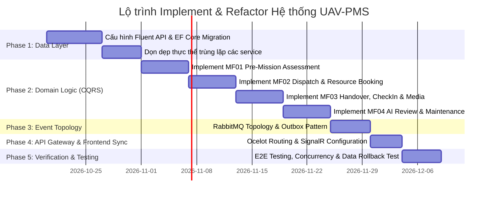

# 🏗️ KẾ HOẠCH TỔNG THỂ IMPLEMENT & REFACTOR TOÀN BỘ HỆ THỐNG UAV-PMS
**Căn cứ theo Sơ đồ Thực thể Liên kết Hợp nhất Toàn diện: `docs/ERD_SYSTEM_MF01_TO_MF04.md`**
*Phiên bản: 3.0 (Tháng 10/2026) - Kiến trúc Microservices .NET 9 & Event-Driven Architecture*

---

## 1. MỤC TIÊU & PHẠM VI DỰ ÁN

### 1.1. Mục tiêu cốt lõi
1. **Thống nhất Mô hình Dữ liệu (Single Source of Truth)**: Xóa bỏ triệt để tình trạng phân mảnh, không nhất quán giữa các bảng `Assets`, `AssetComponents`, `Substations`, `TransmissionLines` và `Towers`. Đưa `Towers` trở thành đối tượng trung tâm quản lý tài sản hạ tầng lưới điện.
2. **Khép kín 4 Luồng Nghiệp vụ Chính (MF01 - MF04)**:
   - **MF01**: Đánh giá tiền khả thi & tài nguyên sẵn sàng (`PreMissionAssessment`).
   - **MF02**: Điều phối đội bay & khóa lịch tài nguyên chống trùng lịch (`MissionAssignment`, `ResourceBooking`).
   - **MF03**: Thực thi hiện trường, bàn giao máy bay có checklist & nạp dữ liệu kiểm tra (`MissionCheckIn`, `DroneHandover`, `InspectionMedia`).
   - **MF04**: Phân tích AI, thẩm định khiếm khuyết, cảnh báo sự cố khẩn & phát phiếu bảo trì (`DetectedAnomaly`, `EmergencyAlert`, `MaintenanceTicket`, `TowerConditionHistory`).
3. **Dọn dẹp Kiến trúc Microservices & Triệt tiêu Duplication**: Loại bỏ hơn 30 thực thể và repository bị copy-paste trùng lặp giữa các service, xác lập ranh giới sở hữu (Domain Ownership) rõ ràng cho từng dịch vụ.

---

## 2. PHÂN TÍCH SAI LỆCH HIỆN TRẠNG (GAP ANALYSIS)

| Tiêu chí | Trạng thái hiện tại trong Code | Trạng thái đích theo ERD mới nhất | Hướng xử lý Refactor |
|---|---|---|---|
| **Hạ tầng Tài sản** | Phân cấp cồng kềnh qua 4 cấp: `Region` -> `Substation` -> `TransmissionLine` -> `Tower` -> `Asset/AssetComponent`. Các bảng lỗi/media/ticket đều trỏ tới `AssetId`. | Tinh gọn: `regions` -> `towers` (chứa `line_code`, `voltage`, `pole_type`, `risk_level`, `active_defects_count`). Mọi dữ liệu media, khiếm khuyết, sự cố, phiếu bảo trì trỏ trực tiếp tới `towers.id`. | Thêm cột chuẩn hóa vào bảng `towers`. Chuyển khóa ngoại `asset_id` sang `tower_id` trên `inspection_media`, `detected_anomalies`, `incident_reports`, `maintenance_tickets`. |
| **Sở hữu Thực thể (Entity Duplication)** | Mỗi service (`IdentityService`, `AIInspectionService`, `NotificationService`, `OperationsService`) đều chứa đầy đủ 30 file thực thể thừa từ thời Monolith. | Mỗi service chỉ giữ đúng các thực thể thuộc phạm vi sở hữu của mình; tương tác liên service thông qua RabbitMQ Domain Events hoặc gRPC. | Xóa bỏ các thực thể thừa ở Identity, AI, Notification; giữ OperationsService làm chủ thể lưu trữ dữ liệu nghiệp vụ chung. |
| **MF01 Tiền khả thi** | Chưa có bảng riêng cho Pre-Mission Assessment độc lập; logic bị gộp lẫn vào quá trình tạo Mission ở MF02. | Thực thể `pre_mission_assessments` quan hệ 1-1 với `missions`, đánh giá 4 khía cạnh: Site, Thời tiết, Vùng trời, Tài nguyên. | Xây dựng Module CQRS `/api/v2/assessments` trên OperationsService. Lưu proposed boundary và target towers. |
| **MF02 Khóa lịch Tài nguyên** | Chỉ gán đơn lẻ qua `MissionAssignment`, dễ xảy ra xung đột (double-booking) khi 1 phi công hoặc 1 UAV được xếp 2 lịch bay trùng giờ. | Thực thể `resource_bookings` khóa cứng khung giờ (`start_at` -> `end_at`) cho cả Pilot và Drone; tự động kiểm tra xung đột thời gian thực. | Thêm bảng `resource_bookings`, viết interceptor/handler kiểm tra overlap: `(startA < endB) AND (endA > startB)`. |
| **MF03 Bàn giao & Check-in** | Chưa có kiểm tra khoảng cách GPS thực tế khi check-in; bàn giao drone chưa lưu checklist vật lý 2 chiều. | `mission_check_ins` lưu tọa độ Point PostGIS; `drone_handovers` lưu `initial_checklist` (trước bay) và `return_checklist` (sau bay). | Tích hợp thư viện PostGIS `ST_DWithin` để xác thực vị trí phi công cách cột tối đa 200m; lưu JSONB checklist. |
| **MF04 Thẩm định & Bảo trì** | Thẩm định lỗi chưa có phản hồi chuyên môn chuẩn hóa; bảo trì chưa có bảng minh chứng trước/sau nghiệm thu. | `detected_anomalies` bổ sung `analyst_feedback` JSONB; `maintenance_proofs` lưu ảnh nghiệm thu 3 giai đoạn `Before`, `InProgress`, `After`. | Cập nhật thực thể `DetectedAnomaly`, tạo bảng `maintenance_proofs`, cập nhật `tower_condition_histories`. |

---

## 3. LỘ TRÌNH TRIỂN KHAI 5 GIAI ĐOẠN (5-PHASE EXECUTION ROADMAP)

---

### GIAI ĐOẠN 1: TÁI CẤU TRÚC LỚP DỮ LIỆU & PERSISTENCE (TUẦN 1 - 2)

#### Công việc chi tiết:
1. **Thiết kế & Tạo Migration trong `OperationsService`**:
   - Thêm các cột vào bảng `towers`: `line_code`, `voltage`, `pole_type`, `address`, `risk_level`, `active_defects_count`, `last_inspected_at`.
   - Tạo mới các bảng theo ERD:
     + `pre_mission_assessments`
     + `resource_bookings`
     + `drone_technical_inspections`
     + `drone_technical_metrics`
     + `mission_check_ins`
     + `drone_handovers`
     + `maintenance_proofs`
     + `tower_condition_histories`
   - Cập nhật các bảng liên kết:
     + Chuyển `inspection_media.asset_id` -> `tower_id` (hỗ trợ migration script sao chép dữ liệu từ Asset sang Tower).
     + Chuyển `detected_anomalies.asset_id` -> `tower_id`.
     + Chuyển `maintenance_tickets.asset_id` -> `tower_id`.
     + Bổ sung trường `version` (`uint` / PostgreSQL `xmin`) vào `missions`, `uavs`, `mission_assignments`.
2. **Dọn dẹp Thực thể Thừa (Microservice Boundary Isolation)**:
   - **`IdentityService`**: Xóa toàn bộ thực thể liên quan đến Drone, Mission, Inspection, Maintenance. Chỉ giữ lại `User`, `Role`, `UserRole`, `RefreshToken`, `TrustedDevice`, `UserGeographicScope`.
   - **`AIInspectionService`**: Chỉ giữ `AIAnalysisRequest`, `DetectedAnomaly`, `DefectCategory`, `InspectionMedia` (Read-model), `Tower` (Read-model). Xóa Drone, Handover, MaintenanceTickets.
   - **`NotificationService`**: Chỉ giữ `Notification`. Xóa sạch các thực thể domain khác, chuyển sang nhận thông tin payload qua RabbitMQ Message Consumers.

---

### GIAI ĐOẠN 2: TRIỂN KHAI NGHIỆP VỤ DOMAIN & CQRS HANDLERS (TUẦN 3 - 4)

#### Luồng MF01: Đánh giá Tiền Khả thi
- Tạo mới Feature folder: `Services/OperationsService/.../Features/Assessments`:
  - `CreatePreMissionAssessmentCommand`: Tính toán sơ bộ khoảng cách bay, số cột, kiểm tra vùng cấm bay (Airspace).
  - `EvaluateResourceReadinessQuery`: Tự động quét tìm Pilot có chứng chỉ bay phù hợp và Drone có biên bản kiểm định còn hạn.
  - `ConfirmAssessmentCommand`: Chốt trạng thái `Ready`.

#### Luồng MF02: Điều phối & Đặt lịch Tài nguyên
- Tạo mới / Cập nhật Feature: `Services/OperationsService/.../Features/Missions`:
  - `CreateMissionCommand`: Tạo nhiệm vụ kế thừa scope từ Assessment.
  - `AssignMissionMemberCommand`: Phân quyền vai trò và gửi notification.
  - `RespondAssignmentCommand`: Phi công chấp thuận hoặc xin hoãn (Postponed).
  - `LockResourceBookingCommand`: Đặt lịch khóa tài nguyên với điều kiện chống xung đột `(StartAt < ExistingEndAt && EndAt > ExistingStartAt)`.
  - `DispatchMissionCommand`: Kiểm tra điều kiện tiên quyết (Đủ phi công chấp thuận, UAV passed inspection, có targets) trước khi chuyển trạng thái sang `Assigned`.

#### Luồng MF03: Bàn giao, Check-in & Nạp Media
- Tạo mới Feature:
  - `FieldCheckInCommand`: Dùng NetTopologySuite đo khoảng cách giữa tọa độ phi công gửi lên và tọa độ cột điện mục tiêu đầu tiên (`point1.Distance(point2) <= 200m`).
  - `DeliverDroneHandoverCommand` & `ReturnDroneHandoverCommand`: Lưu trữ checklist JSONB trước và sau bay.
  - `CanonicalInspectionUploadCommand`: Đảm bảo đường dẫn `POST /api/v1/inspections/upload` giữ nguyên tính tương thích ngược, tự động trích xuất EXIF GPS bằng thư viện `MetadataExtractor` để map vào `towers.id`.

#### Luồng MF04: Thẩm định Khuyết tật & Bảo trì Sửa chữa
- Hoàn thiện Feature:
  - `ReviewDetectedAnomalyCommand`: Analyst cập nhật `validation_status` (`Confirmed` / `Rejected`) và lưu JSONB `analyst_feedback`.
  - `TriggerEmergencyAlertCommand`: Tự động phát sinh `EmergencyAlert` khi phát hiện khiếm khuyết mức `Critical`.
  - `CreateMaintenanceTicketCommand`: Quản lý giao phiếu sửa chữa cột điện tới Kỹ thuật viên bảo trì.
  - `UploadMaintenanceProofCommand`: Thợ tải ảnh nghiệm thu 3 giai đoạn.
  - `CompleteMaintenanceTicketCommand`: Tự động giảm `towers.active_defects_count`, ghi nhận `tower_condition_histories`.

---

### GIAI ĐOẠN 3: BẢO TOÀN EVENT-DRIVEN VỚI RABBITMQ & OUTBOX PATTERN (TUẦN 5)

1. **Chuẩn hóa Topology RabbitMQ**:
   - Exchange: `uavpms.events` (Topic Exchange).
   - Routing Keys & Queues:
     + `inspection.media.uploaded` -> Queue `ai-inspection.media-process` (Kích hoạt AI Analysis).
     + `ai.detection.completed` -> Queue `operations.defect-record` (Lưu Anomaly/Alert) & `notifications.defect-alert`.
     + `mission.dispatched` -> Queue `notifications.mission-dispatch`.
     + `maintenance.ticket.assigned` -> Queue `notifications.ticket-assign`.
2. **Đảm bảo Idempotency**:
   - Consumer kiểm tra trường `source_event_id` trong bảng `ai_analysis_requests` và bảng Outbox trước khi xử lý, ngăn chặn việc phân tích trùng khi có retry.

---

### GIAI ĐOẠN 4: ĐỒNG BỘ API GATEWAY & CONTRACTS (TUẦN 6)

1. **Cấu hình Ocelot `ocelot.json`**:
   - Đăng ký route mới:
     + `/api/v2/assessments/{everything}` -> OperationsService
     + `/api/v1/uavs/{id}/inspections/{everything}` -> OperationsService
     + `/api/v1/maintenance/tickets/{everything}` -> OperationsService
   - Bảo toàn các route upload và static images:
     + `/api/v1/inspections/upload` -> OperationsService
     + `/images/{everything}` -> OperationsService
2. **WebSocket & Hangfire Pass-through**:
   - Cấu hình Ocelot hỗ trợ WebSocket cho `/hubs/notifications` (NotificationService).
   - Cho phép truy cập `/hangfire` dashboard nội bộ.

---

### GIAI ĐOẠN 5: KIỂM THỬ TÍCH HỢP & CHIẾN LƯỢC ROLLBACK (TUẦN 7)

1. **Chiến lược An toàn Dữ liệu (Non-Destructive Migration)**:
   - Các bảng cũ `Assets`, `Substations`, `TransmissionLines` trong đợt đầu được giữ nguyên ở mức database (hoặc tạo PostgreSQL VIEW tương thích ngược).
   - Dữ liệu mới được ghi đồng thời hoặc map trực tiếp vào bảng `towers`.
   - Sau khi toàn bộ code chạy ổn định tối thiểu 2 tuần trên môi trường Staging/Production mới tiến hành Drop các bảng cũ không còn sử dụng.
2. **Kiểm thử Đồng thời (Concurrency Stress Test)**:
   - Viết kịch bản test giả lập 50 request cùng lúc book 1 phi công hoặc 1 drone vào cùng một khung giờ bay để xác nhận cơ chế `DbUpdateConcurrencyException` hoạt động chính xác.
3. **Smoke Test Kịch bản Xuyên suốt MF01 -> MF04**:
   - Kịch bản: Manager đánh giá tiền khả thi (MF01) -> Tạo và điều phối nhiệm vụ (MF02) -> Pilot check-in, nhận máy bay, bay và upload ảnh (MF03) -> AI phát hiện lỗi vỡ sứ, Analyst duyệt, phát cảnh báo khẩn cấp và tạo phiếu bảo dưỡng (MF04) -> Thợ sửa xong, nạp ảnh nghiệm thu và đóng phiếu.
