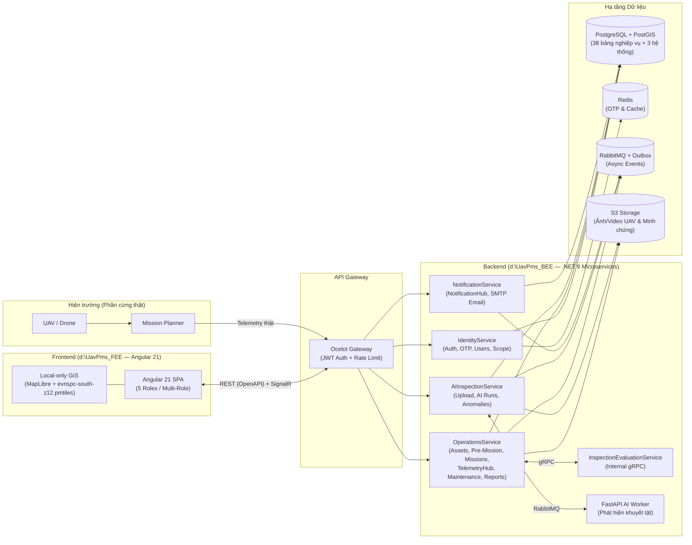

# UAV-PMS — Tài liệu Đặc tả Hệ thống Tổng thể (Master BA Specification v1.0)

> **Vai trò tài liệu**: Nguồn sự thật duy nhất (*Single Source of Truth*) cho toàn bộ đồ án **UAV Powerline Monitoring System (UAV-PMS)** bao phủ **Database (PostgreSQL/PostGIS) → Backend (.NET 9 Microservices + FastAPI AI) → Hợp đồng OpenAPI → Frontend (Angular 21 + Local-only GIS)**.
> Mọi quyết định trong tài liệu này đã được chủ hệ thống xác nhận 100%. Khi có mâu thuẫn với tài liệu cũ (`api_spec.md` cũ, `CODING_STANDARDS.md`), **tài liệu này có quyền ưu tiên cao nhất** (song hành với `docs/AI_SECURITY_AND_GOVERNANCE.md`).

---

## 1. Kiến trúc Tổng thể Hệ thống (End-to-End)



---

## 2. Phạm vi Chính thức (In Scope vs. Explicitly Removed)

### ✅ Các phân hệ GIỮ & CHUẨN HÓA (100% chạy thật, Zero Mock/Fake Data)
1. **Auth, Multi-Role RBAC, Geographic Scope & OTP Email thật** (không bypass OTP, không mock data kể cả ở Dev).
2. **Asset Management & Pre-Mission Readiness** (Regions, Towers, Drones, Flight Controllers, Technical Inspection, Pre-Mission Assessment — **bắt buộc đạt trước khi tạo/chạy Mission**).
3. **Mission Lifecycle, Local-only GIS & Realtime Telemetry thật** (Mission Planner → Backend → SignalR `/hubs/telemetry`, tự động trả Drone khi Mission `Completed`/`Cancelled`).
4. **AI Media Upload & Analyst Review** (Mission & Standalone; `Inspector` chỉ nhận thông báo Thành công/Thất bại; **chỉ `Analyst`** xem bbox & duyệt `Approve`/`Reject`; phân loại mức **`Emergency` (Khẩn cấp)** vs **`Normal` (Bình thường)**).
5. **Maintenance Tickets (tự động tạo khi Analyst Approve), Reports (PDF/Excel), Audit Logs & System Settings**.

### ❌ Các phân hệ LOẠI BỎ / Tạm hoãn (Dọn sạch khỏi DB, BE và FE)
- **Phân hệ Emergency Alert & Edge Device riêng biệt**: Gỡ hoàn toàn (không còn `/api/v1/alerts*`, không còn Escalate riêng, không còn Vision Edge Webhook). Tính chất "khẩn cấp" chỉ là mức độ ưu tiên (`Emergency` | `Normal`) trên khuyết tật và phiếu bảo trì.
- **Bàn giao / Trả Drone thủ công (`drone-handover`)**: Gỡ hoàn toàn. Mission `Completed` hoặc `Cancelled` = Drone tự động giải phóng.
- **Lịch kiểm tra định kỳ (`InspectionSchedules`)**: Gỡ hoàn toàn.
- **Active Learning (sửa khung nhãn gửi train lại AI)**: Tạm coi như **chưa có** (đưa vào backlog nghiên cứu sau).

---

## 3. Database & Schema Chuẩn hóa (PostgreSQL + PostGIS)

- **Hệ quản trị CSDL**: **PostgreSQL + PostGIS** (`Npgsql` EF Core 9 + `NetTopologySuite`), mô hình **Shared Database** dùng chung cho 4 service.
- **Hiện trạng thực tế tại commit `eb1cbd2`**: 42 bảng nghiệp vụ trong `ApplicationDbContextModelSnapshot.cs` + 3 bảng hệ thống PostgreSQL (`__EFMigrationsHistory`, `spatial_ref_sys`, Hangfire) = **45 bảng**.
- **Chính sách dọn DB bắt buộc**:
  - Tạo EF Core Migration **DROP hẳn 4 bảng không còn dùng**: `EmergencyAlerts`, `AlertEscalations`, `IncidentReports`, `InspectionSchedules`.
  - **Bắt buộc chạy Migration qua GitHub Actions** (không chạy SQL DROP thủ công trực tiếp lên DB).
  - **Telemetry không lưu lịch sử từng giây**: Chỉ cập nhật trạng thái mới nhất của Drone (trên bảng `UAVs` hoặc 1 dòng latest/drone trong `DroneTelemetry`/Redis) và phát realtime qua `/hubs/telemetry`.

### Danh mục 38 bảng nghiệp vụ sau chuẩn hóa

| Nhóm phân hệ | Số bảng | Danh sách bảng trong PostgreSQL |
|---|:---:|---|
| **1. Identity, RBAC & Audit** | 7 | `Users`, `Roles`, `UserRoles`, `RefreshTokens`, `TrustedDevices`, `UserGeographicScopes`, `AuditLogs` |
| **2. Assets & Pre-Mission** | 11 | `Regions`, `Towers`, `UAVs`, `DroneFlightControllers`, `DroneTechnicalInspections`, `DroneTechnicalMetrics`, `DroneTelemetry` *(chỉ trạng thái mới nhất)*, `PreMissionAssessments`, `PreMissionAssessmentTowers`, `PreMissionAssessmentPersonnel`, `PreMissionAssessmentDrones` |
| **3. Missions** | 8 | `Missions`, `MissionAssignments`, `MissionTargets`, `MissionPriorityDefects`, `MissionCheckIns`, `MissionFlightLogs`, `MissionCommunicationLogs`, `ResourceBookings` |
| **4. AI Inspection & Review** | 4 | `InspectionMedia`, `AIAnalysisRuns`, `DefectCategories`, `DetectedAnomalies` *(chứa `priority/severity`: `Emergency` \| `Normal`)* |
| **5. Maintenance, Reports & System** | 8 | `MaintenanceTickets`, `MaintenanceProofs`, `MaterialLogs`, `Reports`, `ReportMissions`, `Notifications`, `SystemSettings`, `OutboxMessages` |

---

## 4. Ma trận Phân quyền (5 Roles + Multi-Role + Geographic Scope)

- **5 Role chuẩn**: `SystemAdmin`, `Manager`, `Inspector`, `Analyst`, `Technician`.
- **Multi-Role**: 1 User có thể gắn **nhiều role** trong bảng `UserRoles`. Quyền hiệu lực = hợp (union) của các role user đang giữ.
- **Geographic Scope**:
  - **Chỉ `SystemAdmin`** có quyền cấu hình/khóa vùng địa lý (`UserGeographicScopes`) cho các role khác.
  - Mọi truy vấn dữ liệu nghiệp vụ (`Towers`, `Missions`, `DetectedAnomalies`, `MaintenanceTickets`, `Reports`) phải lọc theo `UserGeographicScopes` của user (ngoại trừ `SystemAdmin`).

| Chức năng | SystemAdmin | Manager | Inspector | Analyst | Technician |
|---|:---:|:---:|:---:|:---:|:---:|
| Tạo/Sửa/Khóa User, Gán Multi-Role, **Khóa vùng địa lý**, System Settings, Audit | ✅ | ❌ | ❌ | ❌ | ❌ |
| Quản lý Region, Tower, Drone, Flight Controller | ✅ | ✅ *(trong vùng)* | Xem *(trong vùng)* | ❌ | Xem *(trong vùng)* |
| Tạo / Duyệt Pre-Mission Assessment | ✅ | ✅ *(trong vùng)* | Thực hiện kiểm tra | ❌ | ❌ |
| Tạo / Sửa / Hủy / Giao Mission | ✅ | ✅ *(trong vùng)* | Xem & thực hiện | ❌ | ❌ |
| Xem Telemetry bay realtime (`/hubs/telemetry`) | ✅ | ✅ *(trong vùng)* | ✅ *(mission được giao)* | ❌ | ❌ |
| Nộp ảnh / video cho AI (Mission & Standalone) | Chỉ nhận TB | Chỉ nhận TB | ✅ *(chỉ nhận TB Thành công/Thất bại)* | ✅ | ❌ |
| **Xem chi tiết AI Detection (bbox) & Duyệt (`Approve`/`Reject`)** | ❌ *(trừ khi có thêm role `Analyst`)* | ❌ *(trừ khi có thêm role `Analyst`)* | ❌ *(trừ khi có thêm role `Analyst`)* | **✅ (Duy nhất)** | ❌ |
| Xem Dashboard tổng hợp & Báo cáo (`Reports`) | ✅ | ✅ *(trong vùng)* | ❌ | ✅ *(trong vùng)* | Xem danh sách |
| Giao Phiếu bảo trì (`MaintenanceTickets`) | ✅ | ✅ *(trong vùng)* | ❌ | ❌ | ❌ |
| Xử lý Phiếu bảo trì, cập nhật vật tư & ảnh minh chứng | ❌ | Xem / Đóng | ❌ | ❌ | ✅ *(phiếu được giao)* |

---

## 5. Đặc tả Chi tiết 5 Luồng Nghiệp vụ Đầu–Cuối (DB → BE → FE)

### Luồng 1 — Auth, Tài khoản, OTP Email thật & Geographic Scope
1. **Tạo tài khoản (`SystemAdmin`)**:
   - **FE**: Form tạo user chọn 1 hoặc nhiều role + (tùy chọn) vùng địa lý.
   - **BE (`IdentityService`)**: Validate danh sách role hợp lệ (**tuyệt đối không tự gán `SystemAdmin` nếu rỗng/sai**). Lưu `Users`, `UserRoles`, `UserGeographicScopes` (DB). Tạo OTP lưu **Redis** và gửi **OTP thật qua SMTP Email** để xác thực email.
2. **Đăng nhập & Xác thực thiết bị mới**:
   - **FE**: Gửi `POST /api/v1/auth/login` kèm `email`, `password`, và `DeviceTrustToken` (nếu thiết bị đã tin cậy).
   - **BE**: Kiểm tra mật khẩu + `IsEmailVerified`. Nếu là thiết bị mới hoặc chưa có `DeviceTrustToken` hợp lệ → sinh OTP lưu **Redis**, gửi **OTP thật qua SMTP Email** (cấm bypass `"123456"` ở mọi môi trường) và trả `otpRequired: true`.
   - **FE → BE**: User nhập OTP gửi `POST /api/v1/auth/otp/verify` → BE xác thực OTP trong Redis → cấp `AccessToken (JWT chứa đầy đủ mảng roles)` + `RefreshToken` (lưu `RefreshTokens`) + `DeviceTrustToken` (nếu user chọn tin cậy thiết bị, lưu `TrustedDevices`).
3. **Đổi mật khẩu / Khóa tài khoản / Reset mật khẩu**:
   - **BE**: `POST /api/v1/users/change-password` bắt buộc xác thực `oldPassword` hoặc `X-StepUp-Token` hợp lệ (thiếu cả 2 trả `400/401`). Khi đổi mật khẩu, reset mật khẩu hoặc khóa tài khoản → **thu hồi ngay toàn bộ `RefreshTokens` và `TrustedDevices`** đang sống của user đó.

---

### Luồng 2 — Quản lý Tài sản & Pre-Mission Readiness (Cổng bắt buộc trước Mission)
1. **Quản lý Tài sản**:
   - **FE ↔ BE (`OperationsService`)**: CRUD `Regions` (PostGIS polygon), `Towers` (PostGIS point), `UAVs`, `DroneFlightControllers` (liên kết UID phần cứng).
2. **Đánh giá Tiền nhiệm vụ (Pre-Mission Assessment — MF01)**:
   - **FE**: `Manager` / `Inspector` chọn khu vực, danh sách cột (`PreMissionAssessmentTowers`), nhân sự (`PreMissionAssessmentPersonnel`), Drone (`PreMissionAssessmentDrones`) và thực hiện kiểm tra kỹ thuật (`DroneTechnicalInspections`, `DroneTechnicalMetrics`).
   - **BE**: Chấm điểm đánh giá (gọi gRPC `InspectionEvaluationService` nếu cần) và lưu trạng thái `PreMissionAssessments` (`Approved` / `Passed` hoặc `Failed`).
   - **Ràng buộc cứng**: Hệ thống **bắt buộc phải có `PreMissionAssessment` đạt chuẩn** thì mới cho phép tạo/bắt đầu `Mission` tương ứng (không cho bỏ qua bước Pre-Mission).

---

### Luồng 3 — Mission Lifecycle, Local-only GIS & Telemetry thật từ Mission Planner
1. **Tạo & Sửa Mission (`Manager`)**:
   - **FE**: Chọn bản `PreMissionAssessment` đạt chuẩn, vẽ/xem cột và tuyến bay trên bản đồ **Local-only GIS** (`MapLibre` + `public/maps/evnspc-south-z12.pmtiles` + schematic fallback — **0 request ra Google/OSM/ArcGIS**).
   - **BE**: Tạo `Missions`, `MissionAssignments`, `MissionTargets`, `ResourceBookings` (khóa Drone trong thời gian bay).
   - **Quyền sửa Mission (`PUT /api/v1/missions/{id}`)**: Khi Mission **chưa bắt đầu bay** (`Draft` / `PendingAcceptance` / `Postponed` / `Confirmed`), BE cho phép cập nhật đầy đủ `Title`, `Description`, `RouteData`, `Drone`, `Inspector`, `Priority`, `ManagerInstructions` (khi đã `Confirmed` mà đổi lịch/người thực hiện sẽ quay về `PendingAcceptance` theo đúng State Machine).
2. **Bay thực tế & Telemetry Realtime (Phần cứng thật)**:
   - **Phần cứng → BE**: UAV kết nối với **Mission Planner** → đẩy gói telemetry (tọa độ GPS, độ cao, pin, tốc độ, trạng thái kết nối) về Backend.
   - **BE (`OperationsService`)**: Cập nhật **trạng thái mới nhất của Drone** (không ghi lịch sử từng giây) và phát realtime qua SignalR **`/hubs/telemetry`** (`TelemetryUpdated`, `DroneOnline`, `DroneOffline` — JSON `camelCase`, có `[Authorize]`).
   - **FE**: Kết nối `/hubs/telemetry`, join `JoinMission(missionId)` / `JoinDrone(droneCode)`, hiển thị vị trí UAV di chuyển + thông số pin/độ cao realtime trên nền bản đồ Local-only GIS.
3. **Kết thúc / Hủy Mission (Tự động trả Drone)**:
   - Khi `Inspector` hoàn thành (`Completed`) hoặc `Manager` hủy (`Cancelled`) Mission → BE tự động cập nhật trạng thái `UAVs` về `Available` và giải phóng `ResourceBookings` (**không có bước bấm bàn giao/trả Drone thủ công**).

---

### Luồng 4 — AI Media Upload & Analyst Review (Tách rạch ròi Vận hành vs. Standalone Test)

#### 4A. Luồng Vận hành Chính thức (Bắt buộc gắn `missionId` thật)
1. **Nộp ảnh / video (`Inspector` hoặc `Analyst`)**:
   - **FE**: Upload ảnh/video gắn với `missionId` (và `towerId` nếu có) — **chỉ tải file lên, KHÔNG chọn mô hình AI (`preferredModel`)**.
   - **BE (`AIInspectionService`)**: Lưu file gốc lên **S3 Storage**, ghi `InspectionMedia` (`MissionId != null`) + `AIAnalysisRuns`, đẩy job qua **RabbitMQ** sang **FastAPI AI Worker** (dùng model mặc định của hệ thống).
   - **Phản hồi cho `Inspector`**: `Inspector` **chỉ nhận thông báo Thành công / Thất bại** sau khi nộp xong → kết thúc nhiệm vụ của `Inspector` (nếu user KHÔNG có thêm role `Analyst` thì không thấy màn hình chi tiết bbox/duyệt AI).
2. **Xử lý AI & Thẩm định (`Analyst` duy nhất)**:
   - **FastAPI AI Worker → BE**: Chạy nhận diện khuyết tật → trả về danh sách `DetectedAnomalies` kèm tọa độ khung (`bbox` JSON), loại lỗi (`DefectCategories`) và mức độ **`Emergency` (Khẩn cấp)** hoặc **`Normal` (Bình thường)**. Ảnh **0 lỗi** vẫn đẩy sang hàng đợi để `Analyst` xác nhận thủ công là ảnh sạch.
   - **FE (chỉ hiển thị cho user có role `Analyst`)**: Gọi `GET /api/v1/ai-analysis/{runId}` (BE trả kèm danh sách `detections`) hoặc `GET /api/v1/anomalies/pending`.
   - **Analyst duyệt**: Xem ảnh + khung bbox (FE tự vẽ overlay), chọn **`Approve`** hoặc **`Reject`** kèm lý do (`PUT /api/v1/anomalies/{id}/validate`). Sau khi duyệt là **khóa cứng (immutable)**.

#### 4B. Luồng Standalone Test Độc lập (`MissionId = NULL`, `TowerId = NULL` — Chỉ riêng `Analyst`)
- **Mục đích**: Tính năng **chỉ dành riêng cho role `Analyst`** (hoặc user có thêm role `Analyst`) để tải ảnh/video rời lên test AI (không chọn mô hình, không gắn với Mission hay Cột điện nào), đồng thời **giữ sẵn nền dữ liệu cho luồng Active Learning / train lại model của `Analyst` trong tương lai**.
- **Ràng buộc chống lỗ hổng logic bắt buộc**:
  1. Khóa RBAC `[Authorize(Roles = UserRoles.Analyst)]` trên `POST /api/v1/ai-analysis/upload` (luồng độc lập). Đổi `InspectionMedia.MissionId` thành **nullable (`NULL`)** qua migration GitHub Actions; **xóa hoàn toàn** logic cũ tự nhét ảnh vào Mission mới nhất của user/người khác (`ResolveMissionAsync`).
  2. **Tách tuyệt đối ở API/UI List**:
     - Mọi danh sách vận hành (Mission, hàng đợi duyệt `Analyst`, `Dashboard`, `Reports`) bắt buộc lọc `WHERE MissionId IS NOT NULL`.
     - Danh sách lịch sử Test AI độc lập lọc riêng `WHERE MissionId IS NULL AND CreatedBy = currentUserId`.
  3. **Cách ly tuyệt đối khỏi dữ liệu vận hành**: Bản ghi `MissionId == null` **KHÔNG** sinh `MaintenanceTicket`, **KHÔNG** tính vào `Dashboard` / `Reports`, và **KHÔNG** tái sử dụng SHA256 checksum chéo với ảnh của Mission thật.
  4. **Dọn dẹp S3**: Hangfire `CleanupJob` hỗ trợ dọn file test cũ quá hạn (cấu hình trong `SystemSettings`) để tránh đầy S3.

---

### Luồng 5 — Tự động tạo Phiếu Bảo trì, Reports & System Settings
1. **Tự động sinh Phiếu Bảo trì**:
   - Ngay khi `Analyst` bấm **`Approve`** khuyết tật → BE tự động tạo 1 bản ghi trong `MaintenanceTickets` **kế thừa mức độ ưu tiên (`Emergency` | `Normal`)** và đẩy sự kiện qua **RabbitMQ → `NotificationService` → SignalR `/hubs/notifications`** báo cho `Manager` thuộc đúng vùng địa lý.
2. **Giao việc & Xử lý Bảo trì**:
   - **FE (`Manager`)**: Lấy danh sách Kỹ thuật viên đúng vùng qua `/api/v1/maintenance/tickets/technicians` (không dùng fallback `/users/assignable`), gán phiếu cho `Technician`.
   - **FE (`Technician`)**: Xem phiếu được giao, ghi nhận vật tư (`MaterialLogs`), tải ảnh minh chứng trước/sau lên **S3** (`MaintenanceProofs`), chuyển trạng thái hoàn tất.
3. **Báo cáo, Audit & Cấu hình hệ thống**:
   - **Reports**: `Manager` / `SystemAdmin` / `Analyst` lập báo cáo tổng hợp (`Reports`, `ReportMissions`) và xuất PDF/Excel (giữ đúng validation ngày lịch & xử lý `403` sạch cache như `REQ-001`).
   - **System Settings**: FE gọi đúng `/api/v1/system-settings` (dấu gạch ngang), BE đồng bộ cache qua Redis/RabbitMQ và che/chặn đọc các cấu hình nhạy cảm.
   - **Audit Logs**: Chỉ `SystemAdmin` xem toàn hệ thống (không lộ log của vùng khác hay Admin cho `Manager`).

### 5.6. Quy tắc Trigger Nhắc hạn & Quá hạn Tự động (Hangfire Jobs)

Toàn bộ trigger nhắc hạn chạy định kỳ bằng **Hangfire (trên PostgreSQL)**, ngưỡng thời gian đọc từ **`SystemSettings`** (không hardcode), có cờ đánh dấu đã gửi (`*NotifiedAt`) để **không gửi trùng lặp mỗi phút**, và phát qua **SignalR `/hubs/notifications`** (+ **SMTP Email thật** với các mốc `Emergency`/Quá hạn):

| Sự kiện / Mốc thời gian | Ngưỡng mặc định (`SystemSettings`) | Đối tượng nhận | Kênh gửi | Trạng thái |
|---|---|---|---|---|
| **Quá hạn xác nhận Mission** | `ConfirmationDeadline <= now` (`PendingAcceptance`) | `Inspector`, `Manager` | SignalR + DB | Đã có (`MissionConfirmationOverdueJob`) |
| **Hết hạn Pre-Mission** | Quá hạn hiệu lực đánh giá | `Manager`, `Inspector` | SignalR + DB | Đã có (`PreMissionAssessmentExpiryJob`) |
| **Nhắc trước giờ bay** | Trước `ScheduledStart` **`30 phút`** | `Inspector` (được giao), `Manager` | SignalR + DB | Bổ sung (Đợt 2) |
| **Quá hạn Check-in hiện trường** | Sau `ScheduledStart` **`15 phút`** chưa check-in | `Inspector`, `Manager` | SignalR + Email | Bổ sung (Đợt 2) |
| **Nhắc hạn Phiếu Bảo trì** | Trước `DueDate` **`24 giờ`** (`Normal`) / **`2 giờ`** (`Emergency`) và khi **quá hạn** | `Technician` (được giao), `Manager` | SignalR + Email *(nếu Emergency/Quá hạn)* | Bổ sung (Đợt 3) |
| **Nhắc duyệt AI Khẩn cấp** | Khuyết tật `Emergency` chờ duyệt quá **`30 phút`** | `Analyst` (thuộc đúng vùng địa lý) | SignalR + Email | Bổ sung (Đợt 3) |

### 5.7. Quy tắc Biên & Chuẩn Vận hành (Edge Cases, Media, Audit, Timezone)

- **Truy vết 1–1 & Khóa cứng Audit khi Analyst duyệt**:
  - Mỗi khuyết tật (`DetectedAnomaly`) được `Analyst` bấm `Approve` sẽ sinh **1 Phiếu bảo trì (`MaintenanceTicket`) riêng** (quan hệ 1–1, kế thừa mức `Emergency` | `Normal`).
  - Sau khi `Analyst` đã chọn `Approve` hoặc `Reject`, quyết định được **khóa cứng (immutable)** — không cho phép đảo ngược trạng thái để bảo toàn lịch sử kiểm toán (`AuditLogs`).
- **Lưu trữ Media & Giới hạn Upload**:
  - Chỉ lưu **ảnh/video gốc** lên S3 Storage; tọa độ khung phát hiện (`bbox`) lưu dạng JSON trong PostgreSQL để Frontend tự render lớp phủ (overlay) lên ảnh.
  - Ràng buộc upload bắt buộc ở cả FE & BE: **Ảnh ≤ 20 MB** (`image/jpeg`, `image/png`, `image/webp`); **Video ≤ 200 MB** (`video/mp4`). Từ chối mọi MIME/extension ngoài danh sách cho phép.
- **Vòng đời Trạng thái chính thức (State Machine — Bắt buộc khớp 100% ở cả BE & FE)**:

  **1) `Mission` State Machine** *(9 trạng thái: `Draft`, `PendingAcceptance`, `Postponed`, `Confirmed`, `Ready`, `InProgress`, `Suspended`, `Completed`, `Cancelled`)*:
  ```mermaid
  stateDiagram-v2
      [*] --> Draft
      Draft --> PendingAcceptance: dispatch
      Draft --> Cancelled: cancelMission
      PendingAcceptance --> Postponed: requestPostpone
      Postponed --> PendingAcceptance: reschedule
      Postponed --> Cancelled: cancelMission
      PendingAcceptance --> Confirmed: allAccept
      PendingAcceptance --> Cancelled: cancelMission
      Confirmed --> PendingAcceptance: reschedule / reassign
      Confirmed --> Ready: checkIn & checklist
      Confirmed --> Cancelled: cancelMission
      Ready --> InProgress: startMission
      Ready --> Cancelled: emergencyCancel
      InProgress --> Suspended: pauseExecution
      Suspended --> InProgress: resumeExecution
      Suspended --> Cancelled: abortMission
      InProgress --> Cancelled: criticalAbort
      InProgress --> Completed: finishInspection
      Completed --> [*]
      Cancelled --> [*]
  ```
  *(Khi chuyển sang `Completed` hoặc `Cancelled`, hệ thống tự động giải phóng/trả Drone.)*

  **2) `MaintenanceTicket` State Machine** *(6 trạng thái: `Open`, `Assigned`, `InProgress`, `PendingVerification`, `Closed`, `Cancelled`)*:
  ```mermaid
  stateDiagram-v2
      [*] --> Open
      Open --> Assigned: assignTechnician
      Open --> Cancelled: cancelTicket
      Assigned --> InProgress: startMaintenance
      Assigned --> Cancelled: cancelTicket
      InProgress --> PendingVerification: submitProof [AfterRepair]
      PendingVerification --> InProgress: rejectProof [rework required]
      PendingVerification --> Closed: approveClosure [Manager verifies]
      Closed --> [*]
      Cancelled --> [*]
  ```
- **Múi giờ & Ngôn ngữ**:
  - Backend & PostgreSQL lưu **100% chuẩn `UTC`** (ISO-8601 kết thúc bằng `Z`).
  - Frontend hiển thị **100% tiếng Việt** theo múi giờ Việt Nam (**`UTC+7`**, định dạng `dd/MM/yyyy HH:mm`).
- **Xử lý từ chối / quá hạn xác nhận Mission (`allAccept`)**:
  - Khi một `Inspector` từ chối nhận Mission hoặc quá `ConfirmationDeadline`, Mission **giữ nguyên trạng thái `PendingAcceptance`** và gửi thông báo ngay cho `Manager` để `Manager` đổi người (`reassign`) hoặc tự quyết định hoãn/hủy.
- **Quy tắc Xóa dữ liệu (Soft Delete & Resource Lock)**:
  - Toàn bộ thực thể chính (`Users`, `Towers`, `UAVs`, `Missions`, `Reports`, `MaintenanceTickets`) dùng **Soft Delete (`IsDeleted = true`)** để bảo toàn lịch sử `AuditLogs`.
  - Chặn xóa/khóa nếu tài nguyên (`UAV`, `Tower`, `User`) đang gắn với Mission chưa ở trạng thái kết thúc (`Completed` / `Cancelled`).
- **Giao thức Telemetry Mission Planner & Ngưỡng Offline**:
  - Bridge từ **Mission Planner** gửi **HTTP POST** vào Backend (có xác thực) → Backend cập nhật trạng thái mới nhất của Drone và phát SignalR `/hubs/telemetry`.
  - Quá **`30 giây`** không nhận gói tin mới → Backend đánh dấu Drone và phát sự kiện **`DroneOffline`**.
- **Ảnh 0 lỗi & Lỗi/Timeout từ FastAPI AI**:
  - **Ảnh 0 lỗi (AI không phát hiện khuyết tật)**: **Vẫn đẩy sang hàng đợi để `Analyst` xác nhận thủ công** là ảnh sạch (chống bỏ sót lỗi False Negative của AI; xác nhận sạch không sinh `MaintenanceTicket`).
  - **AI lỗi / timeout**: Chuyển `AIAnalysisRun` sang `Failed`, gửi thông báo thất bại và **cho phép bấm Chạy lại (`Retry`)**.
- **Chặn trùng lịch tài nguyên (`ResourceBookings`)**:
  - **Chặn cứng (`409 Conflict`)** khi tạo hoặc sửa Mission làm trùng khung giờ sử dụng cùng 1 `UAV` hoặc cùng 1 `Inspector` với một Mission khác chưa kết thúc.
- **Thời hạn hiệu lực của `PreMissionAssessment`**:
  - Bắt buộc ép trần hiệu lực **≤ 7 ngày** (không cho phép cấu hình hoặc duyệt thời hạn vượt quá 7 ngày).
  - `PreMissionAssessment` phải **còn hiệu lực tại CẢ thời điểm tạo Mission lẫn thời điểm `Inspector` bấm `startMission`**; nếu hết hạn trước khi cất cánh → hệ thống chặn bay và yêu cầu đánh giá tiền nhiệm vụ lại.

---

## 6. Chuẩn Hợp đồng API (OpenAPI) & Quy tắc Code Dễ Bảo Vệ

1. **1 chuẩn JSON Envelope duy nhất** trên toàn bộ Backend (`100% camelCase`, kể cả `DroneTelemetry`):
   - Đơn lẻ: `{ "success": true, "data": { ... }, "error": null }`
   - Phân trang (1-based, đẩy `Where/Skip/Take` xuống EF Core `IQueryable`, ép `pageSize <= 100`):
     `{ "success": true, "data": { "items": [...], "pagination": { "page": 1, "pageSize": 20, "totalItems": 120, "totalPages": 6 } }, "error": null }`
   - Lỗi: `{ "success": false, "data": null, "error": { "code": "...", "message": "..." } }`
2. **Đồng bộ OpenAPI**: Sau mỗi batch Backend, xuất `openapi.json` từ Swagger và chép sang `d:\UavPms_FEE\docs\contracts\openapi.json` làm hợp đồng duy nhất cho Frontend.
3. **SignalR sạch**:
   - Tách route Ocelot `/hubs/*/negotiate` dùng `http`, còn WebSocket dùng `ws`.
   - Gỡ toàn bộ Hub method cho client tự `Broadcast*` trên `NotificationHub`.
   - Không bắn trùng 3 event 1 lúc; FE chỉ gọi đúng `JoinMissionGroup`/`LeaveMissionGroup` và tự rejoin đầy đủ nhóm sau `onreconnected`.
4. **Code dễ đọc để bảo vệ hội đồng**: Cả BE và FE tuân thủ tuyệt đối [.agents/skills/readable-code-defense/SKILL.md](file:///d:/UavPms_FEE/.agents/skills/readable-code-defense/SKILL.md) (luồng `if/return` thẳng, không ternary lồng, không đẻ helper copy–paste, comment tiếng Việt giải thích *TẠI SAO*, kèm "Tóm tắt luồng để bảo vệ code" sau mỗi batch).

---

## 7. Lộ trình Thực thi AI-Native (5 Đợt Small Batches)

| Đợt | Trọng tâm | Backend (`d:\UavPms_BEE`) | Frontend (`d:\UavPms_FEE`) |
|---|---|---|---|
| **Đợt 0** | **Harness BE & Vá 5 lỗ hổng P0** | Setup `AGENTS.md` + `readable-code-defense` skill + script xuất `openapi.json`. Vá 5 lỗi P0 (`change-password`, xóa bypass OTP `"123456"`, khóa SignalR `Broadcast*`, khóa Notification Email Relay/IDOR, đóng `/ai-service` & `/hangfire` trên Ocelot). Sửa `CreateUser` (cấm tự gán `SystemAdmin`, giữ OTP email thật). | Đồng bộ `MASTER_SYSTEM_SPEC.md`. |
| **Đợt 1** | **Dọn DB & Chuẩn hóa OpenAPI** | Migration DROP 4 bảng (`EmergencyAlerts`, `AlertEscalations`, `IncidentReports`, `InspectionSchedules`) **chạy qua GitHub Actions**. Gỡ Controller/Service thừa (`Alerts`, `InspectionSchedules`, `drone-handover`). Chuẩn hóa 1 kiểu `ApiResponse` + phân trang `IQueryable` + `camelCase`. **Xuất `openapi.json` v1.0**. | Sync `docs/contracts/openapi.json`. Gỡ UI `Alerts`, `drone-handover`, ẩn `Active Learning`. Gom helper parse/date vào `src/app/shared/utils/`. |
| **Đợt 2** | **Luồng 1–3 (Auth + Pre-Mission + Mission + Local GIS + Telemetry thật)** | Ép ràng buộc `PreMissionAssessment` đạt trước khi tạo/chạy Mission; `PUT /missions/{id}` lưu đủ field khi chưa bay; tự trả Drone khi Done/Cancelled; chuẩn hóa `/hubs/telemetry` (chỉ trạng thái mới nhất, `camelCase`, `[Authorize]`). | Dọn 9 chỗ map online về `evnspc-south-z12.pmtiles`; nối `/hubs/telemetry` hiện UAV thật từ Mission Planner; sửa `notifications-realtime.ts`. |
| **Đợt 3** | **Luồng 4–5 (AI Upload + Analyst Review + Auto Maintenance + Settings)** | Trả `detections` trong `GET /ai-analysis/{runId}`; khóa chặt AI Detection & Standalone Upload chỉ cho role `Analyst` (multi-role); tự tạo `MaintenanceTicket` (`Emergency`/`Normal`) + bắn SignalR khi Approve; áp `GeographicScope` đồng bộ; sửa cache `SystemSettings`. | Bỏ UI chọn `preferredModel`; tách luồng `Inspector` (chỉ nhận TB Thành công/Thất bại) vs `Analyst` (xem bbox, duyệt & Standalone Test); sửa URL `/system-settings`; dọn nốt 24 lỗi ESLint/A11y WIP. |
| **Đợt 4** | **Kiểm thử tích hợp thật & Bảo vệ đồ án** | Test tích hợp không mock (SMTP OTP thật, RabbitMQ AI thật, Mission Planner Telemetry thật). | E2E Playwright 5 luồng + test multi-role + test rút mạng Internet bản đồ PMTiles vẫn chạy 100%. |
