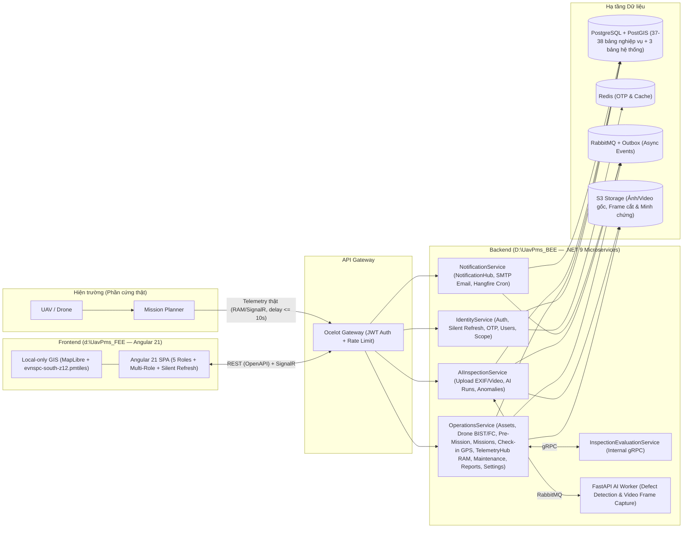
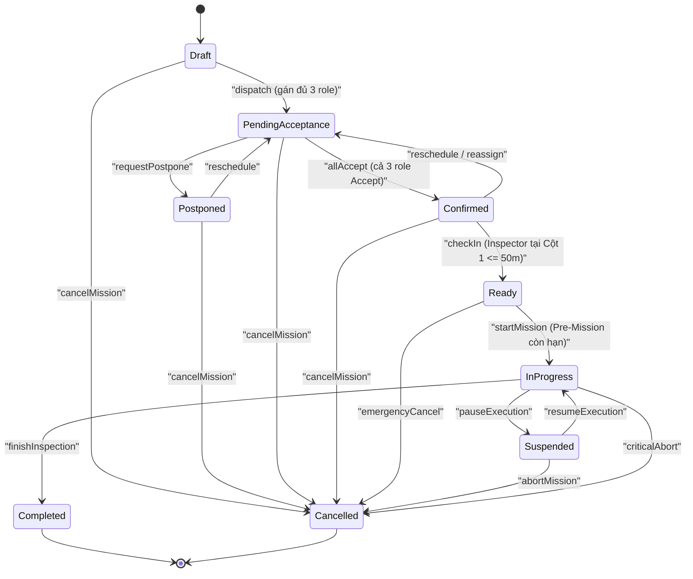
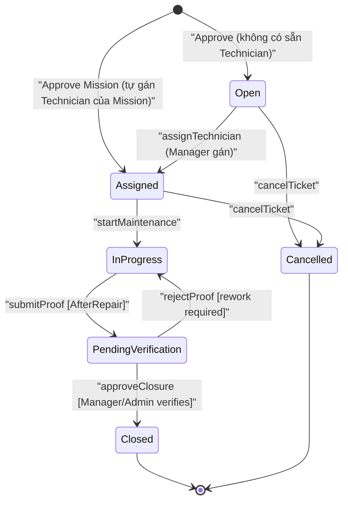

# UAV-PMS — Tài liệu Đặc tả Hệ thống Tổng thể (Master BA & Architecture Spec v2.0)

> **Vai trò tài liệu**: Nguồn sự thật duy nhất (*Single Source of Truth*) cho toàn bộ hệ thống **UAV Powerline Monitoring System (UAV-PMS)** bao phủ **Database (PostgreSQL/PostGIS) → Backend (.NET 9 Microservices + FastAPI AI) → Hợp đồng OpenAPI / SignalR → Frontend (Angular 21 + Local-only GIS)** — sẵn sàng cho bất kỳ AI Agent hoặc kỹ sư mới (Zero-Context) đọc một lần và làm đúng ngay.
> Mọi quyết định trong bản **v2.0** này đã được Chủ hệ thống chốt xác nhận 100% (`2026-11-27`). Khi có mâu thuẫn với tài liệu cũ (`v1.0`, `api_spec.md` cũ, `CODING_STANDARDS.md`), **tài liệu này có quyền ưu tiên cao nhất** (song hành với `docs/AI_SECURITY_AND_GOVERNANCE.md`).

---

## 1. Kiến trúc Tổng thể Hệ thống (End-to-End)

---

## 2. Phạm vi Chính thức (In Scope vs. Explicitly Removed)

### ✅ Các phân hệ GIỮ & CHUẨN HÓA (100% chạy thật, Zero Mock/Fake Data)
1. **Auth, Silent Refresh, Multi-Role RBAC, Geographic Scope, OTP Email thật & `SystemSettings`**:
   - FE tự chạy ngầm **Silent Refresh Token** trước khi Access Token hết hạn (không để user đang thao tác bị văng ra ngoài).
   - `SystemAdmin` toàn quyền hệ thống, cấu hình được toàn bộ ngưỡng nghiệp vụ trong `SystemSettings`.
2. **Quản lý Drone (BIST + Sức khỏe + FC) & Pre-Mission Readiness (MF01)**:
   - Kiểm tra BIST, sức khỏe Drone, kết nối đọc thông số FC hoặc nhập thủ công BIST thực hiện tại **Chi tiết Drone** (chỉ `Technician` và `SystemAdmin`).
   - **Pre-Mission (MF01)** chọn Khu vực, Cột điện, các Drone đã đạt chuẩn, Thời tiết và **chỉ chọn SỐ LƯỢNG nhân sự theo từng role** (không kiểm tra kỹ thuật Drone tại Pre-Mission).
3. **Mission Lifecycle (MF02), Xác nhận 3 Role, Check-in GPS 50m & Telemetry (MF03)**:
   - MF02 chọn đích danh người tham gia cho đủ 3 role (`Inspector`, `Analyst`, `Technician`); **cả 3 role bấm Xác nhận (`Accept`)**; chỉ **`Inspector`** (hoặc `SystemAdmin`) **Check-in GPS trong bán kính `50m` quanh Cột điện số 1**; phát SignalR realtime ngay khi Check-in.
   - Telemetry MF03 đẩy từ phần cứng thật qua BE phát SignalR `/hubs/telemetry` (trung chuyển RAM, **delay ≤ 10s**, **không script giả lập**, **không lưu DB**). Tự trả Drone khi `Completed`/`Cancelled`.
4. **AI Media Upload (EXIF GPS / Video Live GPS) & Duyệt Khuyết tật**:
   - Cho phép upload ảnh **không cần chọn cột trước** (đọc **EXIF GPS** ảnh, AI xong tự gắn cột gần nhất và cho phép đổi thủ công); video có GPS live, AI phát hiện lỗi tự chụp màn hình (extract frame) gắn cột gần nhất.
   - Mọi thành viên trong Mission đều **xem** được defect của Mission; chỉ `Analyst` của Mission (và `SystemAdmin`) được **duyệt (`Approve`/`Reject`)**.
   - **Sau khi duyệt**: **bỏ toàn bộ chữ `"AI Review"` / `"Chờ AI"`**, hiển thị kết quả chính thức; **xóa sạch các chỗ hiện `N/A`**; đồng nhất UI giữa tất cả các role.
5. **Auto Maintenance Tickets, Notification Matrix, Hangfire Cron, Reports & List Ordering**:
   - `Approve` defect thuộc Mission → tự tạo `MaintenanceTicket` (`Emergency` | `Normal`) và **tự động gán thẳng cho `Technician` của Mission** (`Assigned`).
   - Notification chia đúng role theo từng hành động; **khử trùng lặp Popup/Toast** ở cả BE & FE; toàn bộ danh sách mặc định luôn xếp **mới nhất, gần nhất lên đầu**.

### ❌ Các phân hệ LOẠI BỎ / Tạm hoãn (Dọn sạch khỏi DB, BE và FE)
- **Phân hệ Emergency Alert & Edge Device riêng biệt**: Gỡ hoàn toàn (`/api/v1/alerts*`, Escalate riêng, Vision Edge Webhook). Mức độ khẩn cấp chỉ là thuộc tính (`Emergency` | `Normal`) trên khuyết tật và phiếu bảo trì.
- **Bàn giao / Trả Drone thủ công (`drone-handover`)**: Gỡ hoàn toàn. Mission `Completed`/`Cancelled` = tự giải phóng Drone.
- **Lịch kiểm tra định kỳ (`InspectionSchedules`)**: Gỡ hoàn toàn.
- **Màn hình kiểm tra kỹ thuật Drone bên trong Pre-Mission**: Loại bỏ khỏi Pre-Mission (chuyển hoàn toàn sang màn Chi tiết Drone cho `Technician` & `SystemAdmin`).
- **Lưu lịch sử Telemetry xuống Database (`DroneTelemetry` writes)**: Bỏ hoàn toàn việc ghi telemetry xuống PostgreSQL.
- **Active Learning (sửa khung nhãn train lại AI)**: Tạm ẩn khỏi giao diện vận hành (backlog nghiên cứu sau).

---

## 3. Database & Schema Chuẩn hóa (PostgreSQL + PostGIS)

- **Hệ quản trị CSDL**: **PostgreSQL + PostGIS** (`Npgsql` EF Core 9 + `NetTopologySuite`), mô hình **Shared Database**.
- **Hiện trạng gốc tại commit `eb1cbd2`**: 42 bảng nghiệp vụ + 3 bảng hệ thống (`__EFMigrationsHistory`, `spatial_ref_sys`, Hangfire) = 45 bảng.
- **Chính sách dọn & điều chỉnh DB bắt buộc (qua EF Core Migration trên GitHub Actions — cấm chạy tay SQL DROP lên DB)**:
  1. **DROP 4 bảng thừa**: `EmergencyAlerts`, `AlertEscalations`, `IncidentReports`, `InspectionSchedules`.
  2. **Không lưu Telemetry xuống DB**: Bỏ hoàn toàn lệnh `INSERT`/`UPDATE` telemetry khi bay; có thể **DROP luôn bảng `DroneTelemetry`** (còn **37 bảng nghiệp vụ**) hoặc giữ rỗng không ghi.
  3. **Sửa ràng buộc Media**: `InspectionMedia.MissionId` thành **nullable** (phục vụ Standalone Test của `Analyst`/`SystemAdmin`); `TowerId` trên `InspectionMedia` & `DetectedAnomalies` **nullable** (upload ảnh không cần chọn cột trước, gắn qua EXIF GPS sau AI hoặc để trống khi trên tuyến/Standalone).

### Danh mục bảng nghiệp vụ sau chuẩn hóa (37–38 bảng)

| Nhóm phân hệ | Số bảng | Danh sách bảng trong PostgreSQL |
|---|:---:|---|
| **1. Identity, RBAC & Audit** | 7 | `Users`, `Roles`, `UserRoles`, `RefreshTokens`, `TrustedDevices`, `UserGeographicScopes`, `AuditLogs` |
| **2. Assets & Pre-Mission** | 10 *(hoặc 11)* | `Regions`, `Towers`, `UAVs`, `DroneFlightControllers`, `DroneTechnicalInspections`, `DroneTechnicalMetrics`, *(`DroneTelemetry` DROP hoặc không ghi)*, `PreMissionAssessments`, `PreMissionAssessmentTowers`, `PreMissionAssessmentPersonnel` *(lưu số lượng theo role)*, `PreMissionAssessmentDrones` |
| **3. Missions** | 8 | `Missions`, `MissionAssignments` *(3 role: Inspector, Analyst, Technician)*, `MissionTargets` *(chứa `sequence = 1` cho Check-in GPS)*, `MissionPriorityDefects`, `MissionCheckIns`, `MissionFlightLogs`, `MissionCommunicationLogs`, `ResourceBookings` |
| **4. AI Inspection & Review** | 4 | `InspectionMedia` *(`MissionId` & `TowerId` nullable)*, `AIAnalysisRuns`, `DefectCategories`, `DetectedAnomalies` *(`TowerId` nullable, `Emergency` \| `Normal`)* |
| **5. Maintenance, Reports & System** | 8 | `MaintenanceTickets`, `MaintenanceProofs`, `MaterialLogs`, `Reports`, `ReportMissions`, `Notifications`, `SystemSettings`, `OutboxMessages` |

---

## 4. Ma trận Phân quyền (5 Roles + Multi-Role + Geographic Scope)

- **5 Role chuẩn**: `SystemAdmin`, `Manager`, `Inspector`, `Analyst`, `Technician` (từ `UserRoles` — cấm tự tạo role mới).
- **`SystemAdmin` toàn quyền tuyệt đối (Superuser 100%)**:
  - **Không** bị giới hạn bởi `UserGeographicScopes` (xem và thao tác trên toàn bộ các vùng địa lý).
  - Có quyền thực hiện **TẤT CẢ thao tác của mọi role** trong toàn hệ thống (bao gồm cả BIST/FC Drone, Pre-Mission, Mission Accept/Check-in/Bay, Upload/Duyệt AI `Approve`/`Reject`, Giao & Xử lý Bảo trì, `SystemSettings`, User/Multi-Role/Scope, Audit Logs).
- **Multi-Role & Geographic Scope cho 4 role còn lại**:
  - Quyền hiệu lực = hợp (union) của các role user đang giữ.
  - Mọi truy vấn dữ liệu (`Towers`, `UAVs`, `PreMissionAssessments`, `Missions`, `DetectedAnomalies`, `MaintenanceTickets`, `Reports`) phải lọc theo `UserGeographicScopes` của user (ngoại trừ `SystemAdmin`).
- **Đồng nhất UI giữa các role**: Tất cả role khi mở cùng một màn hình (ví dụ Chi tiết Nhiệm vụ → Kết quả giám định, Chi tiết Cột điện, Phiếu bảo trì) phải dùng **cùng 1 nguồn dữ liệu chuẩn**, hiển thị thống nhất trạng thái thật, mã cột, tọa độ BBox (`0..100%`) và thông tin kiểm định — **tuyệt đối không để role này thấy "Chờ duyệt + có mã cột" còn role kia thấy "Đang thẩm định + Chưa gắn cột + BBox lệch"**. Chỉ khác nhau ở quyền hiện/ẩn nút thao tác.

| Chức năng | SystemAdmin | Manager | Inspector | Analyst | Technician |
|---|:---:|:---:|:---:|:---:|:---:|
| Quản lý User, Gán Multi-Role, Khóa vùng địa lý, `SystemSettings`, Audit Logs | ✅ (Toàn hệ thống) | ❌ | ❌ | ❌ | ❌ |
| Quản lý Region, Tower, UAV, Flight Controller | ✅ (Toàn quyền) | ✅ *(trong vùng)* | Xem *(trong vùng)* | Xem *(trong vùng)* | Xem *(trong vùng)* |
| **Kiểm tra BIST, Sức khỏe Drone, đọc FC / nhập thủ công BIST (tại Chi tiết Drone)** | **✅** | Xem kết quả *(không thao tác)* | Xem kết quả | ❌ | **✅ (Duy nhất ngoài Admin)** |
| Tạo / Duyệt Pre-Mission Assessment (MF01 — chọn số lượng nhân sự, không BIST) | ✅ | ✅ *(trong vùng)* | Xem *(trong vùng)* | Xem *(trong vùng)* | Xem *(trong vùng)* |
| Tạo / Sửa / Hủy / Giao Mission (MF02 — chọn đích danh 3 role) | ✅ | ✅ *(trong vùng)* | Xem *(được giao)* | Xem *(được giao)* | Xem *(được giao)* |
| **Bấm Xác nhận nhận Mission (`Accept`)** | ✅ | ❌ *(người giao)* | **✅ *(được gán)*** | **✅ *(được gán)*** | **✅ *(được gán)*** |
| **Check-in hiện trường (GPS bán kính 50m tại Cột điện số 1)** | ✅ | ❌ | **✅ (Duy nhất ngoài Admin)** | ❌ | ❌ |
| Xem Telemetry bay realtime (`/hubs/telemetry`, RAM/SignalR) | ✅ | ✅ *(trong vùng)* | ✅ *(mission được giao)* | Xem *(mission được giao)* | ❌ |
| Upload Ảnh / Video cho AI (Mission — không bắt buộc chọn cột) | ✅ | ❌ | ✅ *(mission được giao)* | ✅ | ❌ |
| Upload Ảnh / Video Standalone Test (`MissionId = NULL`) | ✅ | ❌ | ❌ | ✅ | ❌ |
| **Xem danh sách & chi tiết Defect trong Nhiệm vụ** | **✅** | **✅ *(trong vùng / mission)*** | **✅ *(mission được giao)*** | **✅ *(mission được giao)*** | **✅ *(mission được giao)*** |
| **Duyệt Defect (`Approve` / `Reject`) & đổi cột thủ công** | **✅** | ❌ | ❌ | **✅ *(duy nhất: Analyst trong mission đó)*** | ❌ |
| Xem Dashboard & Báo cáo (`Reports` PDF/Excel) | ✅ | ✅ *(trong vùng)* | ❌ | ✅ *(trong vùng)* | Xem danh sách |
| Giao / Đóng Phiếu bảo trì (`MaintenanceTickets`) | ✅ | ✅ *(trong vùng)* | ❌ | ❌ | ❌ |
| Xử lý Phiếu bảo trì, cập nhật vật tư & ảnh minh chứng trước/sau | ✅ | Xem / Duyệt đóng | ❌ | ❌ | ✅ *(phiếu được giao)* |

---

## 5. Đặc tả Chi tiết 5 Luồng Nghiệp vụ Đầu–Cuối (DB → BE → FE)

### Luồng 1 — Auth, Silent Refresh Token, OTP Email thật & `SystemSettings`
1. **Tạo tài khoản (`SystemAdmin`)**:
   - **FE**: Form tạo user chọn 1 hoặc nhiều role + (tùy chọn) `geographicScopeIds`.
   - **BE (`IdentityService`)**: Validate danh sách role hợp lệ (**tuyệt đối không tự gán `SystemAdmin` nếu rỗng/sai** — trả `400`). Lưu `Users`, `UserRoles`, `UserGeographicScopes` cùng transaction; tạo OTP lưu **Redis** và gửi **OTP thật qua SMTP Email (MailKit + TLS)** (`IsEmailVerified = false`). Nếu gửi OTP lỗi sau commit → trả `503 OTP_DELIVERY_FAILED`.
2. **Đăng nhập & Xác thực thiết bị mới**:
   - **FE**: Gửi `POST /api/v1/auth/login` kèm `email`, `password` và `DeviceTrustToken` (nếu có).
   - **BE**: Kiểm tra mật khẩu + `IsEmailVerified`. Nếu thiết bị mới hoặc `DeviceTrustToken` không hợp lệ → sinh OTP lưu **Redis**, gửi **OTP thật qua SMTP** (cấm bypass `"123456"` ở mọi môi trường) và trả `data.otpRequired = true`.
   - **FE → BE**: User nhập OTP gửi `POST /api/v1/auth/otp/verify` → cấp `AccessToken` (JWT chứa đủ mảng `roles`), `RefreshToken` và `DeviceTrustToken` (nếu chọn tin cậy).
3. **Silent Refresh Token (Chống văng đăng xuất khi đang thao tác)**:
   - **FE (`core/auth/`)**:
     - Chủ động theo dõi thời điểm hết hạn (`exp`) của `AccessToken` và tự chạy ngầm `POST /api/v1/auth/refresh-token` **trước khi token hết hạn** (ví dụ trước 60 giây) trong khi người dùng đang thao tác.
     - Trong HTTP Interceptor: khi gặp `401` do `AccessToken` vừa hết hạn, **khóa một luồng refresh duy nhất (`isRefreshing`)**, xếp hàng các request song song chờ token mới rồi **tự động retry lại request ban đầu** (không văng ra ngoài).
     - Chỉ thu hồi phiên và chuyển về Login khi `RefreshToken` thực sự hết hạn, không hợp lệ hoặc bị thu hồi.
4. **Đổi mật khẩu / Reset / Khóa tài khoản**:
   - `POST /api/v1/users/change-password` bắt buộc có `oldPassword` hợp lệ hoặc `X-StepUp-Token` hợp lệ (`400`/`401`). Đổi mật khẩu, reset mật khẩu hoặc khóa tài khoản → **thu hồi ngay toàn bộ `RefreshTokens` và `TrustedDevices`** đang sống của user đó trong cùng transaction.
5. **`SystemSettings` (Cấu hình động bởi `SystemAdmin` tại `/api/v1/system-settings`)**:
   - Chỉ `SystemAdmin` được chỉnh sửa và lưu (đồng bộ cache Redis/RabbitMQ, che kín secret nội bộ không cho FE đọc):
     - `CheckInRadiusMeters`: Bán kính GPS Check-in tại cột số 1 (mặc định **`50`** mét).
     - Ngưỡng an toàn Pre-Mission (tốc độ gió tối đa, pin tối thiểu, hiệu lực Pre-Mission ≤ `7` ngày).
     - Thời gian sống phiên / Access Token / Refresh Token (theo chính sách bảo mật).
     - Các mốc thời gian nhắc hạn tự động của Hangfire (trước giờ bay, quá hạn check-in, nhắc duyệt AI khẩn, nhắc hạn bảo trì).
     - Giới hạn upload (`MaxImageSizeMb = 20`, `MaxVideoSizeMb = 200`) và thời gian tự dọn file test Standalone S3.

---

### Luồng 2 — Chi tiết Drone (BIST/Health/FC) & Pre-Mission Readiness (MF01)
1. **Quản lý Tài sản (`Regions`, `Towers`, `UAVs`, `DroneFlightControllers`)**:
   - CRUD khu vực (PostGIS polygon), cột điện (PostGIS point + `sequence`), UAV và liên kết UID Flight Controller.
2. **Kiểm tra BIST, Sức khỏe Drone & Thông số FC (Tại màn Chi tiết Drone)**:
   - **Vị trí UI**: Nằm trực tiếp trong màn hình **Chi tiết Drone (`Drone Detail`)** — **chỉ `Technician` và `SystemAdmin` được quyền thao tác**.
   - **Thao tác hỗ trợ**:
     - Kết nối trực tiếp qua cổng Serial/FC lấy thông số Flight Controller (Firmware, Sensor, Pin, GPS lock, Motor/ESC) và chạy BIST tự động.
     - **Cho phép `Technician` và `SystemAdmin` nhập thủ công thông số BIST / kiểm tra sức khỏe Drone** kèm ghi chú kiểm định và lưu vào `DroneTechnicalInspections` / `DroneTechnicalMetrics`.
   - **Kết quả**: Cập nhật trạng thái kỹ thuật của Drone sang **`Đạt chuẩn / Sẵn sàng`** hoặc **`Không đạt / Cần bảo trì`**.
3. **Đánh giá Tiền nhiệm vụ (Pre-Mission Assessment — MF01)**:
   - **Loại bỏ hoàn toàn màn hình & bước kiểm tra kỹ thuật Drone khỏi Pre-Mission** (không bắt `Manager` kiểm tra BIST/FC trong MF01).
   - **Các bước của `Manager` (hoặc `SystemAdmin`) trong MF01**:
     1. Chọn Khu vực (`Region`) và Danh sách Cột điện cần bay (`PreMissionAssessmentTowers`).
     2. Chọn các **Drone đang ở trạng thái `Đạt chuẩn / Sẵn sàng`** (kế thừa kết quả kiểm tra từ màn Chi tiết Drone).
     3. Kiểm tra điều kiện Thời tiết / Không vực an toàn.
     4. **Chỉ chọn SỐ LƯỢNG nhân sự cần thiết theo từng role** (`InspectorCount`, `AnalystCount`, `TechnicianCount` lưu tại `PreMissionAssessmentPersonnel`) — **chưa chọn đích danh tên người** ở MF01.
   - **Ràng buộc cứng**: Phải có bản `PreMissionAssessment` đạt chuẩn và còn hiệu lực (tối đa **≤ 7 ngày**) thì mới được tạo và bắt đầu Mission.

---

### Luồng 3 — Tạo/Giao Mission (MF02), Xác nhận 3 Role, Check-in GPS 50m & Telemetry (MF03)
1. **Tạo & Giao Mission (MF02 — `Manager` / `SystemAdmin`)**:
   - Chọn bản `PreMissionAssessment` đạt chuẩn, vẽ/xem cột và tuyến bay trên bản đồ **Local-only GIS** (`MapLibre` + `public/maps/evnspc-south-z12.pmtiles` + schematic local fallback — **0 request ra Google/OSM/ArcGIS/CDN**).
   - **Chọn đích danh người tham gia** cho đủ **3 role của nhiệm vụ**: **`Inspector`**, **`Analyst`**, **`Technician`** (lưu `MissionAssignments` + `ResourceBookings` khóa Drone & nhân sự chống trùng lịch `409 Conflict`).
   - Khi Mission chưa bay (`Draft` / `PendingAcceptance` / `Postponed` / `Confirmed`), `PUT /api/v1/missions/{id}` cho cập nhật đầy đủ trường; nếu đang `Confirmed` mà đổi lịch/nhân sự → quay về `PendingAcceptance`.
2. **Xác nhận nhiệm vụ (`Accept`) — Đủ 3 Role**:
   - Sau khi giao nhiệm vụ (`PendingAcceptance`), **cả 3 role được gán (`Inspector`, `Analyst`, `Technician`) đều phải bấm Xác nhận (`Accept`)**.
   - Chỉ khi **tất cả 3 người được gán đều đã `Accept`**, Mission mới tự chuyển sang **`Confirmed`**. Nếu bất kỳ ai từ chối hoặc quá `ConfirmationDeadline` → giữ `PendingAcceptance` và báo ngay cho `Manager` để phân công lại.
3. **Check-in hiện trường GPS 50m tại Cột điện số 1 (Realtime)**:
   - **Ai được Check-in**: **Chỉ `Inspector` được phân công trong nhiệm vụ (và `SystemAdmin`)** mới thực hiện Check-in *(lưu ý: `Inspector` là người bay hiện trường tại cột số 1; `Analyst` và `Technician` chỉ bấm Xác nhận nhiệm vụ, không bấm Check-in)*.
   - **Kiểm tra khoảng cách GPS bắt buộc**:
     - Lấy tọa độ GPS hiện tại từ thiết bị của người Check-in và tọa độ GPS của **Cột điện đầu tiên trong nhiệm vụ (`sequence = 1` ở `MissionTargets`)**.
     - Tính khoảng cách Haversine giữa 2 tọa độ: bắt buộc **`distanceMeters <= CheckInRadiusMeters`** (mặc định **`50m`** từ `SystemSettings` — chấp nhận sai số 50m). Nếu vượt quá `50m` hoặc thiết bị không có GPS → từ chối Check-in với thông báo rõ khoảng cách hiện tại so với giới hạn `50m`. *(Khi demo trong hội trường, dùng cột điện có tọa độ đặt tại khu vực hội trường để chạy đúng chuẩn 50m.)*
   - **Cập nhật Realtime (Không cần F5)**:
     - Ngay khi Check-in thành công (`MissionCheckIns` + checklist → `Ready`), BE phát **1 sự kiện SignalR** lên `/hubs/notifications` cho nhóm `mission_{id}` (và `Manager` tạo nhiệm vụ); FE tự cập nhật ngay giao diện (kèm polling dự phòng nhẹ khi ở trạng thái `Confirmed`/`Preparing`).
4. **Bay thực tế & Telemetry Realtime (MF03)**:
   - **Luồng dữ liệu**: Phần cứng UAV / Mission Planner → BE → phát thẳng qua SignalR **`/hubs/telemetry`** (`TelemetryUpdated`, `DroneOnline`, `DroneOffline` > 30s — JSON `camelCase`, `[Authorize]`) → FE hiển thị vị trí UAV + pin + độ cao trên bản đồ Local-only GIS.
   - **Quy tắc cứng MF03**:
     - Độ trễ (**delay**) đầu–cuối cho phép **≤ `10 giây`**.
     - **KHÔNG dùng script giả lập**.
     - **KHÔNG lưu lịch sử hay ghi xuống Database PostgreSQL ở BE** (chỉ trung chuyển trên RAM/SignalR).
5. **Kết thúc / Hủy Mission**: Khi `Inspector`/`SystemAdmin` hoàn thành (`Completed`) hoặc `Manager`/`SystemAdmin` hủy (`Cancelled`) → BE tự động cập nhật `UAVs` về `Available` và giải phóng `ResourceBookings`.

---

### Luồng 4 — Upload Ảnh (EXIF GPS) / Video Live GPS, AI Phân tích & Duyệt Khuyết tật
#### 4A. Luồng Vận hành Chính thức (`MissionId != NULL`)
1. **Upload Ảnh / Video (`Inspector`, `Analyst` được gán, hoặc `SystemAdmin`)**:
   - **Upload Ảnh** (≤ 20 MB; `image/jpeg`, `image/png`, `image/webp`):
     - **Không bắt buộc chọn cột điện lúc upload** (`TowerId` có thể để trống).
     - Backend / AI Worker đọc **metadata EXIF GPS** (`GPSLatitude`, `GPSLongitude`) của file ảnh gốc trước khi xử lý.
   - **Upload Video** (≤ 200 MB; `video/mp4`):
     - Video quay từ Drone mang thông số GPS live trên luồng/hình. Khi FastAPI AI Worker phát hiện lỗi trên video sẽ **tự động chụp màn hình (trích xuất frame chứa lỗi)** lưu ảnh frame + timestamp/giây + tọa độ GPS tại thời điểm lỗi.
   - FE chỉ upload file, **không có UI chọn mô hình AI (`preferredModel`)**; `Inspector` sau khi nộp nhận thông báo kết quả nộp/phân tích (Thành công / Thất bại).
2. **Tự động gắn Cột điện gần nhất & Chỉnh sửa thủ công**:
   - Sau khi AI xử lý xong: nếu ảnh hoặc frame video có tọa độ GPS (từ EXIF hoặc GPS live), hệ thống tự tính khoảng cách tới danh sách cột trong `MissionTargets` và **tự động gắn `TowerId` với cột điện gần nhất**.
   - Nếu ảnh/video mất GPS hoặc gắn nhầm cột trên thực địa, `Analyst` của nhiệm vụ (hoặc `SystemAdmin`) được phép **chọn/đổi cột điện thủ công** trực tiếp trên thẻ/chi tiết khuyết tật (hoặc giữ nguyên trạng thái `"Chưa gắn cột"` nếu lỗi nằm trên dây giữa hai cột mà vẫn duyệt được bình thường).
3. **Xem Kết quả thống nhất vs. Duyệt (`Approve` / `Reject`)**:
   - **1 nguồn dữ liệu đồng nhất**: Tất cả thành viên có mặt trong nhiệm vụ (`Manager` vùng, `Inspector`, `Analyst`, `Technician` được gán) và `SystemAdmin` đều **xem được đầy đủ danh sách & chi tiết defect trong tab "Kết quả giám định"** của Mission (không trả `403`, dùng chung chuẩn trạng thái, mã cột `towerCode` và tọa độ BBox **`0..100%`**).
   - **Quyền duyệt**: Chỉ **`Analyst` được phân công trong chính nhiệm vụ đó** (và **`SystemAdmin`**) có quyền bấm **`Approve`** hoặc **`Reject`** kèm lý do (`PUT /api/v1/anomalies/{id}/validate`). Sau khi duyệt là **khóa cứng (immutable)**.
   - **Xóa nhãn `"AI Review"` sau khi duyệt & Diệt triệt để `"N/A"`**:
     - Chưa duyệt: hiển thị trạng thái **`Chờ duyệt`**.
     - Sau khi `Analyst`/`SystemAdmin` đã duyệt: **bỏ toàn bộ chữ `"AI Review"` / `"Chờ AI"` / `"Đang thẩm định AI"`** trên badge, tiêu đề, cột trạng thái; thay bằng kết quả giám định chính thức (**`Đã xác nhận`** / **`Đã loại bỏ`** / **`Đã khắc phục`**).
     - Không hiển thị chữ **`N/A`** vô nghĩa ở thẻ khuyết tật/nhiệm vụ: hiển thị ngày phát hiện (`dd/MM/yyyy HH:mm` `UTC+7`), mã cột (hoặc `"Chưa gắn cột"`), độ tin cậy `%`, mức độ `Khẩn cấp`/`Bình thường`; ẩn hoàn toàn dòng nào không áp dụng.

#### 4B. Luồng Standalone Test Độc lập (`MissionId = NULL`, `TowerId = NULL`)
- Chỉ dành cho **`Analyst`** và **`SystemAdmin`** để tải ảnh/video test độc lập.
- Tách biệt 100% khỏi danh sách vận hành (`WHERE MissionId IS NOT NULL`), không sinh `MaintenanceTicket`, không tính vào Dashboard/Reports, không dùng lại checksum chéo với ảnh Mission thật, có Hangfire dọn file S3 quá hạn theo `SystemSettings`.

---

### Luồng 5 — Tự động gán Phiếu Bảo trì, Notification Matrix, SignalR, Hangfire & List Ordering
1. **Tự động tạo & Tự động gán Phiếu Bảo trì (`MaintenanceTickets`)**:
   - Ngay khi `Analyst` (hoặc `SystemAdmin`) bấm **`Approve`** một khuyết tật thuộc Mission:
     - BE tự tạo 1 `MaintenanceTicket` riêng (quan hệ 1–1 với khuyết tật, kế thừa mức **`Emergency` | `Normal`**).
     - Nếu Mission đó **đã có `Technician` được phân công** (`MissionAssignments`): BE **tự động gán luôn phiếu đó cho `Technician` của Mission** và đặt trạng thái ban đầu là **`Assigned` ngay lập tức** (bắn Notification cho `Technician` đó và `Manager`).
     - Nếu là lỗi chưa có `Technician` trong Mission: tạo phiếu trạng thái **`Open`** và bắn Notification cho `Manager` vào gán thủ công từ `/api/v1/maintenance/tickets/technicians`.
2. **Xử lý Bảo trì hai chiều (`Technician` ↔ `Manager`)**:
   - `Technician` (hoặc `SystemAdmin`) bấm bắt đầu (`InProgress`), ghi vật tư (`MaterialLogs`), tải ảnh minh chứng trước/sau lên S3 (`MaintenanceProofs`), gửi nghiệm thu (`PendingVerification`).
   - `Manager` (hoặc `SystemAdmin`) kiểm tra minh chứng → bấm Đóng phiếu (`Closed`) hoặc Yêu cầu làm lại (`InProgress`). Mọi bước chuyển trạng thái đều bắn Notification hai chiều đúng người phụ trách.
3. **Ma trận Notification chia đúng Role (SignalR + DB + Email)**:

| Sự kiện nghiệp vụ | Đối tượng nhận chính thức | Kênh gửi |
|---|---|---|
| **Tạo / Giao nhiệm vụ (`dispatch` / `reassign`)** | `Inspector`, `Analyst`, `Technician` được phân công *(+ `SystemAdmin` xem toàn hệ thống)* | SignalR + DB |
| **Phản hồi nhận / từ chối nhiệm vụ (`Accept` / `Reject`)** | `Manager` tạo nhiệm vụ | SignalR + DB |
| **Check-in hiện trường thành công** | `Manager` tạo nhiệm vụ *(+ thành viên đang mở màn Mission nhận reload)* | SignalR + DB |
| **Hoàn tất upload / Có kết quả AI** | `Analyst` được gán vào nhiệm vụ *(+ TB Thành công/Thất bại cho `Inspector` nộp)* | SignalR + DB |
| **Duyệt khuyết tật & Tự sinh/gán Phiếu Bảo trì** | `Technician` được gán phiếu + `Manager` của nhiệm vụ | SignalR + DB *(+ Email nếu `Emergency`)* |
| **Cập nhật tiến độ / Gửi minh chứng / Đóng hoặc Trả lại Phiếu Bảo trì** | Giao tiếp 2 chiều giữa `Technician` xử lý phiếu ↔ `Manager` phụ trách | SignalR + DB |
| **Các mốc nhắc hạn & quá hạn tự động (Hangfire)** | Đúng role chịu trách nhiệm của mốc đó (xem Bảng 5.6) | SignalR + DB + Email *(nếu Emergency/Quá hạn)* |

4. **Quy tắc Chống Trùng Lặp Popup Notification (Zero Duplicate Popup)**:
   - **Backend (`NotificationService`)**:
     - Mỗi sự kiện nghiệp vụ chỉ phát **1 sự kiện SignalR duy nhất** (không phát lặp 2–3 tên event cho cùng 1 hành động).
     - `NotificationConnectionRegistry` hợp nhất `connectionId` bằng `Distinct` và dọn sạch tất cả dynamic groups trong `OnDisconnectedAsync` (người dùng thuộc nhiều group hay có nhiều role chỉ nhận tối đa 1 payload cho 1 thông báo).
   - **Frontend (`notifications-realtime.ts` & `notifications-store.ts`)**:
     - Dùng cơ chế **deduplicate (khử trùng lặp)** theo `notificationId` / `eventId` (hoặc khóa dự phòng `type + referenceId + actorId` trong cửa sổ vài giây) trước khi đẩy vào hàng đợi Toast/Popup — tuyệt đối không bật 2 popup giống hệt nhau trên màn hình.
5. **Quy tắc Sắp xếp Danh sách Toàn Hệ thống (Default List Ordering)**:
   - **Mọi danh sách** (Missions, Pre-Mission Assessments, Drones, Towers, Defect/Detection Results, Maintenance Tickets, Notifications, Reports, Audit Logs) trên cả Backend (API mặc định khi không truyền `sort`) lẫn Frontend **luôn mặc định sắp xếp item MỚI NHẤT, GẦN NHẤT lên đầu (`CreatedAt` / `UpdatedAt` / `DetectedAt` DESC)**.
6. **Báo cáo & Audit Logs**:
   - Báo cáo (`Reports`, `ReportMissions`) xuất PDF/Excel theo vùng (`SystemAdmin` toàn hệ thống), Audit Logs xem toàn hệ thống bởi `SystemAdmin`.

### 5.6. Quy tắc Trigger Nhắc hạn & Quá hạn Tự động (Hangfire Jobs)

Toàn bộ trigger chạy định kỳ bằng **Hangfire (PostgreSQL)**, ngưỡng đọc từ **`SystemSettings`** (do `SystemAdmin` cấu hình, không hardcode), có cờ `*NotifiedAt` chống gửi trùng mỗi phút:

| Sự kiện / Mốc thời gian | Ngưỡng mặc định (`SystemSettings`) | Đối tượng nhận | Kênh gửi |
|---|---|---|---|
| **Quá hạn xác nhận Mission** | Quá `ConfirmationDeadline` (`PendingAcceptance`) | Thành viên chưa `Accept` (`Inspector`/`Analyst`/`Technician`) + `Manager` | SignalR + DB |
| **Hết hạn Pre-Mission** | Quá hạn hiệu lực (trần ≤ 7 ngày) | `Manager`, `Inspector` | SignalR + DB |
| **Nhắc trước giờ bay** | Trước `ScheduledStart` **`30 phút`** | `Inspector` (được giao), `Manager` | SignalR + DB |
| **Quá hạn Check-in hiện trường** | Sau `ScheduledStart` **`15 phút`** chưa check-in | `Inspector`, `Manager` | SignalR + Email |
| **Nhắc duyệt AI Khẩn cấp** | Khuyết tật `Emergency` chờ duyệt quá **`30 phút`** | `Analyst` của Mission / đúng vùng | SignalR + Email |
| **Nhắc hạn Phiếu Bảo trì** | Trước `DueDate` **`24 giờ`** (`Normal`) / **`2 giờ`** (`Emergency`) và khi **quá hạn** | `Technician` được gán + `Manager` | SignalR + Email *(nếu Emergency/Quá hạn)* |

### 5.7. Vòng đời Trạng thái Chính thức (State Machines) & Quy tắc Biên

1. **`Mission` State Machine** *(9 trạng thái: `Draft`, `PendingAcceptance`, `Postponed`, `Confirmed`, `Ready`, `InProgress`, `Suspended`, `Completed`, `Cancelled`)*:

*(Khi chuyển sang `Completed` hoặc `Cancelled`, hệ thống tự động giải phóng/trả Drone về `Available`.)*

2. **`MaintenanceTicket` State Machine** *(6 trạng thái: `Open`, `Assigned`, `InProgress`, `PendingVerification`, `Closed`, `Cancelled`)*:

3. **Các quy tắc biên bắt buộc khác**:
   - **Múi giờ & Ngôn ngữ**: BE/PostgreSQL lưu **100% `UTC`** (`Z`); FE hiển thị **100% tiếng Việt theo `UTC+7` (`dd/MM/yyyy HH:mm`)** qua `src/app/shared/utils/`.
   - **Media Upload**: Ảnh ≤ `20 MB` (`image/jpeg`, `image/png`, `image/webp`); Video ≤ `200 MB` (`video/mp4`). Lưu ảnh/video/frame gốc lên S3; tọa độ BBox lưu JSON chuẩn `0..100%` để FE render overlay.
   - **Ảnh 0 lỗi & AI lỗi/timeout**: Ảnh 0 lỗi vẫn đẩy hàng đợi cho `Analyst` xác nhận sạch (không sinh phiếu bảo trì); AI lỗi/timeout chuyển `Failed` + cho phép bấm `Retry`.
   - **Soft Delete & Resource Lock**: Dùng `IsDeleted = true`; chặn xóa/khóa `UAV`, `Tower`, `User` đang gắn Mission chưa kết thúc.
   - **Chặn trùng lịch (`ResourceBookings`)**: Chặn cứng **`409 Conflict`** nếu trùng giờ sử dụng cùng 1 `UAV` hoặc cùng 1 nhân sự (`Inspector`/`Analyst`/`Technician`) với Mission khác chưa kết thúc.
   - **Hiệu lực `PreMissionAssessment`**: Trần hiệu lực **≤ 7 ngày**, kiểm tra hiệu lực ở cả thời điểm tạo Mission lẫn thời điểm bấm `startMission`.

---

## 6. Chuẩn Hợp đồng API (OpenAPI), SignalR & Quy tắc Code Sạch cho Dev Review

1. **1 JSON Envelope `camelCase` duy nhất** trên toàn BE:
   - Đơn lẻ: `{ "success": true, "data": { ... }, "error": null }`
   - Phân trang (1-based, đẩy `Where/OrderByDescending/Skip/Take` xuống EF Core `IQueryable`, mặc định sắp xếp **mới nhất lên đầu**, `pageSize <= 100`):
     `{ "success": true, "data": { "items": [...], "pagination": { "page": 1, "pageSize": 20, "totalItems": 120, "totalPages": 6 } }, "error": null }`
   - Lỗi: `{ "success": false, "data": null, "error": { "code": "...", "message": "..." } }`
2. **Đồng bộ OpenAPI**: Sau mỗi batch BE đổi REST, chạy `./scripts/export-openapi.ps1` xuất sang `d:\UavPms_FEE\docs\contracts\openapi.json` và ghi 2–3 dòng vào `docs/contracts/HANDOFF.md`.
3. **SignalR sạch**:
   - Tách route Ocelot `/hubs/*/negotiate` dùng `http`, WebSocket dùng `ws`.
   - Gỡ toàn bộ Hub method cho client `Broadcast*` trên `NotificationHub`; mỗi sự kiện nghiệp vụ phát **1 event duy nhất**, `Distinct` connection ID; FE khử trùng lặp trước khi hiện Toast/Popup và tự rejoin đầy đủ group sau `onreconnected`.
4. **Chuẩn Code sạch để Dev vào Review được (`.agents/skills/readable-code-defense/SKILL.md`)**:
   - **Không viết code 1 dòng (one-liner) hay ternary lồng nhau**: Viết luồng `if / return` (guard clause) thẳng từ trên xuống, tối đa 2 cấp `if`, dễ trace từng dòng.
   - **Gom helper/utils dùng chung — KHÔNG duplicate, KHÔNG tạo nhiều class dư thừa**: Tái sử dụng `src/app/shared/utils/` (FE) và `Shared` utilities (BE); tuyệt đối không copy-paste hàm parse/date/mapper mới nếu đã có sẵn.
   - **Không comment tràn lan**: Chỉ viết comment ngắn tiếng Việt ở đúng chỗ quy tắc nghiệp vụ hoặc edge case quan trọng để giải thích *TẠI SAO*. Kết thúc mỗi batch bằng **"Tóm tắt luồng để bảo vệ code"** (5–8 dòng).

---

## 7. Quy trình & Lộ trình Thực thi AI-Native v2.0 (Mainflow-First — Chống Lan Man)

1. **Nguyên tắc làm việc (Zero-Context Onboarding & Anti-Banking Ceiling)**:
   - Bắt đầu mọi phiên làm việc từ **lỗi thực tế / Mainflow** trước khi làm CI/YAML hay refactor phụ.
   - Áp dụng **Vertical Slice**: 1 tính năng / 1 lỗi P0 = 1 lát gọn (~250–450 dòng) + 1 lượt **Independent Judge** theo 3 tầng rủi ro (Tier 1 Bảo mật thật / Tier 2 UI & Nghiệp vụ / Tier 3 CI tĩnh — **cấm over-engineering SRE mức ngân hàng**).
   - Luôn giữ working tree sạch WIP (cất WIP sang nhánh `wip/*`), chạy test nhắm mục tiêu khi lặp → 1 lần full gate cuối (`npm run verify:all` / `dotnet test UavPms.sln`), reset chat khi chuyển domain.
2. **Lộ trình 5 Đợt đồng bộ v2.0**:

| Đợt | Trọng tâm | Backend (`D:\UavPms_BEE`) | Frontend (`d:\UavPms_FEE`) |
|---|---|---|---|
| **Đợt 0** *(Đang chốt)* | **Nền tảng, Bảo mật P0 & Chạy thông Luồng chính** | Đã xong `H`, `C1`, `C2a`, `C2b`, `C3a`, `G1` (P0-5), `N1` (P0-3). Làm nốt: **`P0-4` (`N2+N3`)** + **`P0-1`** + **`P0-2`** (MailKit SMTP) + **`CU`** (`CreateUser`). | Đã xong `FE-REQ-002` (Lint/Utils), `FE-REQ-003` (gỡ phân hệ thừa), `FE-REQ-004` 4/6 màn GIS. Chốt **`FE-REQ-005`** (Check-in realtime + Kết quả giám định đồng nhất) + sửa 2 lỗi CI PR + sort `/ai-review` mới nhất lên đầu. |
| **Đợt 1** | **Dọn DB, Silent Refresh, List Ordering & OpenAPI v1.0** | Migration **DROP 4 bảng** (+ xử lý `DroneTelemetry`), `InspectionMedia.MissionId` & `TowerId` nullable. Chuẩn hóa 1 `ApiResponse` + `camelCase` + mặc định **OrderByDescending mới nhất** toàn bộ API. **Xuất `openapi.json` v1.0**. | **Silent Refresh Token** (không bị văng khi đang dùng). Sync `docs/contracts/openapi.json` v1.0. Chuyển nốt 2 màn Pre-Mission sang **Local-only GIS** (`FE-REQ-004` PR-1b2). |
| **Đợt 2** | **Drone BIST/FC, Pre-Mission 3 Role, Check-in GPS 50m & Telemetry MF03** | Chuyển BIST/FC sang Drone Detail (`Technician`/`Admin`), bỏ BIST khỏi Pre-Mission, MF01 chọn số lượng → MF02 chọn đích danh 3 role → cả 3 `Accept` → `Inspector` Check-in GPS `≤ 50m` tại Cột 1 + bắn SignalR. `/hubs/telemetry` RAM-only (delay `≤ 10s`, không lưu DB). `SystemAdmin` full quyền + `SystemSettings`. | Nối UI Chi tiết Drone (BIST/FC/nhập tay cho `Technician`/`Admin`), bỏ kiểm tra Drone ở Pre-Mission, MF02 chọn 3 role + 3 nút `Accept`, Check-in GPS `50m` tại Cột 1, nối `/hubs/telemetry` trên Local GIS, UI `SystemSettings` cho `SystemAdmin`. |
| **Đợt 3** | **EXIF GPS/Video Frame, Xóa "AI Review" & `N/A`, Auto Maintenance, Notification Matrix** | Trích EXIF GPS ảnh & frame lỗi video gắn cột gần nhất (`TowerId` nullable), cho phép đổi cột. Mở quyền **Xem** defect cho mọi thành viên Mission (chỉ `Analyst` Mission / `SystemAdmin` **Duyệt**). Tự gán `MaintenanceTicket` cho `Technician` của Mission. Chia đúng Notification Matrix + Hangfire cron + chống duplicate SignalR. | Upload ảnh không cần chọn cột + đổi cột thủ công, **bỏ chữ `"AI Review"` sau duyệt**, **xóa sạch `N/A`**, đồng nhất UI các role, bỏ `preferredModel` & khóa `20MB`/`200MB`, khử duplicate popup Notification, mặc định mọi list mới nhất lên đầu. |
| **Đợt 4** | **Kiểm thử tích hợp thật Zero Mock & Bảo vệ đồ án** | Test tích hợp thật (SMTP OTP, RabbitMQ AI + EXIF/Video, GPS 50m Check-in, Telemetry ≤ 10s RAM-only, Hangfire cron, Notification Matrix). | Playwright E2E đủ 5 luồng + Multi-role + Silent Refresh + Test rút mạng bản đồ PMTiles + dọn code theo `readable-code-defense`. |

---

## 8. Phụ lục Chuẩn hóa (Canonical Enums, `SystemSettings` Keys & SignalR Events)

### 8.1. Canonical Enums & Nhãn hiển thị UI bắt buộc
- **`Role`** (5 giá trị cố định): `SystemAdmin`, `Manager`, `Inspector`, `Analyst`, `Technician`.
- **`MissionStatus`** (9 trạng thái): `Draft`, `PendingAcceptance`, `Postponed`, `Confirmed`, `Ready`, `InProgress`, `Suspended`, `Completed`, `Cancelled`.
- **`MaintenanceTicketStatus`** (6 trạng thái): `Open`, `Assigned`, `InProgress`, `PendingVerification`, `Closed`, `Cancelled`.
- **`AnomalyValidationStatus`** *(cấm tuyệt đối chữ `"AI Review"` / `"Chờ AI"` sau khi đã duyệt; cấm `"N/A"`)*:
  - `Pending` → UI: **`Chờ duyệt`**
  - `Approved` → UI: **`Đã xác nhận`**
  - `Rejected` → UI: **`Đã loại bỏ`**
  - `Resolved` → UI: **`Đã khắc phục`**
- **`SeverityLevel`**: `Emergency` *(UI: `Khẩn cấp`)* | `Normal` *(UI: `Bình thường`)*.
- **`DroneTechnicalStatus`**: `Ready` *(UI: `Đạt chuẩn / Sẵn sàng`)* | `MaintenanceRequired` *(UI: `Không đạt / Cần bảo trì`)*.
- **`MediaType`**: `Image` (`image/jpeg`, `image/png`, `image/webp` ≤ 20 MB) | `Video` (`video/mp4` ≤ 200 MB).

### 8.2. Canonical `SystemSettings` Keys (Quản trị bởi `SystemAdmin` tại `/api/v1/system-settings`)

| Key chuẩn (`SystemSettings`) | Mặc định | Đơn vị / Biên | Service tiêu thụ |
|---|---:|---|---|
| `CheckInRadiusMeters` | `50` | mét (`> 0`) | `OperationsService` |
| `PreMissionMaxValidityDays` | `7` | ngày (`1..7`) | `OperationsService` |
| `PreMissionMaxWindSpeedMs` | `12` | m/s | `OperationsService` |
| `PreMissionMinBatteryPct` | `30` | % (`20..100`) | `OperationsService` |
| `MaxImageSizeMb` | `20` | MB (`<= 20`) | `AIInspectionService` |
| `MaxVideoSizeMb` | `200` | MB (`<= 200`) | `AIInspectionService` |
| `AccessTokenExpiryMinutes` | `15` | phút | `IdentityService` |
| `RefreshTokenExpiryDays` | `7` | ngày | `IdentityService` |
| `RemindBeforeFlightMinutes` | `30` | phút | `NotificationService` (Hangfire) |
| `CheckInOverdueMinutes` | `15` | phút | `NotificationService` (Hangfire) |
| `EmergencyAiReviewOverdueMinutes` | `30` | phút | `NotificationService` (Hangfire) |
| `MaintenanceRemindNormalHours` | `24` | giờ | `NotificationService` (Hangfire) |
| `MaintenanceRemindEmergencyHours` | `2` | giờ | `NotificationService` (Hangfire) |
| `StandaloneMediaRetentionDays` | `7` | ngày | `AIInspectionService` / Hangfire |

### 8.3. SignalR Hubs & Event Contract (`camelCase`, `[Authorize]`)
- **`/hubs/notifications`** (`NotificationService` — Ocelot tách HTTP `/negotiate` + WS): mỗi sự kiện nghiệp vụ phát **1 event duy nhất**, `NotificationConnectionRegistry` lọc `Distinct` `connectionId` và dọn group ở `OnDisconnectedAsync`; FE deduplicate theo `notificationId` / `eventId` (dự phòng `type + referenceId + actorId`) trước khi hiện Popup/Toast.
- **`/hubs/telemetry`** (`OperationsService` — RAM-only, không ghi DB `DroneTelemetry`, độ trễ ≤ `10s`): `TelemetryUpdated`, `DroneOnline`, `DroneOffline` *(khi mất tín hiệu > 30s)*.
