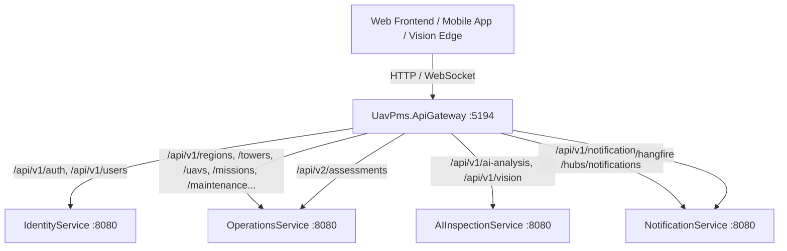

# 📋 TÀI LIỆU ĐẶC TẢ API (API SPECIFICATION) - UAV-PMS SYSTEM
**Hệ thống Quản lý và Giám sát Lưới điện bằng Thiết bị bay không người lái (UAV PMS)**
*Phiên bản chuẩn hóa toàn diện: Hợp nhất MF01 - MF04 (Đồng bộ 100% với `docs/ERD_SYSTEM_MF01_TO_MF04.md`)*

---

## 1. QUY ƯỚC CHUNG (GENERAL CONVENTIONS)

### 1.1. Base URL & Môi trường Triển khai
- **Local Development (Qua API Gateway Ocelot)**: `http://localhost:5194`
- **Staging / Production (Gateway)**: `https://uavpms.ddns.net`
- **Tiền tố API**:
  - `/api/v1`: Toàn bộ các API tiêu chuẩn của hệ thống (Auth, Users, GIS, Missions MF02, Execution MF03, AI Review MF04, Maintenance, Notifications).
  - `/api/v2`: Dành riêng cho luồng Đánh giá Tiền khả thi MF01 (`/api/v2/assessments`).

### 1.2. Ràng buộc Path Parameters (Bắt buộc GUID)
Mọi tham số ID trên URL định tuyến backend (`{id}`, `{missionId}`, `{towerId}`, `{droneId}`, `{userId}`, `{ticketId}`, `{anomalyId}`, v.v.) đều áp dụng ràng buộc **`guid`** (UUID 36 ký tự: `xxxxxxxx-xxxx-xxxx-xxxx-xxxxxxxxxxxx`).
- ✅ **HỢP LỆ**: `GET /api/v1/missions/3fa85f64-5717-4562-b3fc-2c963f66afa6`
- ❌ **LỖI 404 NOT FOUND**: `GET /api/v1/missions/MS-2026-0001` *(Router ASP.NET không match regex GUID dẫn đến trả về 404 Not Found ngay lập tức).*

### 1.3. Chuẩn Đóng gói Phản hồi (API Response Envelope)
Tất cả các API trả về theo cấu trúc đóng gói thống nhất `ApiResponse<T>`:
```json
{
  "success": true,
  "message": "Thao tác thành công.",
  "data": { ... }
}
```

Trường hợp danh sách có phân trang (`Pagination`), trường `data` tuân thủ format:
```json
{
  "success": true,
  "message": "Lấy danh sách thành công.",
  "data": {
    "items": [ ... ],
    "totalCount": 120,
    "page": 1,
    "pageSize": 10,
    "totalPages": 12
  }
}
```

Trường hợp lỗi nghiệp vụ / validation:
```json
{
  "success": false,
  "message": "Dữ liệu không hợp lệ hoặc xung đột nghiệp vụ.",
  "errors": [
    "Thời gian bắt đầu nhiệm vụ không được ở trong quá khứ.",
    "Drone đã được gán cho một nhiệm vụ khác trong khung giờ này."
  ]
}
```

### 1.4. Xác thực & Phân quyền (Authentication & RBAC)
Gửi Bearer JWT Token qua HTTP Request Header:
```http
Authorization: Bearer <access_token>
```

Hệ thống định nghĩa 6 vai trò tiêu chuẩn (`UserRoles`):
1. **`SystemAdmin`**: Toàn quyền cấu hình hệ thống, quản lý tài khoản, gán quyền, xem toàn bộ Audit Logs.
2. **`Manager`**: Quản lý vận hành khu vực; lập đánh giá tiền khả thi (MF01), tạo & phân công nhiệm vụ (MF02), phát lệnh bảo trì, duyệt cảnh báo sự cố.
3. **`Pilot` / `Inspector`**: Phi công / Thanh tra viên hiện trường; check-in, nhận/trả drone (MF03), tải ảnh kiểm tra, nạp log bay, báo cáo sự cố.
4. **`Analyst`**: Chuyên viên phân tích AI; duyệt/bác bỏ kết quả phát hiện khiếm khuyết của YOLOv8, gắn phản hồi chuyên môn (MF04).
5. **`Technician`**: Kỹ thuật viên kiểm định drone (MF02) và thợ bảo trì sửa chữa cột điện hiện trường (MF04).

---

## 2. SƠ ĐỒ ĐIỀU HƯỚNG GATEWAY (OCELOT ARCHITECTURE)



---

## 3. CHI TIẾT TỪNG MODULE API

---

### MODULE 1: XÁC THỰC & NGƯỜI DÙNG (IDENTITYSERVICE)

> [!TIP]
> **MÃ OTP MÔI TRƯỜNG DEV/TEST**: Mặc định là **`123456`**.

#### 1.1. [POST] `/api/v1/auth/login`
- **Mô tả**: Đăng nhập tài khoản bằng email và mật khẩu. Tự động kiểm tra thiết bị tin cậy (`device_trust_token`).
- **Phân quyền**: Public
- **Request Body**:
  ```json
  {
    "email": "manager@uavpms.com",
    "password": "Password123@",
    "deviceFingerprint": "browser-chrome-linux-uuid"
  }
  ```
- **Response `200 OK` (Khi không yêu cầu OTP)**:
  ```json
  {
    "success": true,
    "message": "Đăng nhập thành công.",
    "data": {
      "requiresOtp": false,
      "accessToken": "eyJhbGciOiJIUzI1NiIs...",
      "refreshToken": "7a90ab8e-5b12-4a...",
      "expiresAt": "2026-10-19T21:30:00Z",
      "user": {
        "id": "11111111-1111-1111-1111-111111111111",
        "username": "manager_hp",
        "email": "manager@uavpms.com",
        "fullName": "Nguyễn Văn Quản Lý",
        "roles": ["Manager"]
      }
    }
  }
  ```

#### 1.2. [POST] `/api/v1/auth/verify-otp`
- **Mô tả**: Xác thực OTP (khi đăng nhập trên thiết bị lạ hoặc thực hiện hành động nhạy cảm).
- **Phân quyền**: Public
- **Request Body**:
  ```json
  {
    "email": "manager@uavpms.com",
    "otpCode": "123456",
    "trustDevice": true
  }
  ```

#### 1.3. [POST] `/api/v1/auth/refresh-token`
- **Mô tả**: Cấp mới Access Token bằng Refresh Token.
- **Request Body**:
  ```json
  {
    "refreshToken": "7a90ab8e-5b12-4a..."
  }
  ```

#### 1.4. [GET] `/api/v1/users`
- **Mô tả**: Lấy danh sách nhân sự trong hệ thống có phân trang và lọc theo vai trò.
- **Phân quyền**: `SystemAdmin`, `Manager`
- **Query Params**: `role` (Pilot, Technician, Analyst...), `search`, `page`, `pageSize`

#### 1.5. [GET] `/api/v1/users/{id}`
- **Mô tả**: Xem thông tin chi tiết một người dùng, quyền hạn và khu vực địa lý được phân quyền.

---

### MODULE 2: HẠ TẦNG LƯỚI ĐIỆN & GIS (OPERATIONSSERVICE)

#### 2.1. [GET] `/api/v1/regions`
- **Mô tả**: Lấy danh sách các khu vực quản lý kèm ranh giới Polygon (GeoJSON).
- **Phân quyền**: Toàn bộ người dùng đã xác thực.

#### 2.2. [GET] `/api/v1/towers`
- **Mô tả**: Lấy danh sách cột điện có phân trang và lọc theo khu vực, tuyến dây, mức độ rủi ro.
- **Phân quyền**: Toàn bộ người dùng đã xác thực.
- **Query Params**:
  - `regionId`: GUID
  - `lineCode`: Chuỗi mã tuyến (VD: `22kV_471_E2.1`)
  - `riskLevel`: `Normal`, `Warning`, `Critical`
  - `hasActiveDefects`: `true`/`false`
  - `page`, `pageSize`
- **Response `200 OK`**:
  ```json
  {
    "success": true,
    "data": {
      "items": [
        {
          "id": "22222222-2222-2222-2222-222222222222",
          "regionId": "33333333-3333-3333-3333-333333333333",
          "towerCode": "NPC_HP_01_001",
          "lineCode": "22kV_471_E2.1",
          "voltage": "22kV",
          "poleType": "Bê tông ly tâm",
          "address": "Xã An Đồng, Huyện An Dương, Hải Phòng",
          "latitude": 20.8651,
          "longitude": 106.6838,
          "riskLevel": "Warning",
          "activeDefectsCount": 2,
          "lastInspectedAt": "2026-10-15T08:00:00Z"
        }
      ],
      "totalCount": 45,
      "page": 1,
      "pageSize": 10,
      "totalPages": 5
    }
  }
  ```

#### 2.3. [GET] `/api/v1/towers/{id}`
- **Mô tả**: Xem chi tiết cột điện, danh sách khiếm khuyết đang tồn tại và lịch sử kiểm tra.

#### 2.4. [POST] `/api/v1/towers/spatial-query`
- **Mô tả**: Tìm kiếm các cột điện nằm trong đa giác quy hoạch bay (GeoJSON Polygon).
- **Phân quyền**: `Manager`, `SystemAdmin`
- **Request Body**:
  ```json
  {
    "polygon": {
      "type": "Polygon",
      "coordinates": [
        [
          [106.680, 20.860],
          [106.690, 20.860],
          [106.690, 20.870],
          [106.680, 20.870],
          [106.680, 20.860]
        ]
      ]
    }
  }
  ```

#### 2.5. [GET] `/api/v1/towers/{id}/condition-history`
- **Mô tả**: Lấy lịch sử biến thiên tình trạng rủi ro của cột điện (`tower_condition_histories`).

---

### MODULE 3: ĐỘI BAY UAV & KIỂM ĐỊNH KỸ THUẬT (OPERATIONSSERVICE)

#### 3.1. [GET] `/api/v1/uavs`
- **Mô tả**: Lấy danh sách thiết bị bay, trạng thái hoạt động (`Ready`, `Degraded`, `Grounded`), tình trạng kỹ thuật (`Good`, `Fair`, `Critical`), mức pin, giờ bay.
- **Query Params**: `status`, `operationalStatus`, `page`, `pageSize`

#### 3.2. [GET] `/api/v1/uavs/{id}`
- **Mô tả**: Xem thông tin chi tiết một drone và lịch sử kiểm định kỹ thuật.

#### 3.3. [POST] `/api/v1/uavs/{id}/inspections`
- **Mô tả**: Tạo biên bản kiểm định kỹ thuật cho drone trước chiến dịch bay.
- **Phân quyền**: `Technician`, `SystemAdmin`
- **Request Body**:
  ```json
  {
    "technicianUserId": "44444444-4444-4444-4444-444444444444",
    "notes": "Kiểm định định kỳ tuần 42 trước khi nhận nhiệm vụ"
  }
  ```

#### 3.4. [POST] `/api/v1/uavs/{id}/inspections/{inspectionId}/metrics`
- **Mô tả**: Nạp các chỉ số đo đạc chi tiết từng phân hệ phần cứng (`Propulsion`, `Avionics`, `Payload`, `Power`).
- **Request Body**:
  ```json
  {
    "metrics": [
      {
        "metricCode": "MOTOR_VIBRATION",
        "subsystem": "Propulsion",
        "numericValue": 1.25,
        "passed": true,
        "isCritical": true,
        "unit": "mm/s"
      },
      {
        "metricCode": "BATTERY_HEALTH",
        "subsystem": "Power",
        "numericValue": 94.0,
        "passed": true,
        "isCritical": true,
        "unit": "%"
      }
    ]
  }
  ```

#### 3.5. [PUT] `/api/v1/uavs/{id}/inspections/{inspectionId}/complete`
- **Mô tả**: Hoàn thành kiểm định, chốt kết quả `Passed`/`Failed`, tính hạn giá trị `validUntil` và tự động cập nhật `uav.operational_status`.

---

### MODULE 4: MF01 - ĐÁNH GIÁ TIỀN KHẢ THI (PRE-MISSION ASSESSMENT V2)

#### 4.1. [POST] `/api/v2/assessments`
- **Mô tả**: Quản lý tạo hồ sơ đánh giá tiền khả thi cho một chiến dịch bay dự kiến.
- **Phân quyền**: `Manager`, `SystemAdmin`
- **Request Body**:
  ```json
  {
    "regionId": "33333333-3333-3333-3333-333333333333",
    "plannedStart": "2026-10-25T08:00:00Z",
    "plannedEnd": "2026-10-25T17:00:00Z",
    "targetTowerIds": [
      "22222222-2222-2222-2222-222222222222",
      "55555555-5555-5555-5555-555555555555"
    ],
    "proposedBoundary": {
      "type": "Polygon",
      "coordinates": [...]
    }
  }
  ```
- **Response `201 Created`**:
  ```json
  {
    "success": true,
    "message": "Khởi tạo hồ sơ tiền khả thi thành công.",
    "data": {
      "assessmentId": "66666666-6666-6666-6666-666666666666",
      "status": "Evaluating",
      "siteFeasibility": "Feasible",
      "weatherSuitability": "Suitable",
      "airspaceClearance": "Clear",
      "resourceReadiness": "Ready",
      "findings": {
        "candidatePilotsCount": 3,
        "candidateUavsCount": 2,
        "totalDistanceMeters": 4500,
        "estimatedFlightDurationMinutes": 45
      }
    }
  }
  ```

#### 4.2. [GET] `/api/v2/assessments/{id}`
- **Mô tả**: Lấy thông tin chi tiết hồ sơ thẩm định tiền khả thi, bao gồm các chỉ số cảnh báo rủi ro bãi bay và danh sách tài nguyên khả dụng.

#### 4.3. [PUT] `/api/v2/assessments/{id}/confirm`
- **Mô tả**: Quản lý xác nhận hồ sơ tiền khả thi đạt yêu cầu (`status = 'Ready'`), cho phép chuyển tiếp sang MF02 để lập nhiệm vụ chính thức.

---

### MODULE 5: MF02 - ĐIỀU PHỐI & PHÂN CÔNG NHIỆM VỤ BAY (OPERATIONSSERVICE)

#### 5.1. [POST] `/api/v1/missions`
- **Mô tả**: Tạo nhiệm vụ bay kiểm tra chính thức (có thể kế thừa phạm vi từ Assessment MF01 hoặc tạo trực tiếp).
- **Phân quyền**: `Manager`, `SystemAdmin`
- **Request Body**:
  ```json
  {
    "title": "Kiểm tra định kỳ tuyến đường dây 22kV An Dương - Hải Phòng",
    "assessmentId": "66666666-6666-6666-6666-666666666666",
    "regionId": "33333333-3333-3333-3333-333333333333",
    "priority": 1,
    "objective": "Periodic",
    "plannedStart": "2026-10-25T08:00:00Z",
    "plannedEnd": "2026-10-25T17:00:00Z",
    "managerInstructions": "Chú ý khu vực cột 12-15 có cây cối rậm rạp",
    "confirmationDeadline": "2026-10-24T18:00:00Z",
    "targetTowerIds": [
      "22222222-2222-2222-2222-222222222222",
      "55555555-5555-5555-5555-555555555555"
    ]
  }
  ```

#### 5.2. [GET] `/api/v1/missions`
- **Mô tả**: Lấy danh sách nhiệm vụ bay có lọc theo trạng thái (`Draft`, `PendingAcceptance`, `Assigned`, `InProgress`, `Completed`), mức ưu tiên, khoảng thời gian.

#### 5.3. [GET] `/api/v1/missions/{id}`
- **Mô tả**: Chi tiết nhiệm vụ bao gồm: Danh sách cột cần kiểm tra (`mission_targets`), Đội bay được phân công (`mission_assignments`), Thiết bị bay (`uavs`), Lịch giữ chỗ tài nguyên (`resource_bookings`).

#### 5.4. [POST] `/api/v1/missions/{id}/assignments`
- **Mô tả**: Gán thành viên đội bay kèm vai trò ngữ cảnh (`PILOT`, `CO_PILOT`, `INSPECTOR`, `OBSERVER`). Tự động gửi thông báo Realtime đến thành viên.
- **Request Body**:
  ```json
  {
    "userId": "77777777-7777-7777-7777-777777777777",
    "assignmentRole": "PILOT",
    "isRequired": true
  }
  ```

#### 5.5. [PUT] `/api/v1/missions/{id}/assignments/{assignmentId}/respond`
- **Mô tả**: Phi công / Thành viên phản hồi nhận nhiệm vụ (`Accepted` hoặc `Postponed` kèm lý do).
- **Phân quyền**: Chính thành viên được gán.
- **Request Body**:
  ```json
  {
    "responseStatus": "Accepted",
    "reason": null
  }
  ```

#### 5.6. [PUT] `/api/v1/missions/{id}/drone`
- **Mô tả**: Gán drone chính thức cho nhiệm vụ (Kiểm tra xung đột lịch giữ chỗ & điều kiện kiểm định còn hạn).
- **Request Body**:
  ```json
  {
    "uavId": "88888888-8888-8888-8888-888888888888"
  }
  ```

#### 5.7. [POST] `/api/v1/missions/{id}/dispatch`
- **Mô tả**: Quản lý phát lệnh điều phối nhiệm vụ khi tất cả điều kiện sẵn sàng đạt chuẩn. Chuyển trạng thái sang `Assigned`.

#### 5.8. [POST] `/api/v1/missions/{id}/cancel`
- **Mô tả**: Hủy nhiệm vụ bay (ghi nhận lý do vào Audit Log và tự động giải phóng tài nguyên đã khóa lịch).

---

### MODULE 6: MF03 - THỰC THI HIỆN TRƯỜNG & NẠP DỮ LIỆU (OPERATIONSSERVICE)

#### 6.1. [POST] `/api/v1/missions/{id}/check-in`
- **Mô tả**: Thành viên đội bay check-in hiện trường bằng GPS khi có mặt tại điểm tập kết.
- **Phân quyền**: `Pilot`, `Inspector`
- **Request Body**:
  ```json
  {
    "latitude": 20.8655,
    "longitude": 106.6840
  }
  ```

#### 6.2. [POST] `/api/v1/missions/{id}/drone-handover/deliver`
- **Mô tả**: Ký biên bản bàn giao drone trước chuyến bay giữa Thủ kho/Kỹ thuật viên và Phi công trưởng.
- **Request Body**:
  ```json
  {
    "droneId": "88888888-8888-8888-8888-888888888888",
    "receivedByUserId": "77777777-7777-7777-7777-777777777777",
    "initialChecklist": {
      "propellersSecure": true,
      "cameraLensClean": true,
      "gimbalCalibrated": true,
      "batteryPercentage": 100,
      "gpsLockAcquired": true
    }
  }
  ```

#### 6.3. [POST] `/api/v1/missions/{id}/drone-handover/return`
- **Mô tả**: Ký biên bản thu hồi drone sau khi hoàn thành chuyến bay (Ghi nhận hư hại vật lý, số pin còn lại).

#### 6.4. [POST] `/api/v1/missions/{id}/flight-logs`
- **Mô tả**: Nạp file log bay telemetry ghi nhận quỹ đạo GPS, độ cao tối đa, mức pin thấp nhất và thời lượng bay.
- **Request Body**:
  ```json
  {
    "gpsTrack": [
      {"lat": 20.8651, "lon": 106.6838, "alt": 45.2, "time": "2026-10-25T08:15:00Z", "battery": 98},
      {"lat": 20.8658, "lon": 106.6845, "alt": 50.1, "time": "2026-10-25T08:16:00Z", "battery": 96}
    ],
    "minBatteryRecorded": 25.5,
    "maxAltitudeM": 65.0,
    "flightDurationSeconds": 2400,
    "connectionStatus": "Normal"
  }
  ```

#### 6.5. [POST] `/api/v1/missions/{id}/incidents`
- **Mô tả**: Lập biên bản sự cố phát sinh tại hiện trường (Va chạm vật cản, thời tiết cực đoan, lỗi mất sóng).
- **Request Body**:
  ```json
  {
    "towerId": "22222222-2222-2222-2222-222222222222",
    "incidentType": "Collision",
    "severity": "High",
    "description": "Cánh quạt va quẹt nhẹ cành cây khi hạ độ cao tiếp cận chuỗi sứ",
    "fileUrl": "https://storage.uavpms.com/incidents/inc-01.jpg"
  }
  ```

#### 6.6. [POST] `/api/v1/inspections/upload`
- **Mô tả**: Endpoint canonical upload ảnh/video kiểm tra hiện trường (`multipart/form-data`). Hệ thống tự động bóc tách GPS EXIF, đối chiếu vị trí cột điện và gửi sự kiện Outbox kích hoạt AI Analysis.
- **Headers**: `Content-Type: multipart/form-data`
- **Form Data**:
  - `missionId`: GUID
  - `towerId`: GUID (tùy chọn, nếu không gửi hệ thống tự động resolve dựa vào tọa độ GPS EXIF của ảnh)
  - `files`: Danh sách tệp ảnh JPEG/PNG hoặc Video MP4.
- **Response `200 OK`**:
  ```json
  {
    "success": true,
    "message": "Tải lên 5 ảnh thành công và đã chuyển vào hàng đợi phân tích AI.",
    "data": {
      "uploadedCount": 5,
      "mediaIds": [
        "99999999-9999-9999-9999-999999999999",
        "aaaaaaaa-aaaa-aaaa-aaaa-aaaaaaaaaaaa"
      ]
    }
  }
  ```

---

### MODULE 7: MF04 - PHÂN TÍCH AI & THẨM ĐỊNH KHUYẾT TẬT (AIINSPECTIONSERVICE)

#### 7.1. [GET] `/api/v1/ai-analysis/defects/categories`
- **Mô tả**: Lấy danh mục khiếm khuyết chuẩn hóa (`CORROSION`, `BROKEN_INSULATOR`, `WIRE_SAGGING`, `FOREIGN_OBJECT`).

#### 7.2. [GET] `/api/v1/ai-analysis/anomalies`
- **Mô tả**: Lấy danh sách các khiếm khuyết được AI phát hiện, lọc theo nhiệm vụ, cột điện, trạng thái thẩm định.
- **Query Params**: `missionId`, `towerId`, `validationStatus` (`Pending`, `Confirmed`, `Rejected`), `minConfidence`, `page`, `pageSize`
- **Response `200 OK`**:
  ```json
  {
    "success": true,
    "data": {
      "items": [
        {
          "id": "bbbbbbbb-bbbb-bbbb-bbbb-bbbbbbbbbbbb",
          "mediaId": "99999999-9999-9999-9999-999999999999",
          "towerId": "22222222-2222-2222-2222-222222222222",
          "categoryCode": "BROKEN_INSULATOR",
          "categoryName": "Vỡ bát sứ cách điện",
          "confidenceScore": 0.94,
          "validationStatus": "Pending",
          "boundingBox": {"x": 0.42, "y": 0.55, "width": 0.12, "height": 0.08},
          "cropUrl": "https://storage.uavpms.com/crops/crop-01.jpg",
          "imageUrl": "https://storage.uavpms.com/annotated/img-01.jpg",
          "aiSource": "Server"
        }
      ],
      "totalCount": 1
    }
  }
  ```

#### 7.3. [PUT] `/api/v1/ai-analysis/anomalies/{id}/review`
- **Mô tả**: Chuyên viên phân tích (Analyst) thẩm định phát hiện bất thường: Phê duyệt (`Confirmed`) hoặc Bác bỏ (`Rejected`) kèm nhận xét chuyên môn.
- **Phân quyền**: `Analyst`, `Manager`
- **Request Body**:
  ```json
  {
    "validationStatus": "Confirmed",
    "analystFeedback": {
      "defectSubtype": "Vỡ mép đĩa sứ pha B",
      "recommendedAction": "Thay thế khẩn cấp trong vòng 7 ngày",
      "comment": "Vết nứt sâu có nguy cơ phóng điện vầng quang khi trời mưa ẩm"
    }
  }
  ```

#### 7.4. [POST] `/api/v1/vision/detections`
- **Mô tả**: Webhook tiếp nhận cảnh báo phát hiện thời gian thực từ Edge Device (Camera drone / Vision Edge AI).

---

### MODULE 8: MF04 - CẢNH BÁO KHẨN CẤP & BẢO TRÌ SỬA CHỮA (OPERATIONSSERVICE)

#### 8.1. [GET] `/api/v1/emergency-alerts`
- **Mô tả**: Lấy danh sách các cảnh báo sự cố khẩn cấp đang kích hoạt (`Active`, `Investigating`).

#### 8.2. [PUT] `/api/v1/emergency-alerts/{id}/resolve`
- **Mô tả**: Xử lý / Đóng cảnh báo khẩn cấp (Chuyển sang `Resolved` hoặc `FalsePositive` kèm biên bản).

#### 8.3. [POST] `/api/v1/emergency-alerts/{id}/escalate`
- **Mô tả**: Leo thang cảnh báo lên cấp quản lý cao hơn khi quá hạn thời gian xử lý chuẩn.

#### 8.4. [POST] `/api/v1/maintenance/tickets`
- **Mô tả**: Quản lý tạo phiếu sửa chữa / bảo trì cột điện (từ khiếm khuyết đã được Analyst phê duyệt).
- **Phân quyền**: `Manager`
- **Request Body**:
  ```json
  {
    "anomalyId": "bbbbbbbb-bbbb-bbbb-bbbb-bbbbbbbbbbbb",
    "towerId": "22222222-2222-2222-2222-222222222222",
    "technicianId": "cccccccc-cccc-cccc-cccc-cccccccccccc",
    "priority": "High",
    "description": "Thay thế chuỗi cách điện vỡ tại pha B cột NPC_HP_01_001",
    "dueDate": "2026-11-01T17:00:00Z"
  }
  ```

#### 8.5. [GET] `/api/v1/maintenance/tickets`
- **Mô tả**: Lấy danh sách phiếu bảo trì có lọc theo trạng thái (`Assigned`, `InProgress`, `Completed`, `Closed`), mức ưu tiên, cột điện, thợ sửa chữa.

#### 8.6. [POST] `/api/v1/maintenance/tickets/{id}/proofs`
- **Mô tả**: Thợ bảo trì tải ảnh chụp nghiệm thu hiện trường trước (`Before`), trong khi làm (`InProgress`) hoặc sau khi sửa chữa (`After`).
- **Request Body**:
  ```json
  {
    "proofType": "After",
    "fileUrl": "https://storage.uavpms.com/proofs/after-repair-01.jpg"
  }
  ```

#### 8.7. [PUT] `/api/v1/maintenance/tickets/{id}/complete`
- **Mô tả**: Nghiệm thu và đóng phiếu sửa chữa. Hệ thống tự động giảm `towers.active_defects_count` và cập nhật bản ghi lịch sử `tower_condition_histories`.

---

### MODULE 9: THÔNG BÁO REAL-TIME & SIGNALR (NOTIFICATIONSERVICE)

#### 9.1. [GET] `/api/v1/notifications`
- **Mô tả**: Lấy danh sách thông báo gửi đến người dùng hiện tại có phân trang.

#### 9.2. [GET] `/api/v1/notifications/unread-count`
- **Mô tả**: Lấy số lượng thông báo chưa đọc.

#### 9.3. [PUT] `/api/v1/notifications/{id}/read`
- **Mô tả**: Đánh dấu một thông báo là đã đọc.

#### 9.4. [WebSocket Hub] `/hubs/notifications`
- **Giao thức**: SignalR WebSocket
- **Sự kiện đẩy xuống Client**:
  - `ReceiveNotification`: Nhận thông báo vận hành mới (giao nhiệm vụ, yêu cầu phản hồi).
  - `ReceiveEmergencyAlert`: Nhận cảnh báo khẩn cấp tức thời (âm thanh & banner đỏ).
  - `MissionStatusChanged`: Cập nhật trạng thái nhiệm vụ realtime.

#### 9.5. [Dashboard UI] `/hangfire`
- **Mô tả**: Bảng điều khiển quản lý tác vụ nền và tác vụ định kỳ của Hangfire (Gửi email nhắc nhở quá hạn, đồng bộ dữ liệu).

---

### MODULE 10: MONITORING DASHBOARD & BÁO CÁO (OPERATIONSSERVICE)

#### 10.1. [GET] `/api/v1/monitor/summary`
- **Mô tả**: Lấy các chỉ số KPI vận hành tổng hợp toàn hệ thống:
  - Tổng số nhiệm vụ (theo trạng thái).
  - Tổng số cột điện theo mức độ rủi ro (`Normal`, `Warning`, `Critical`).
  - Tình trạng khả dụng của phi đội UAV.
  - Số sự cố và cảnh báo khẩn cấp đang chờ xử lý.

#### 10.2. [GET] `/api/v1/audit-logs`
- **Mô tả**: Truy vấn nhật ký kiểm toán hệ thống (`audit_logs`) có lọc theo bảng, ID bản ghi, nhân sự thao tác và khoảng thời gian.
- **Phân quyền**: `SystemAdmin`
