# Tài liệu Thiết kế Cơ sở Dữ liệu (Database Schema Documentation)
**Hệ thống Quản lý và Giám sát Lưới điện bằng Thiết bị bay không người lái (UAV PMS)**
*Phiên bản chuẩn hóa toàn diện: Hợp nhất MF01 - MF04 (Đồng bộ 100% với `docs/ERD_SYSTEM_MF01_TO_MF04.md`)*

---

## 1. Tổng quan & Triết lý Thiết kế

Cơ sở dữ liệu của hệ thống UAV PMS được thiết kế trên nền tảng **PostgreSQL 16+** kết hợp tiện ích mở rộng địa không gian **PostGIS** và kiểu dữ liệu bán cấu trúc **JSONB**.

### Các nguyên tắc cốt lõi:
1. **Chuẩn hóa đối tượng hạ tầng lưới điện**: Hạ tầng được tinh gọn tập trung vào `regions` (Khu vực quản lý) và `towers` (Cột điện truyền tải/phân phối). Toàn bộ dữ liệu kiểm tra, sự cố, ảnh chụp, khuyết tật và bảo trì đều gắn trực tiếp với `towers` thay vì phân mảnh qua các cấp trung gian không cần thiết.
2. **Quản trị vòng đời nhiệm vụ bay chặt chẽ (MF01 - MF03)**:
   - **MF01**: Tiền khả thi & sẵn sàng tài nguyên (`pre_mission_assessments`) đánh giá trước khi tạo nhiệm vụ.
   - **MF02**: Điều phối & phân công (`missions`, `mission_targets`, `mission_assignments`, `resource_bookings`, `drone_technical_inspections`, `drone_technical_metrics`).
   - **MF03**: Thực thi hiện trường & bàn giao (`mission_check_ins`, `drone_handovers`, `mission_flight_logs`, `incident_reports`, `inspection_media`).
3. **Chu trình AI, Thẩm định & Bảo dưỡng khép kín (MF04)**:
   - Phân tích AI (`ai_analysis_requests`, `detected_anomalies`, `defect_categories`).
   - Xử lý sự cố khẩn (`emergency_alerts`, `alert_escalations`).
   - Khắc phục & Nghiệm thu (`maintenance_tickets`, `maintenance_proofs`, `tower_condition_histories`).
4. **Kiểm toán & Độc lập dịch vụ**: Toàn bộ thao tác nghiệp vụ được lưu vết qua `audit_logs`, các sự kiện quan trọng gửi qua `notifications`.

---

## 2. Sơ đồ Thực thể Liên kết (ERD Toàn diện)

```mermaid
erDiagram
    %% HẠ TẦNG & TÀI NGUYÊN (SHARED FOUNDATION)
    regions ||--o{ towers : "chứa các cột điện"
    regions ||--o{ missions : "phạm vi địa bàn nhiệm vụ"
    users ||--o{ user_roles : "gán chức danh"
    roles ||--o{ user_roles : "định nghĩa quyền hệ thống"

    %% MF01: LẬP KẾ HOẠCH & TIỀN KHẢ THI
    missions ||--o| pre_mission_assessments : "hồ sơ đánh giá tiền khả thi (1-1)"
    missions ||--o{ mission_targets : "danh sách cột cần kiểm tra"
    towers ||--o{ mission_targets : "đối tượng kiểm tra"
    users ||--o{ pre_mission_assessments : "quản lý đánh giá"

    %% MF02: ĐIỀU PHỐI & KHÓA GIỮ TÀI NGUYÊN
    missions ||--o{ mission_assignments : "phân công vai trò đội bay"
    users ||--o{ mission_assignments : "thành viên nhận nhiệm vụ"
    missions ||--o{ resource_bookings : "khóa lịch tài nguyên"
    users ||--o{ resource_bookings : "giữ chỗ phi công"
    uavs ||--o{ resource_bookings : "giữ chỗ máy bay"
    missions }o--o| uavs : "thiết bị bay chính thức"
    uavs ||--o{ drone_technical_inspections : "kiểm định kỹ thuật định kỳ"
    drone_technical_inspections ||--o{ drone_technical_metrics : "thông số đo đạc chi tiết"
    users ||--o{ drone_technical_inspections : "kỹ thuật viên kiểm định"

    %% MF03: THỰC THI HIỆN TRƯỜNG & NẠP DỮ LIỆU
    missions ||--o{ mission_check_ins : "xác nhận có mặt hiện trường"
    users ||--o{ mission_check_ins : "nhân sự check-in"
    missions ||--o{ drone_handovers : "biên bản giao nhận máy bay"
    uavs ||--o{ drone_handovers : "máy bay bàn giao"
    users ||--o{ drone_handovers : "người giao (handed_over_by)"
    users ||--o{ drone_handovers : "người nhận (received_by)"
    missions ||--o{ mission_flight_logs : "telemetry & quỹ đạo bay"
    missions ||--o{ incident_reports : "báo cáo sự cố hiện trường"
    towers ||--o{ incident_reports : "cột xảy ra sự cố"
    users ||--o{ incident_reports : "người phát hiện"
    missions ||--o{ inspection_media : "ảnh/video thanh tra tải lên"
    towers ||--o{ inspection_media : "cột điện trong ảnh"
    users ||--o{ inspection_media : "thanh tra viên tải lên"

    %% MF04: PHÂN TÍCH AI & THẨM ĐỊNH LỖI
    inspection_media ||--o{ ai_analysis_requests : "kích hoạt tác vụ AI"
    inspection_media ||--o{ detected_anomalies : "chứa các khiếm khuyết"
    missions ||--o{ ai_analysis_requests : "ngữ cảnh nhiệm vụ"
    towers ||--o{ detected_anomalies : "vị trí cột xuất hiện lỗi"
    defect_categories ||--o{ detected_anomalies : "phân loại danh mục lỗi"
    users ||--o{ detected_anomalies : "chuyên viên thẩm định (analyst)"

    %% MF04: CẢNH BÁO KHẨN CẤP & BẢO TRÌ SỬA CHỮA
    detected_anomalies ||--o{ emergency_alerts : "phát cảnh báo sự cố khẩn"
    emergency_alerts ||--o{ alert_escalations : "leo thang cấp xử lý"
    users ||--o{ emergency_alerts : "quản lý tiếp nhận xử lý"
    users ||--o{ alert_escalations : "người chuyển / người nhận leo thang"
    detected_anomalies ||--o{ maintenance_tickets : "sinh phiếu bảo trì"
    towers ||--o{ maintenance_tickets : "cột cần sửa chữa"
    users ||--o{ maintenance_tickets : "quản lý giao việc (manager)"
    users ||--o{ maintenance_tickets : "thợ sửa chữa nhận việc (technician)"
    maintenance_tickets ||--o{ maintenance_proofs : "ảnh chụp nghiệm thu trước/sau"
    users ||--o{ maintenance_proofs : "thợ bảo trì tải ảnh"
    towers ||--o{ tower_condition_histories : "ghi nhận lịch sử trạng thái rủi ro"

    %% THÔNG BÁO & KIỂM TOÁN VẬN HÀNH
    missions ||--o{ audit_logs : "nhật ký kiểm toán vòng đời"
    users ||--o{ audit_logs : "tác nhân thao tác"
    users ||--o{ notifications : "thông báo vận hành & cảnh báo"
```

---

## 3. Từ điển Dữ liệu Chi tiết (Data Dictionary)

### 3.1. Phân hệ Hạ tầng & Tài nguyên Chung (Shared Foundation)

#### Bảng `regions` (Khu vực quản lý lưới điện)
| Tên cột | Kiểu dữ liệu | Khóa / Ràng buộc | Mô tả |
|---|---|---|---|
| `id` | `uuid` | PK, Not Null | Mã định danh duy nhất của khu vực |
| `code` | `varchar(50)` | Unique, Not Null | Mã viết tắt khu vực (VD: `KV_HAIPHONG`) |
| `name` | `varchar(200)` | Not Null | Tên khu vực (VD: `Khu vực Hải Phòng`) |
| `geom` | `geometry(Polygon, 4326)` | Nullable | Ranh giới địa lý bao phủ vùng quản lý |
| `created_at` | `timestamptz` | Not Null, Default now() | Thời điểm tạo bản ghi |
| `updated_at` | `timestamptz` | Nullable | Thời điểm cập nhật cuối cùng |

#### Bảng `towers` (Cột điện truyền tải / phân phối)
| Tên cột | Kiểu dữ liệu | Khóa / Ràng buộc | Mô tả |
|---|---|---|---|
| `id` | `uuid` | PK, Not Null | Mã định danh duy nhất của cột |
| `region_id` | `uuid` | FK -> `regions(id)`, Not Null | Khu vực quản lý cột điện |
| `tower_code` | `varchar(100)` | Unique, Not Null | Mã định danh cột điện (VD: `NPC_HP_01_001`) |
| `line_code` | `varchar(100)` | Not Null | Mã tuyến đường dây (VD: `22kV_471_E2.1`) |
| `voltage` | `varchar(50)` | Not Null | Cấp điện áp (VD: `22kV`, `110kV`, `220kV`) |
| `pole_type` | `varchar(100)` | Nullable | Loại cột (Bê tông ly tâm, Tháp thép hình, Cột đỡ) |
| `address` | `varchar(500)` | Nullable | Địa chỉ / mô tả vị trí thực tế của cột |
| `geom` | `geometry(Point, 4326)` | Not Null | Tọa độ địa lý chính xác (WGS84) |
| `risk_level` | `varchar(20)` | Not Null, Default 'Normal' | Mức rủi ro: `Normal`, `Warning`, `Critical` |
| `active_defects_count` | `int` | Not Null, Default 0 | Số lỗi khiếm khuyết chưa khắc phục |
| `last_inspected_at` | `timestamptz` | Nullable | Thời điểm kiểm tra gần nhất |
| `created_at` | `timestamptz` | Not Null, Default now() | Thời điểm tạo |
| `updated_at` | `timestamptz` | Nullable | Thời điểm cập nhật |

#### Bảng `users` (Nhân sự hệ thống)
| Tên cột | Kiểu dữ liệu | Khóa / Ràng buộc | Mô tả |
|---|---|---|---|
| `id` | `uuid` | PK, Not Null | Mã định danh người dùng |
| `username` | `varchar(100)` | Unique, Not Null | Tên đăng nhập |
| `email` | `varchar(255)` | Unique, Not Null | Email liên hệ công vụ |
| `full_name` | `varchar(200)` | Not Null | Họ và tên đầy đủ |
| `phone` | `varchar(30)` | Nullable | Số điện thoại |
| `is_active` | `boolean` | Not Null, Default true | Trạng thái hoạt động |
| `created_at` | `timestamptz` | Not Null, Default now() | Thời điểm khởi tạo |
| `updated_at` | `timestamptz` | Nullable | Thời điểm cập nhật |

#### Bảng `roles` (Vai trò quyền hạn)
| Tên cột | Kiểu dữ liệu | Khóa / Ràng buộc | Mô tả |
|---|---|---|---|
| `id` | `int` | PK, Not Null | ID vai trò (1: Admin, 2: Manager, 3: Inspector, 4: Pilot, 5: Technician, 6: Analyst) |
| `role_name` | `varchar(50)` | Unique, Not Null | Tên vai trò |
| `description` | `varchar(255)` | Nullable | Diễn giải chức năng vai trò |

#### Bảng `user_roles` (Bảng trung gian phân quyền)
| Tên cột | Kiểu dữ liệu | Khóa / Ràng buộc | Mô tả |
|---|---|---|---|
| `user_id` | `uuid` | PK, FK -> `users(id)` | Khóa ngoại người dùng |
| `role_id` | `int` | PK, FK -> `roles(id)` | Khóa ngoại vai trò |
| `assigned_at` | `timestamptz` | Not Null, Default now() | Thời điểm gán vai trò |

---

### 3.2. Phân hệ Quản lý Thiết bị Bay & Kiểm định (Drone Fleet)

#### Bảng `uavs` (Thiết bị máy bay không người lái)
| Tên cột | Kiểu dữ liệu | Khóa / Ràng buộc | Mô tả |
|---|---|---|---|
| `id` | `uuid` | PK, Not Null | Mã định danh thiết bị |
| `uav_code` | `varchar(50)` | Unique, Not Null | Mã quản lý (VD: `UAV-01`) |
| `name` | `varchar(150)` | Not Null | Tên định danh thiết bị |
| `model` | `varchar(100)` | Not Null | Dòng máy bay (VD: `DJI Matrice 300 RTK`) |
| `serial_number` | `varchar(100)` | Unique, Not Null | Số sê-ri phần cứng |
| `status` | `varchar(30)` | Not Null, Default 'Idle' | `Idle`, `Assigned`, `Flying`, `Maintenance` |
| `operational_status` | `varchar(30)` | Not Null, Default 'Ready' | `Ready`, `Degraded`, `Grounded` |
| `technical_health` | `varchar(30)` | Not Null, Default 'Good' | `Good`, `Fair`, `Critical`, `Unknown` |
| `battery_level` | `float` | Not Null, Default 100.0 | Mức pin hiện tại (%) |
| `total_flight_hours` | `float` | Not Null, Default 0.0 | Tổng số giờ bay lũy kế |
| `current_location` | `geometry(Point, 4326)`| Nullable | Tọa độ GPS hiện tại |
| `version` | `bigint` / `xmin` | Not Null, Default 1 | Concurrency token chống ghi đè đồng thời |
| `created_at` | `timestamptz` | Not Null, Default now() | Thời điểm tạo |
| `updated_at` | `timestamptz` | Nullable | Thời điểm cập nhật |

#### Bảng `drone_technical_inspections` (Biên bản kiểm định kỹ thuật drone)
| Tên cột | Kiểu dữ liệu | Khóa / Ràng buộc | Mô tả |
|---|---|---|---|
| `id` | `uuid` | PK, Not Null | Mã biên bản kiểm định |
| `drone_id` | `uuid` | FK -> `uavs(id)`, Not Null | Thiết bị được kiểm định |
| `technician_user_id`| `uuid` | FK -> `users(id)`, Not Null | Kỹ thuật viên thực hiện |
| `status` | `varchar(30)` | Not Null, Default 'Pending'| `Pending`, `Passed`, `Failed` |
| `health` | `varchar(30)` | Not Null, Default 'Good' | `Good`, `Fair`, `Poor`, `Critical` |
| `started_at` | `timestamptz` | Not Null | Bắt đầu kiểm định |
| `completed_at` | `timestamptz` | Nullable | Hoàn thành kiểm định |
| `valid_until` | `timestamptz` | Nullable | Hạn giá trị biên bản kiểm định |
| `raw_snapshot` | `jsonb` | Nullable | Dữ liệu cảm biến phần cứng raw |
| `notes` | `text` | Nullable | Ghi chú đánh giá của kỹ thuật viên |

#### Bảng `drone_technical_metrics` (Thông số đo đạc chi tiết từng phân hệ)
| Tên cột | Kiểu dữ liệu | Khóa / Ràng buộc | Mô tả |
|---|---|---|---|
| `id` | `uuid` | PK, Not Null | ID chỉ số |
| `inspection_id` | `uuid` | FK -> `drone_technical_inspections(id)` | Thuộc biên bản kiểm định |
| `metric_code` | `varchar(50)` | Not Null | `MOTOR_VIBRATION`, `BATTERY_HEALTH`, `IMU_DRIFT` |
| `subsystem` | `varchar(50)` | Not Null | Phân hệ: `Propulsion`, `Avionics`, `Payload`, `Power` |
| `numeric_value` | `numeric(12,4)` | Nullable | Giá trị số đo |
| `passed` | `boolean` | Not Null | Đạt chuẩn hay không |
| `is_critical` | `boolean` | Not Null, Default false | Chỉ số an toàn bắt buộc |
| `unit` | `varchar(30)` | Nullable | Đơn vị tính (V, %, mm/s, độ) |

---

### 3.3. Phân hệ MF01: Đánh giá Tiền Khả thi & Lập Kế hoạch

#### Bảng `missions` (Nhiệm vụ kiểm tra bay)
| Tên cột | Kiểu dữ liệu | Khóa / Ràng buộc | Mô tả |
|---|---|---|---|
| `id` | `uuid` | PK, Not Null | Mã định danh nhiệm vụ |
| `mission_code` | `varchar(50)` | Unique, Not Null | Mã nhiệm vụ duy nhất (VD: `MS-2026-0001`) |
| `title` | `varchar(255)` | Not Null | Tên tiêu đề nhiệm vụ |
| `status` | `varchar(30)` | Not Null, Default 'Draft' | `Draft`, `PendingAcceptance`, `Assigned`, `InProgress`, `Completed`, `Cancelled` |
| `priority` | `int` | Not Null, Default 1 | Mức ưu tiên: 1 (`Normal`), 2 (`Urgent`), 3 (`Emergency`) |
| `objective` | `varchar(50)` | Not Null | Mục tiêu: `Periodic`, `PostIncident`, `Acceptance` |
| `planned_start` | `timestamptz` | Not Null | Dự kiến bắt đầu bay |
| `planned_end` | `timestamptz` | Not Null | Dự kiến hoàn thành |
| `actual_start` | `timestamptz` | Nullable | Thời gian cất cánh thực tế |
| `actual_end` | `timestamptz` | Nullable | Thời gian kết thúc thực tế |
| `manager_id` | `uuid` | FK -> `users(id)`, Not Null | Quản lý phụ trách lập nhiệm vụ |
| `inspector_id` | `uuid` | FK -> `users(id)`, Nullable | Thanh tra viên / Phi công trưởng phụ trách |
| `uav_id` | `uuid` | FK -> `uavs(id)`, Nullable | Drone chính thức được gán |
| `region_id` | `uuid` | FK -> `regions(id)`, Not Null | Khu vực quản lý của nhiệm vụ |
| `boundary` | `geometry(Polygon, 4326)` | Nullable | Ranh giới vùng bay quy hoạch |
| `manager_instructions`| `text` | Nullable | Chỉ thị của Quản lý cho đội bay |
| `confirmation_deadline`| `timestamptz`| Nullable | Hạn chót các thành viên xác nhận nhận nhiệm vụ |
| `version` | `bigint` / `xmin` | Not Null, Default 1 | Concurrency token chống conflict cập nhật |
| `created_at` | `timestamptz` | Not Null, Default now() | Thời điểm tạo |
| `updated_at` | `timestamptz` | Nullable | Thời điểm cập nhật |

#### Bảng `pre_mission_assessments` (Hồ sơ tiền khả thi MF01 - Quan hệ 1-1 với missions)
| Tên cột | Kiểu dữ liệu | Khóa / Ràng buộc | Mô tả |
|---|---|---|---|
| `id` | `uuid` | PK, Not Null | ID hồ sơ đánh giá tiền khả thi |
| `mission_id` | `uuid` | Unique, FK -> `missions(id)` | Liên kết 1-1 với nhiệm vụ |
| `manager_id` | `uuid` | FK -> `users(id)`, Not Null | Người thực hiện thẩm định |
| `status` | `varchar(30)` | Not Null, Default 'Evaluating' | `Evaluating`, `Ready`, `NotReady`, `Completed` |
| `site_feasibility` | `varchar(30)` | Not Null | Khả thi bãi bay: `Feasible`, `Infeasible`, `Conditional` |
| `weather_suitability`| `varchar(30)` | Not Null | Thời tiết: `Suitable`, `Marginal`, `Unsuitable` |
| `airspace_clearance`| `varchar(30)` | Not Null | Vùng trời: `Clear`, `Restricted`, `Forbidden` |
| `resource_readiness`| `varchar(30)` | Not Null | Tài nguyên: `Ready`, `Insufficient` |
| `findings` | `jsonb` | Nullable | Chi tiết kết quả phân tích rủi ro & khuyến nghị |
| `proposed_boundary` | `geometry(Polygon, 4326)` | Nullable | Vùng bay đề xuất |
| `evaluated_at` | `timestamptz` | Not Null, Default now() | Thời điểm đánh giá |

#### Bảng `mission_targets` (Danh sách cột điện trong nhiệm vụ)
| Tên cột | Kiểu dữ liệu | Khóa / Ràng buộc | Mô tả |
|---|---|---|---|
| `id` | `uuid` | PK, Not Null | ID mục tiêu kiểm tra |
| `mission_id` | `uuid` | FK -> `missions(id)`, Not Null | Nhiệm vụ liên quan |
| `tower_id` | `uuid` | FK -> `towers(id)`, Not Null | Cột điện cần kiểm tra |
| `sequence_order` | `int` | Not Null, Default 1 | Thứ tự bay qua các cột |
| `inspection_status` | `varchar(30)` | Not Null, Default 'Pending' | `Pending`, `Inspected`, `Skipped` |
| `inspected_at` | `timestamptz` | Nullable | Thời điểm kiểm tra xong cột |

---

### 3.4. Phân hệ MF02: Điều phối Đội bay & Đặt lịch Tài nguyên

#### Bảng `mission_assignments` (Phân công vai trò nhân sự đội bay)
| Tên cột | Kiểu dữ liệu | Khóa / Ràng buộc | Mô tả |
|---|---|---|---|
| `id` | `uuid` | PK, Not Null | ID phân công |
| `mission_id` | `uuid` | FK -> `missions(id)`, Not Null | Nhiệm vụ phân công |
| `user_id` | `uuid` | FK -> `users(id)`, Not Null | Nhân sự được gán |
| `assignment_role` | `varchar(30)` | Not Null | `PILOT`, `CO_PILOT`, `INSPECTOR`, `OBSERVER` |
| `is_required` | `boolean` | Not Null, Default true | Vai trò bắt buộc để bắt đầu chuyến bay |
| `status` | `varchar(30)` | Not Null, Default 'Active' | `Active`, `Inactive`, `Replaced` |
| `response_status` | `varchar(30)` | Not Null, Default 'Pending'| `Pending`, `Accepted`, `Postponed` |
| `assigned_at` | `timestamptz` | Not Null, Default now() | Thời điểm giao việc |
| `responded_at` | `timestamptz` | Nullable | Thời điểm nhân sự phản hồi |
| `response_reason` | `text` | Nullable | Lý do xin hoãn hoặc từ chối |
| `version` | `bigint` / `xmin` | Not Null, Default 1 | Concurrency token |

#### Bảng `resource_bookings` (Khóa giữ lịch tài nguyên Pilot & UAV)
| Tên cột | Kiểu dữ liệu | Khóa / Ràng buộc | Mô tả |
|---|---|---|---|
| `id` | `uuid` | PK, Not Null | ID bản ghi khóa lịch |
| `mission_id` | `uuid` | FK -> `missions(id)`, Not Null | Nhiệm vụ sử dụng tài nguyên |
| `user_id` | `uuid` | FK -> `users(id)`, Nullable | Phi công được khóa lịch |
| `drone_id` | `uuid` | FK -> `uavs(id)`, Nullable | Máy bay được khóa lịch |
| `start_at` | `timestamptz` | Not Null | Thời điểm bắt đầu chiếm dụng |
| `end_at` | `timestamptz` | Not Null | Thời điểm kết thúc chiếm dụng |
| `status` | `varchar(30)` | Not Null, Default 'Active' | `Active`, `Released`, `Cancelled` |

---

### 3.5. Phân hệ MF03: Thực thi Hiện trường, Bàn giao & Nạp Dữ liệu

#### Bảng `mission_check_ins` (Xác nhận có mặt hiện trường qua GPS)
| Tên cột | Kiểu dữ liệu | Khóa / Ràng buộc | Mô tả |
|---|---|---|---|
| `id` | `uuid` | PK, Not Null | ID check-in |
| `mission_id` | `uuid` | FK -> `missions(id)`, Not Null | Nhiệm vụ check-in |
| `user_id` | `uuid` | FK -> `users(id)`, Not Null | Thành viên check-in |
| `check_in_location` | `geometry(Point, 4326)`| Not Null | Tọa độ GPS điểm check-in |
| `checked_in_at` | `timestamptz` | Not Null, Default now() | Thời điểm check-in |
| `status` | `varchar(30)` | Not Null, Default 'CheckedIn' | `CheckedIn`, `Cancelled` |

#### Bảng `drone_handovers` (Biên bản bàn giao thiết bị bay trước và sau bay)
| Tên cột | Kiểu dữ liệu | Khóa / Ràng buộc | Mô tả |
|---|---|---|---|
| `id` | `uuid` | PK, Not Null | ID bàn giao |
| `mission_id` | `uuid` | FK -> `missions(id)`, Not Null | Nhiệm vụ liên quan |
| `drone_id` | `uuid` | FK -> `uavs(id)`, Not Null | Thiết bị bay bàn giao |
| `handed_over_by` | `uuid` | FK -> `users(id)`, Not Null | Người giao (thường là Thủ kho/Kỹ thuật) |
| `received_by` | `uuid` | FK -> `users(id)`, Not Null | Người nhận (Phi công trưởng) |
| `received_at` | `timestamptz` | Not Null | Thời điểm nhận máy bay |
| `initial_checklist` | `jsonb` | Not Null | Checklist trước bay: Cánh quạt, camera, gimbal, pin |
| `status` | `varchar(30)` | Not Null, Default 'Accepted' | `Accepted`, `Rejected` |
| `returned_at` | `timestamptz` | Nullable | Thời điểm thu hồi máy bay |
| `return_checklist` | `jsonb` | Nullable | Checklist sau bay: Hư hại vật lý, tình trạng pin |

#### Bảng `mission_flight_logs` (Nhật ký quỹ đạo bay & Telemetry)
| Tên cột | Kiểu dữ liệu | Khóa / Ràng buộc | Mô tả |
|---|---|---|---|
| `id` | `uuid` | PK, Not Null | ID log bay |
| `mission_id` | `uuid` | FK -> `missions(id)`, Not Null | Nhiệm vụ bay |
| `gps_track` | `jsonb` | Not Null | Mảng tọa độ quỹ đạo bay: `[{lat, lon, alt, time, speed}]` |
| `min_battery_recorded`| `float` | Nullable | Mức pin thấp nhất ghi nhận (%) |
| `max_altitude_m` | `float` | Nullable | Độ cao lớn nhất (mét) |
| `flight_duration_seconds`| `int` | Nullable | Thời lượng bay thực tế (giây) |
| `connection_status` | `varchar(30)` | Nullable | Sóng điều khiển: `Normal`, `Degraded`, `Lost` |
| `recorded_at` | `timestamptz` | Not Null, Default now() | Thời điểm ghi log |
| `created_by` | `uuid` | FK -> `users(id)`, Not Null | Nhân viên nạp file log |

#### Bảng `incident_reports` (Báo cáo sự cố phát sinh tại hiện trường)
| Tên cột | Kiểu dữ liệu | Khóa / Ràng buộc | Mô tả |
|---|---|---|---|
| `id` | `uuid` | PK, Not Null | ID sự cố |
| `mission_id` | `uuid` | FK -> `missions(id)`, Not Null | Nhiệm vụ xảy ra sự cố |
| `reported_by` | `uuid` | FK -> `users(id)`, Not Null | Người lập biên bản |
| `tower_id` | `uuid` | FK -> `towers(id)`, Nullable | Vị trí cột xảy ra sự cố (nếu có) |
| `incident_type` | `varchar(50)` | Not Null | `Weather`, `Collision`, `EquipmentFailure`, `GridContact` |
| `severity` | `varchar(30)` | Not Null | `Low`, `Medium`, `High`, `Critical` |
| `description` | `text` | Not Null | Mô tả chi tiết diễn biến sự cố (>= 10 ký tự) |
| `file_url` | `varchar(500)` | Nullable | Ảnh/video hiện trường sự cố |
| `status` | `varchar(30)` | Not Null, Default 'Reported' | `Reported`, `Investigating`, `Resolved` |
| `reported_at` | `timestamptz` | Not Null, Default now() | Thời điểm phát hiện sự cố |

#### Bảng `inspection_media` (Tệp hình ảnh / video nạp từ nhiệm vụ)
| Tên cột | Kiểu dữ liệu | Khóa / Ràng buộc | Mô tả |
|---|---|---|---|
| `id` | `uuid` | PK, Not Null | ID file kiểm tra |
| `mission_id` | `uuid` | FK -> `missions(id)`, Not Null | Nhiệm vụ kiểm tra |
| `tower_id` | `uuid` | FK -> `towers(id)`, Nullable | Cột điện trong bức ảnh |
| `uploaded_by` | `uuid` | FK -> `users(id)`, Not Null | Thanh tra viên tải file |
| `capture_location` | `geometry(Point, 4326)`| Nullable | Tọa độ GPS trích xuất từ EXIF ảnh |
| `media_type` | `varchar(20)` | Not Null, Default 'Image' | `Image` hoặc `Video` |
| `file_url` | `varchar(500)` | Not Null | Đường dẫn lưu trữ (MinIO / S3) |
| `ai_source` | `varchar(30)` | Not Null, Default 'Server' | Nguồn ảnh: `DroneEdge` hoặc `Server` |
| `validation_status` | `varchar(30)` | Not Null, Default 'Pending' | `Pending`, `Approved`, `Rejected` |
| `captured_at` | `timestamptz` | Nullable | Thời gian chụp ảnh từ EXIF |
| `created_at` | `timestamptz` | Not Null, Default now() | Thời điểm nạp hệ thống |

---

### 3.6. Phân hệ MF04: Phân tích AI, Thẩm định Lỗi & Bảo trì

#### Bảng `defect_categories` (Danh mục khiếm khuyết chuẩn hóa)
| Tên cột | Kiểu dữ liệu | Khóa / Ràng buộc | Mô tả |
|---|---|---|---|
| `id` | `int` | PK, Not Null | ID phân loại |
| `category_code` | `varchar(50)` | Unique, Not Null | Mã lỗi (VD: `CORROSION`, `BROKEN_INSULATOR`, `WIRE_SAGGING`) |
| `name` | `varchar(150)` | Not Null | Tên khiếm khuyết tiếng Việt |
| `default_severity` | `varchar(30)` | Not Null | `Low`, `Medium`, `High`, `Critical` |
| `description` | `text` | Nullable | Tiêu chuẩn kỹ thuật nhận diện khiếm khuyết |
| `is_active` | `boolean` | Not Null, Default true | Trạng thái sử dụng |

#### Bảng `ai_analysis_requests` (Yêu cầu phân tích AI từ Worker)
| Tên cột | Kiểu dữ liệu | Khóa / Ràng buộc | Mô tả |
|---|---|---|---|
| `id` | `uuid` | PK, Not Null | ID yêu cầu phân tích |
| `media_id` | `uuid` | FK -> `inspection_media(id)` | Ảnh gửi phân tích |
| `mission_id` | `uuid` | FK -> `missions(id)` | Ngữ cảnh nhiệm vụ |
| `tower_id` | `uuid` | FK -> `towers(id)`, Nullable | Vị trí cột điện liên quan |
| `uploaded_by` | `uuid` | FK -> `users(id)`, Nullable | Người nạp ảnh |
| `source_event_id` | `uuid` | Nullable | Khóa Idempotency tránh xử lý trùng |
| `media_type` | `varchar(20)` | Not Null, Default 'Image' | Loại media |
| `status` | `varchar(30)` | Not Null, Default 'Pending'| `Pending`, `Processing`, `Completed`, `Failed` |
| `result` | `jsonb` | Nullable | Kết quả JSON thô trả về từ mô hình YOLOv8 |
| `completed_at` | `timestamptz` | Nullable | Thời điểm hoàn thành |
| `created_at` | `timestamptz` | Not Null, Default now() | Thời điểm tạo yêu cầu |

#### Bảng `detected_anomalies` (Các khiếm khuyết phát hiện trên ảnh)
| Tên cột | Kiểu dữ liệu | Khóa / Ràng buộc | Mô tả |
|---|---|---|---|
| `id` | `uuid` | PK, Not Null | ID phát hiện bất thường |
| `media_id` | `uuid` | FK -> `inspection_media(id)` | Ảnh phát hiện lỗi |
| `tower_id` | `uuid` | FK -> `towers(id)`, Nullable | Cột điện có khuyết tật |
| `category_id` | `int` | FK -> `defect_categories(id)` | Danh mục khiếm khuyết |
| `analyst_id` | `uuid` | FK -> `users(id)`, Nullable | Chuyên viên thẩm định lỗi |
| `bounding_box` | `jsonb` | Not Null | Tọa độ chuẩn hóa: `{"x": 0.12, "y": 0.34, "width": 0.15, "height": 0.20}` |
| `confidence_score` | `float` | Not Null | Độ tin cậy AI (0.00 -> 1.00) |
| `validation_status` | `varchar(30)` | Not Null, Default 'Pending'| `Pending`, `Confirmed`, `Rejected` |
| `analyst_feedback` | `jsonb` | Nullable | Nhận xét chuyên môn của Analyst |
| `validated_at` | `timestamptz` | Nullable | Thời điểm thẩm định |
| `crop_url` | `varchar(500)` | Nullable | Đường dẫn ảnh phóng to vết lỗi (thumbnail) |
| `image_url` | `varchar(500)` | Nullable | Đường dẫn ảnh gốc có gắn bounding box |
| `gps` | `jsonb` | Nullable | Tọa độ GPS trích xuất của vết lỗi |
| `ai_source` | `varchar(30)` | Not Null, Default 'Server' | `Server` hoặc `DroneEdge` |

#### Bảng `emergency_alerts` (Cảnh báo sự cố khẩn cấp)
| Tên cột | Kiểu dữ liệu | Khóa / Ràng buộc | Mô tả |
|---|---|---|---|
| `id` | `uuid` | PK, Not Null | ID cảnh báo khẩn cấp |
| `anomaly_id` | `uuid` | FK -> `detected_anomalies(id)` | Lỗi kích hoạt cảnh báo |
| `tower_id` | `uuid` | FK -> `towers(id)`, Nullable | Cột điện liên quan |
| `mission_id` | `uuid` | FK -> `missions(id)`, Nullable | Nhiệm vụ liên quan |
| `status` | `varchar(30)` | Not Null, Default 'Active' | `Active`, `Investigating`, `Resolved`, `FalsePositive` |
| `priority` | `varchar(30)` | Not Null, Default 'Critical'| `High`, `Critical`, `Emergency` |
| `triggered_at` | `timestamptz` | Not Null, Default now() | Thời điểm phát cảnh báo |
| `resolved_at` | `timestamptz` | Nullable | Thời điểm giải quyết |
| `reviewed_by_user_id`| `uuid` | FK -> `users(id)`, Nullable | Quản lý phụ trách xử lý |
| `notes` | `text` | Nullable | Ghi chú điều tra / xử lý khẩn |

#### Bảng `alert_escalations` (Lịch sử leo thang cảnh báo khi quá hạn xử lý)
| Tên cột | Kiểu dữ liệu | Khóa / Ràng buộc | Mô tả |
|---|---|---|---|
| `id` | `uuid` | PK, Not Null | ID leo thang |
| `alert_id` | `uuid` | FK -> `emergency_alerts(id)` | Cảnh báo được leo thang |
| `escalated_by` | `uuid` | FK -> `users(id)`, Not Null | Người chuyển cấp |
| `escalated_to` | `uuid` | FK -> `users(id)`, Not Null | Cấp quản lý cao hơn nhận xử lý |
| `escalation_level` | `int` | Not Null, Default 1 | Cấp bậc leo thang (1, 2, 3) |
| `reason` | `text` | Not Null | Lý do leo thang (VD: Quá 30 phút chưa có phản hồi) |
| `escalated_at` | `timestamptz` | Not Null, Default now() | Thời điểm leo thang |

#### Bảng `maintenance_tickets` (Phiếu giao việc bảo trì / sửa chữa cột điện)
| Tên cột | Kiểu dữ liệu | Khóa / Ràng buộc | Mô tả |
|---|---|---|---|
| `id` | `uuid` | PK, Not Null | ID phiếu bảo trì |
| `ticket_code` | `varchar(50)` | Unique, Not Null | Mã phiếu (VD: `MT-2026-0001`) |
| `anomaly_id` | `uuid` | FK -> `detected_anomalies(id)` | Khiếm khuyết đã được Analyst phê duyệt |
| `tower_id` | `uuid` | FK -> `towers(id)`, Not Null | Cột điện cần khắc phục |
| `manager_id` | `uuid` | FK -> `users(id)`, Not Null | Quản lý giao phiếu |
| `technician_id` | `uuid` | FK -> `users(id)`, Nullable | Kỹ thuật viên / Thợ sửa chữa nhận việc |
| `status` | `varchar(30)` | Not Null, Default 'Assigned'| `Assigned`, `InProgress`, `Completed`, `Closed`, `Cancelled` |
| `priority` | `varchar(30)` | Not Null, Default 'Normal' | `Low`, `Medium`, `High`, `Critical` |
| `description` | `text` | Not Null | Yêu cầu kỹ thuật sửa chữa / thay thế phụ tùng |
| `due_date` | `timestamptz` | Not Null | Hạn chót hoàn thành |
| `assigned_at` | `timestamptz` | Not Null, Default now() | Thời điểm giao việc |
| `started_at` | `timestamptz` | Nullable | Thời điểm thợ bắt đầu sửa tại hiện trường |
| `resolved_at` | `timestamptz` | Nullable | Thời điểm hoàn thành sửa chữa |

#### Bảng `maintenance_proofs` (Bằng chứng nghiệm thu sửa chữa)
| Tên cột | Kiểu dữ liệu | Khóa / Ràng buộc | Mô tả |
|---|---|---|---|
| `id` | `uuid` | PK, Not Null | ID minh chứng |
| `ticket_id` | `uuid` | FK -> `maintenance_tickets(id)` | Thuộc phiếu bảo trì |
| `proof_type` | `varchar(30)` | Not Null | Giai đoạn: `Before`, `InProgress`, `After` |
| `file_url` | `varchar(500)` | Not Null | Đường dẫn ảnh/video nghiệm thu hiện trường |
| `uploaded_by` | `uuid` | FK -> `users(id)`, Not Null | Thợ bảo trì tải minh chứng |
| `uploaded_at` | `timestamptz` | Not Null, Default now() | Thời điểm chụp & tải ảnh |

#### Bảng `tower_condition_histories` (Lịch sử biến thiên trạng thái rủi ro cột điện)
| Tên cột | Kiểu dữ liệu | Khóa / Ràng buộc | Mô tả |
|---|---|---|---|
| `id` | `uuid` | PK, Not Null | ID lịch sử tình trạng |
| `tower_id` | `uuid` | FK -> `towers(id)`, Not Null | Cột điện liên quan |
| `risk_level` | `varchar(30)` | Not Null | Mức rủi ro: `Normal`, `Warning`, `Critical` |
| `active_defects_count`| `int` | Not Null, Default 0 | Số lỗi khiếm khuyết đang tồn đọng |
| `assessed_at` | `timestamptz` | Not Null, Default now() | Thời điểm đánh giá tình trạng |

---

### 3.7. Phân hệ Thông báo & Kiểm toán (Cross-cutting System)

#### Bảng `notifications` (Hộp thư thông báo vận hành)
| Tên cột | Kiểu dữ liệu | Khóa / Ràng buộc | Mô tả |
|---|---|---|---|
| `id` | `uuid` | PK, Not Null | ID thông báo |
| `user_id` | `uuid` | FK -> `users(id)`, Not Null | Người nhận |
| `type` | `varchar(50)` | Not Null | `MISSION_DISPATCH`, `CRITICAL_INCIDENT`, `TICKET_ASSIGNED` |
| `reference_type` | `varchar(50)` | Nullable | `MISSION`, `INCIDENT`, `TICKET` (Polymorphic Reference) |
| `reference_id` | `uuid` | Nullable | ID của thực thể được tham chiếu |
| `title` | `varchar(255)` | Not Null | Tiêu đề thông báo |
| `body` | `text` | Not Null | Nội dung chi tiết |
| `is_read` | `boolean` | Not Null, Default false | Đã đọc hay chưa |
| `sent_at` | `timestamptz` | Not Null, Default now() | Thời điểm phát thông báo |

#### Bảng `audit_logs` (Nhật ký kiểm toán hệ thống)
| Tên cột | Kiểu dữ liệu | Khóa / Ràng buộc | Mô tả |
|---|---|---|---|
| `id` | `uuid` | PK, Not Null | ID log |
| `user_id` | `uuid` | FK -> `users(id)`, Nullable | Nhân sự thao tác (null nếu do hệ thống) |
| `table_name` | `varchar(100)` | Not Null | Tên bảng chịu tác động (`missions`, `maintenance_tickets`...) |
| `record_id` | `uuid` | Not Null | ID bản ghi chịu tác động |
| `action_type` | `varchar(50)` | Not Null | `CREATE`, `UPDATE`, `DELETE`, `CONFIRM`, `COMPLETE` |
| `old_values` | `jsonb` | Nullable | Dữ liệu cũ trước khi sửa |
| `new_values` | `jsonb` | Nullable | Dữ liệu mới sau khi sửa |
| `created_at` | `timestamptz` | Not Null, Default now() | Thời điểm ghi nhận |

---

## 4. Chiến lược Đánh chỉ mục (Indexing Strategy)

Để tối ưu hiệu năng truy vấn lớn và thời gian thực, hệ thống triển khai các nhóm index chuyên biệt:

1. **Chỉ mục Không gian (Spatial GiST Index)**:
   - `regions(geom)`: Phục vụ phép thử điểm thuộc đa giác `ST_Contains(region.geom, tower.geom)`.
   - `towers(geom)`: Phục vụ tìm kiếm cột điện lân cận `ST_DWithin` và lọc theo bounding box `ST_Intersects`.
   - `missions(boundary)`: Phục vụ lọc các cột điện nằm trong vùng bay nhiệm vụ.
   - `mission_check_ins(check_in_location)`: Phục vụ xác thực phi công có mặt tại vị trí cột hay không.
2. **Chỉ mục B-Tree Khóa ngoại & Tối ưu Join**:
   - `towers(region_id)`
   - `missions(region_id)`, `missions(manager_id)`, `missions(inspector_id)`, `missions(uav_id)`
   - `mission_targets(mission_id, tower_id)`
   - `mission_assignments(mission_id, user_id)`
   - `resource_bookings(mission_id, user_id, drone_id)`
   - `inspection_media(mission_id, tower_id)`
   - `detected_anomalies(media_id, tower_id, category_id)`
   - `maintenance_tickets(tower_id, anomaly_id, technician_id)`
3. **Chỉ mục B-Tree Trạng thái & Phân trang**:
   - `missions(status, planned_start)`
   - `towers(risk_level, active_defects_count)`
   - `detected_anomalies(validation_status)`
   - `emergency_alerts(status, priority)`
   - `notifications(user_id, is_read, sent_at)`
4. **Chỉ mục GIN cho Dữ liệu JSONB**:
   - `detected_anomalies USING gin (bounding_box)`
   - `mission_flight_logs USING gin (gps_track)`
   - `audit_logs USING gin (old_values, new_values)`

---

## 5. Quy chuẩn Concurrency & Toàn vẹn Dữ liệu

1. **Optimistic Concurrency Control**:
   - Các bảng có tần suất cập nhật trạng thái cạnh tranh cao như `missions`, `uavs`, `mission_assignments` sử dụng trường `version` (`bigint` hoặc `xmin` của PostgreSQL).
   - Khi cập nhật, nếu `version` trong điều kiện WHERE không khớp, EF Core ném `DbUpdateConcurrencyException`, trả về HTTP 409 Conflict yêu cầu client tải lại dữ liệu mới nhất.
2. **Idempotency Token trong Tích hợp Hàng đợi**:
   - Bảng `ai_analysis_requests` chứa trường `source_event_id` đảm bảo cơ chế Outbox & RabbitMQ không gây phân tích ảnh trùng lặp khi nhận lại cùng một sự kiện nạp ảnh.
3. **Soft Delete**:
   - Các thực thể nghiệp vụ nhạy cảm như `users`, `towers`, `uavs`, `missions` áp dụng cơ chế Soft Delete (`is_deleted` = true và `deleted_at`) để bảo toàn lịch sử kiểm toán và báo cáo quản trị.