# Tài liệu Thiết kế Cơ sở Dữ liệu (Database Schema Documentation)
**Hệ thống Quản lý và Giám sát Lưới điện bằng Thiết bị bay không người lái (UAV PMS)**
*Phiên bản ERD v2.2 (42 bảng). Đồng bộ với `docs/reports/report3/report3_diagrams/ERD_Full_v2.mmd` và `ERD_Full_v2_CHANGES.md` cùng thư mục. Hợp đồng tên vật lý: `docs/database/ERD_v2_2_TARGET_SCHEMA.md`.*

---

## 1. Tổng quan & Triết lý Thiết kế

Cơ sở dữ liệu của hệ thống UAV PMS dùng **PostgreSQL 16+**, tiện ích mở rộng địa không gian **PostGIS** và kiểu dữ liệu bán cấu trúc **JSONB**. Tất cả service (Operations, AIInspection, Notification, Identity) dùng **chung một CSDL**. Chỉ OperationsService sở hữu migration. Các service khác map đúng tên bảng và cột như tài liệu này (được map một phần cột, không được map cột không tồn tại).

### Các nguyên tắc cốt lõi:
1. **Hạ tầng lưới điện chỉ có hai tầng `regions → towers`**: Cột điện (`towers`) là đơn vị nhỏ nhất được quản lý và thuộc trực tiếp một khu vực. Không có trạm biến áp, đường dây, đoạn dây, đơn vị quản lý hay linh kiện trên cột. Mọi dữ liệu nghiệp vụ (mục tiêu nhiệm vụ, ảnh, bất thường, sự cố) gắn với `tower_id`.
2. **Không có tính năng điểm sức khỏe / mức rủi ro cột điện**: Không có bảng lịch sử tình trạng cột. Màn hình chi tiết cột điện lấy trực tiếp danh sách bất thường (`detected_anomalies`, bản chưa bị thay thế) và lịch sử bảo trì (`maintenance_tickets` qua `anomaly_id`).
3. **Quản trị vòng đời nhiệm vụ bay (MF01 - MF03)**:
   - **MF01**: Lịch kiểm tra định kỳ (`inspection_schedules`) và đánh giá tiền khả thi (`pre_mission_assessments` cùng 3 bảng con `_towers`, `_personnel`, `_drones`).
   - **MF02**: Nhiệm vụ, phân công và khóa lịch tài nguyên (`missions`, `mission_priority_defects`, `mission_targets`, `mission_assignments`, `resource_bookings`, `mission_communication_logs`).
   - **MF03**: Thực thi hiện trường (`mission_check_ins`, `drone_handovers`, `mission_flight_logs`, `incident_reports`, `inspection_media`).
4. **Phân tích AI hai nhánh edge + cloud (MF04)**: Mỗi lần chạy model trên một media là một dòng `ai_analysis_runs` (`execution_location` = `Edge`/`Cloud`). Mỗi bất thường trỏ về lần chạy sinh ra nó (`analysis_run_id`, NULL = tạo tay). Kết quả edge được kết quả cloud thay thế thì trỏ sang bản cloud qua `superseded_by_id`.
5. **Báo cáo sinh trực tiếp, không lưu file**: `reports` chỉ lưu phạm vi (`date_from`, `date_to`, `region_id`, danh sách nhiệm vụ trong `report_missions`). Số bất thường và nội dung PDF/Excel luôn tính từ dữ liệu hiện tại khi xem hoặc tải.
6. **Một sự thật, một chỗ (3NF)**: Không lưu cột suy ra được qua FK hoặc phép tính. Ví dụ: cột điện của phiếu bảo trì = `detected_anomalies.tower_id` của `anomaly_id`; nguồn AI của bất thường suy ra từ `ai_analysis_runs`.
7. **Timestamp thay cho cờ boolean**: `read_at` thay `is_read`, `pushed_at` thay `is_pushed`, `unpaired_at` thay `is_active`, `overdue_notified_at` thay `is_overdue_notified`.
8. **Kiểm toán & Độc lập dịch vụ**: Thao tác nghiệp vụ được lưu vết qua `audit_logs`. Sự kiện tích hợp đi qua `outbox_messages`. Thông báo người dùng lưu ở `notifications`.

### Quy ước đặt tên và kiểu dữ liệu
- **Tên logic** (trong tài liệu và ERD) dùng `snake_case`. **Tên vật lý** của bảng và cột là `PascalCase` (mặc định của EF Core). Ví dụ: bảng `towers` → `"Towers"`, cột `tower_id` → `"TowerId"`, bảng `ai_analysis_runs` → `"AIAnalysisRuns"`, bảng `uavs` → `"UAVs"`.
- **Cột audit chung** (`base_entity_audit`): `created_at timestamptz NOT NULL default now()`, `created_by uuid`, `updated_at timestamptz`, `updated_by uuid`, `is_deleted boolean default false` (soft delete), `deleted_at timestamptz`. Mọi bảng có các cột này, **trừ** `roles`, `user_roles`, `defect_categories`, `mission_priority_defects`, `report_missions`, `notifications`, `audit_logs`, `outbox_messages`. Các bảng dữ liệu bên dưới không lặp lại cột audit.
- **Enum** lưu dạng chuỗi `varchar(n)`, trừ `missions.priority` (`smallint`). Danh sách giá trị đầy đủ ở mục 7 của `ERD_Full_v2_CHANGES.md`.
- **Dữ liệu không gian** dùng `geometry` SRID 4326 (WGS 84).

### Migration
Schema v2.2 được áp dụng bởi migration EF Core **`20261027181344_AlignSchemaWithErdV2_2`** (`Services/OperationsService/UavPms.OperationsService.Infrastructure/Migrations/`). Migration này backfill dữ liệu rồi xóa 8 bảng cũ (`AssetComponents`, `AssetHealthHistories`, `TowerConditionHistories`, `LineSegments`, `MissionTargetLines`, `TransmissionLines`, `Substations`, `ManagementUnits`), thay `PreMissionAssessmentAssets` bằng `PreMissionAssessmentTowers` và đổi `AIAnalysisRequests` thành `AIAnalysisRuns`. Migration không hỗ trợ `Down`. Muốn rollback thì khôi phục bản `pg_dump` chụp trước khi chạy migration.

---

## 2. Sơ đồ Thực thể Liên kết (ERD Toàn diện)

Khối quan hệ dưới đây lấy nguyên từ `ERD_Full_v2.mmd`. Thuộc tính của từng bảng nằm trong tệp `.mmd` và trong mục 3.

```mermaid
erDiagram
    %% 1. IDENTITY & ACCESS CONTROL (IdentityService)
    users ||--o{ user_roles : "has"
    roles ||--o{ user_roles : "grants"
    users ||--o{ user_geographic_scopes : "scoped by"
    regions ||--o{ user_geographic_scopes : "scope: region"
    users ||--o{ refresh_tokens : "owns"
    users ||--o{ trusted_devices : "trusts"

    %% 2. GRID INFRASTRUCTURE (region -> tower; tower is the smallest managed unit)
    regions |o--o{ regions : "parent of"
    regions ||--o{ towers : "located in"

    %% 3. UAV FLEET & TECHNICAL READINESS
    regions |o--o{ uavs : "home region"
    uavs ||--o{ drone_flight_controllers : "paired with"
    uavs ||--o{ drone_technical_inspections : "inspected in"
    users |o--o{ drone_technical_inspections : "performed by"
    drone_technical_inspections ||--o{ drone_technical_metrics : "measures"
    drone_technical_inspections |o--o{ uavs : "latest inspection of"

    %% 4. MF01 - PLANNING & PRE-MISSION FEASIBILITY
    regions ||--o{ inspection_schedules : "scheduled for"
    users ||--o{ pre_mission_assessments : "prepared by"
    regions ||--o{ pre_mission_assessments : "scoped to"
    pre_mission_assessments ||--o{ pre_mission_assessment_towers : "covers"
    towers ||--o{ pre_mission_assessment_towers : "assessed in"
    pre_mission_assessments ||--o{ pre_mission_assessment_personnel : "evaluates"
    users ||--o{ pre_mission_assessment_personnel : "candidate"
    pre_mission_assessments ||--o{ pre_mission_assessment_drones : "evaluates"
    uavs ||--o{ pre_mission_assessment_drones : "candidate"
    drone_technical_inspections |o--o{ pre_mission_assessment_drones : "evidence"

    %% 5. MF02 - MISSION, ASSIGNMENT & RESOURCE BOOKING
    pre_mission_assessments |o--o| missions : "realized by"
    users ||--o{ missions : "manages"
    uavs |o--o{ missions : "flown by"
    regions |o--o{ missions : "covers"
    inspection_schedules |o--o{ missions : "generates"
    missions ||--o{ mission_priority_defects : "prioritizes"
    defect_categories ||--o{ mission_priority_defects : "prioritized in"
    missions ||--o{ mission_targets : "targets"
    towers ||--o{ mission_targets : "targeted in"
    missions ||--o{ mission_assignments : "staffed by"
    users ||--o{ mission_assignments : "assignee"
    users ||--o{ mission_assignments : "assigned by"
    missions ||--o{ resource_bookings : "reserves"
    users |o--o{ resource_bookings : "booked person"
    uavs |o--o{ resource_bookings : "booked UAV"
    missions ||--o{ mission_communication_logs : "discussed in"
    users |o--o{ mission_communication_logs : "sender"

    %% 6. MF03 - FIELD EXECUTION & DATA INGESTION
    missions ||--o{ mission_check_ins : "check-ins"
    users ||--o{ mission_check_ins : "checks in"
    missions ||--o{ drone_handovers : "handovers"
    uavs ||--o{ drone_handovers : "handed over"
    users ||--o{ drone_handovers : "handed over by"
    users ||--o{ drone_handovers : "received by"
    missions ||--o{ mission_flight_logs : "telemetry"
    missions ||--o{ incident_reports : "incidents"
    towers |o--o{ incident_reports : "incident at"
    users ||--o{ incident_reports : "reported by"
    missions ||--o{ inspection_media : "captures"
    towers |o--o{ inspection_media : "depicts"
    users |o--o{ inspection_media : "uploaded by"

    %% 7. MF04 - AI ANALYSIS (EDGE + CLOUD), DEFECT VALIDATION & ALERTS
    inspection_media ||--o{ ai_analysis_runs : "analyzed by"
    users |o--o{ ai_analysis_runs : "requested by"
    uavs |o--o{ ai_analysis_runs : "edge device"
    ai_analysis_runs |o--o{ detected_anomalies : "produces"
    inspection_media ||--o{ detected_anomalies : "reveals"
    detected_anomalies |o--o{ detected_anomalies : "superseded by"
    towers |o--o{ detected_anomalies : "located on"
    defect_categories ||--o{ detected_anomalies : "classifies"
    users |o--o{ detected_anomalies : "validated by"
    detected_anomalies ||--o{ emergency_alerts : "triggers"
    users |o--o{ emergency_alerts : "reviewed by"
    emergency_alerts ||--o{ alert_escalations : "escalated via"
    users ||--o{ alert_escalations : "escalated by"
    users ||--o{ alert_escalations : "escalated to"

    %% 8. MAINTENANCE & REPAIR
    detected_anomalies ||--o{ maintenance_tickets : "initiates"
    users ||--o{ maintenance_tickets : "managed by"
    users ||--o{ maintenance_tickets : "assigned to"
    maintenance_tickets ||--o{ maintenance_proofs : "proved by"
    users ||--o{ maintenance_proofs : "uploaded by"
    maintenance_tickets ||--o{ material_logs : "consumes"
    users ||--o{ material_logs : "logged by"

    %% 9. REPORTING
    users |o--o{ reports : "created by"
    users |o--o{ reports : "approved by"
    regions |o--o{ reports : "scope region"
    reports ||--o{ report_missions : "includes"
    missions ||--o{ report_missions : "reported in"

    %% 10. NOTIFICATION, AUDIT & SYSTEM
    users ||--o{ notifications : "receives"
    users |o--o{ audit_logs : "acted by"
```

`system_settings` và `outbox_messages` là bảng độc lập, không có quan hệ FK.

---

## 3. Từ điển Dữ liệu Chi tiết (Data Dictionary)

Cột audit chung không được liệt kê lại trong từng bảng (xem mục 1). Cột "Tên vật lý" chỉ ghi khi tên bảng không suy ra trực tiếp từ tên logic.

### 3.1. Phân hệ Định danh & Phân quyền (Identity & Access Control)

#### Bảng `users` → `"Users"` (Nhân sự hệ thống)
| Tên cột | Kiểu dữ liệu | Khóa / Ràng buộc | Mô tả |
|---|---|---|---|
| `id` | `uuid` | PK | Mã định danh người dùng |
| `email` | `varchar(255)` | UK (`IX_Users_Email`) | Email đăng nhập, lưu dạng `trim + lower` |
| `phone` | `varchar(20)` | UK partial (`IX_Users_Phone`, `WHERE phone <> ''`) | Số điện thoại; `''` = không có |
| `password_hash` | `text` | | Băm mật khẩu. Chỉ IdentityService map cột này |
| `full_name` | `varchar(150)` | | Họ và tên |
| `status` | `varchar(20)` | | `UserStatus`: `Pending`, `Active`, `Inactive`, `Suspended` |
| `is_email_verified` | `boolean` | | Email đã xác thực hay chưa |

#### Bảng `roles` → `"Roles"` (Vai trò quyền hạn, không có cột audit)
| Tên cột | Kiểu dữ liệu | Khóa / Ràng buộc | Mô tả |
|---|---|---|---|
| `id` | `int` | PK, identity | ID vai trò |
| `role_name` | `varchar(50)` | UK | Tên vai trò |
| `description` | `varchar(255)` | | Diễn giải chức năng vai trò |

#### Bảng `user_roles` → `"UserRoles"` (Bảng trung gian phân quyền, không có cột audit)
| Tên cột | Kiểu dữ liệu | Khóa / Ràng buộc | Mô tả |
|---|---|---|---|
| `user_id` | `uuid` | PK, FK → `users(id)` | Người dùng |
| `role_id` | `int` | PK, FK → `roles(id)` | Vai trò |
| `assigned_at` | `timestamptz` | | Thời điểm gán vai trò |

#### Bảng `user_geographic_scopes` → `"UserGeographicScopes"` (Phạm vi địa lý của người dùng)
| Tên cột | Kiểu dữ liệu | Khóa / Ràng buộc | Mô tả |
|---|---|---|---|
| `id` | `uuid` | PK | ID phạm vi |
| `user_id` | `uuid` | FK → `users(id)`, Not Null | Người dùng |
| `region_id` | `uuid` | FK → `regions(id)`, Not Null | Khu vực được phép truy cập |

Ràng buộc: UK `(user_id, region_id)` với điều kiện `NOT is_deleted`. Phạm vi chỉ còn theo khu vực, không còn cột trạm/đường dây/đơn vị quản lý.

#### Bảng `refresh_tokens` → `"RefreshTokens"`
| Tên cột | Kiểu dữ liệu | Khóa / Ràng buộc | Mô tả |
|---|---|---|---|
| `id` | `uuid` | PK | ID token |
| `user_id` | `uuid` | FK → `users(id)` | Chủ sở hữu |
| `token_hash` | `varchar(128)` | UK | Băm của refresh token |
| `device_info` | `varchar(255)` | | Thông tin thiết bị |
| `expires_at` | `timestamptz` | | Hạn token |
| `revoked_at` | `timestamptz` | Nullable | NULL = token còn hiệu lực |

#### Bảng `trusted_devices` → `"TrustedDevices"`
| Tên cột | Kiểu dữ liệu | Khóa / Ràng buộc | Mô tả |
|---|---|---|---|
| `id` | `uuid` | PK | ID thiết bị tin cậy |
| `user_id` | `uuid` | FK → `users(id)` | Người dùng |
| `device_token_hash` | `varchar(128)` | UK | Băm của device trust token |
| `user_agent` | `varchar(512)` | | User agent của trình duyệt/thiết bị |
| `last_used_at` | `timestamptz` | | Lần dùng gần nhất |
| `expires_at` | `timestamptz` | | Hạn tin cậy |

---

### 3.2. Phân hệ Hạ tầng Lưới điện (khu vực → cột điện)

#### Bảng `regions` → `"Regions"` (Khu vực quản lý)
| Tên cột | Kiểu dữ liệu | Khóa / Ràng buộc | Mô tả |
|---|---|---|---|
| `id` | `uuid` | PK | Mã định danh khu vực |
| `parent_id` | `uuid` | FK → `regions(id)`, Nullable | Khu vực cha (tự tham chiếu) |
| `code` | `varchar(50)` | UK | Mã khu vực (VD: `KV_HAIPHONG`) |
| `name` | `varchar(150)` | | Tên khu vực (cột vật lý `"Name"`, trước đây `RegionName`) |
| `type` | `varchar(30)` | | `Province`, `District`, `Area` |
| `geom` | `geometry(MultiPolygon, 4326)` | GiST index | Ranh giới địa lý |

#### Bảng `towers` → `"Towers"` (Cột điện, đơn vị hạ tầng nhỏ nhất)
| Tên cột | Kiểu dữ liệu | Khóa / Ràng buộc | Mô tả |
|---|---|---|---|
| `id` | `uuid` | PK | Mã định danh cột |
| `region_id` | `uuid` | FK → `regions(id)`, **Not Null** | Khu vực chứa cột (cha duy nhất) |
| `tower_code` | `varchar(50)` | UK | Mã cột (VD: `NPC_HP_01_001`) |
| `pole_type` | `varchar(100)` | Nullable | Loại cột (Bê tông ly tâm, Tháp thép...) |
| `address` | `varchar(500)` | Nullable | Địa chỉ / mô tả vị trí |
| `geom` | `geometry(Point, 4326)` | GiST index | Tọa độ cột (WGS 84) |

Không còn các cột `line_asset_id`, `line_code`, `voltage`, `risk_level`, `active_defects_count`, `last_inspected_at`. Số bất thường đang mở và lần kiểm tra gần nhất được tính từ `detected_anomalies` và `mission_targets` khi cần.

---

### 3.3. Phân hệ Đội UAV & Sẵn sàng Kỹ thuật (Drone Fleet)

#### Bảng `uavs` → `"UAVs"` (Thiết bị bay không người lái)
| Tên cột | Kiểu dữ liệu | Khóa / Ràng buộc | Mô tả |
|---|---|---|---|
| `id` | `uuid` | PK | Mã định danh thiết bị |
| `uav_code` | `varchar(50)` | UK | Mã quản lý (VD: `UAV-01`) |
| `serial_number` | `varchar(100)` | UK | Số sê-ri phần cứng |
| `name` | `varchar(150)` | | Tên thiết bị |
| `model` | `varchar(150)` | | Dòng máy (VD: `DJI Matrice 300 RTK`) |
| `category` | `varchar(50)` | | Loại khung (VD: `Hexacopter`) |
| `assigned_region_id` | `uuid` | FK → `regions(id)`, Nullable | Khu vực đóng quân |
| `last_technical_inspection_id` | `uuid` | FK → `drone_technical_inspections(id)`, Nullable | Biên bản kiểm định gần nhất |
| `flight_status` | `varchar(20)` | | `DroneStatus`: `Idle`, `Flying`, `Maintenance`, `Offline` (cột vật lý `"FlightStatus"`, trước đây `Status`) |
| `operational_status` | `varchar(20)` | | `DroneOperationalStatus`: `Available`, `Reserved`, `InUse`, `Maintenance`, `Unavailable`, `Lost` |
| `technical_health` | `varchar(20)` | | `Unknown`, `Healthy`, `Warning`, `Critical` |
| `flight_endurance_minutes` | `numeric` | | Thời gian bay tối đa (phút) |
| `operational_range_km` | `numeric` | | Tầm hoạt động (km) |
| `camera_payload_info` | `varchar(500)` | | Thông tin camera / payload |
| `battery_level` | `numeric` | | Mức pin 0-100 (%) |
| `current_location` | `geometry(Point, 4326)` | GiST index | Vị trí hiện tại |
| `last_maintenance_at` | `timestamptz` | | Lần bảo dưỡng gần nhất |
| `version` | `bigint` | Concurrency token | Khóa lạc quan |

#### Bảng `drone_flight_controllers` → `"DroneFlightControllers"` (Ghép cặp bộ điều khiển bay)
| Tên cột | Kiểu dữ liệu | Khóa / Ràng buộc | Mô tả |
|---|---|---|---|
| `id` | `uuid` | PK | ID ghép cặp |
| `drone_id` | `uuid` | FK → `uavs(id)`; UK khi `unpaired_at IS NULL` | Drone được ghép |
| `flight_controller_uid` | `varchar(128)` | UK khi `unpaired_at IS NULL` | UID bộ điều khiển bay |
| `board_identifier` | `varchar(100)` | | Mã bo mạch |
| `firmware_name` | `varchar(100)` | | Tên firmware |
| `firmware_version` | `varchar(100)` | | Phiên bản firmware |
| `paired_at` | `timestamptz` | | Thời điểm ghép |
| `unpaired_at` | `timestamptz` | Nullable | NULL = đang ghép (thay cho `is_active`) |
| `last_seen_at` | `timestamptz` | | Lần cuối thấy thiết bị |

#### Bảng `drone_technical_inspections` → `"DroneTechnicalInspections"` (Biên bản kiểm định kỹ thuật)
| Tên cột | Kiểu dữ liệu | Khóa / Ràng buộc | Mô tả |
|---|---|---|---|
| `id` | `uuid` | PK | Mã biên bản |
| `drone_id` | `uuid` | FK → `uavs(id)` | Drone được kiểm định |
| `technician_id` | `uuid` | FK → `users(id)`, Nullable | Kỹ thuật viên (cột vật lý `"TechnicianId"`, trước đây `TechnicianUserId`) |
| `status` | `varchar(20)` | | `TechInspectionStatus`: `Pending`, `InProgress`, `Passed`, `Failed`, `Incomplete` |
| `health` | `varchar(20)` | | `Unknown`, `Healthy`, `Warning`, `Critical` |
| `source_type` | `varchar(20)` | | `EdgeDevice`, `Manual` |
| `source_version` | `varchar(50)` | | Phiên bản nguồn dữ liệu |
| `policy_version` | `varchar(50)` | | Phiên bản chính sách đánh giá |
| `raw_snapshot` | `jsonb` | | Dữ liệu cảm biến thô |
| `notes` | `text` | | Ghi chú |
| `started_at` | `timestamptz` | | Bắt đầu kiểm định |
| `completed_at` | `timestamptz` | | Hoàn thành |
| `valid_until` | `timestamptz` | | Hạn hiệu lực biên bản |
| `version` | `bigint` | Concurrency token | Khóa lạc quan |

#### Bảng `drone_technical_metrics` → `"DroneTechnicalMetrics"` (Chỉ số đo từng phân hệ)
| Tên cột | Kiểu dữ liệu | Khóa / Ràng buộc | Mô tả |
|---|---|---|---|
| `id` | `uuid` | PK | ID chỉ số |
| `inspection_id` | `uuid` | FK → `drone_technical_inspections(id)`; UK `(inspection_id, subsystem, metric_code)` | Biên bản chứa chỉ số |
| `subsystem` | `varchar(100)` | | Phân hệ (Propulsion, Avionics, Payload, Power...) |
| `metric_code` | `varchar(100)` | | Mã chỉ số (VD: `MOTOR_VIBRATION`) |
| `numeric_value` | `numeric` | Nullable | Giá trị số |
| `bool_value` | `boolean` | Nullable | Giá trị đúng/sai |
| `value_text` | `text` | Nullable | Giá trị chuỗi |
| `unit` | `varchar(20)` | | Đơn vị |
| `passed` | `boolean` | | Đạt hay không |
| `is_required` | `boolean` | | Chỉ số bắt buộc |
| `severity` | `varchar(20)` | | `Info`, `Warning`, `Critical` (thay cho cột `critical`) |
| `metadata` | `jsonb` | | Dữ liệu bổ sung |

CHECK `CK_DroneTechnicalMetrics_SingleValue`: tối đa một trong `numeric_value`, `bool_value`, `value_text` khác NULL.

---

### 3.4. Phân hệ MF01: Lập Kế hoạch & Đánh giá Tiền Khả thi

#### Bảng `inspection_schedules` → `"InspectionSchedules"` (Lịch kiểm tra định kỳ)
| Tên cột | Kiểu dữ liệu | Khóa / Ràng buộc | Mô tả |
|---|---|---|---|
| `id` | `uuid` | PK | ID lịch |
| `region_id` | `uuid` | FK → `regions(id)` | Khu vực áp dụng |
| `name` | `varchar(256)` | | Tên lịch |
| `recurrence_rule` | `varchar(512)` | | Quy tắc lặp iCal RRULE |
| `planned_time` | `time` | | Giờ bay dự kiến |
| `is_active` | `boolean` | | Lịch đang áp dụng |

Người tạo lấy từ cột audit `created_by` (không còn `created_by_user_id`).

#### Bảng `pre_mission_assessments` → `"PreMissionAssessments"` (Hồ sơ tiền khả thi)
| Tên cột | Kiểu dữ liệu | Khóa / Ràng buộc | Mô tả |
|---|---|---|---|
| `id` | `uuid` | PK | ID hồ sơ |
| `manager_id` | `uuid` | FK → `users(id)` | Người lập |
| `region_id` | `uuid` | FK → `regions(id)` | Khu vực đánh giá |
| `status` | `varchar(20)` | CHECK | `AssessmentStatus`: `Draft`, `Evaluating`, `Ready`, `NotReady`, `Expired`, `Completed`, `Cancelled` |
| `site_feasibility_status` | `varchar(20)` | | Kết quả khả thi hiện trường |
| `overall_technical_health` | `varchar(20)` | | Sức khỏe kỹ thuật tổng hợp của đội drone ứng viên |
| `planned_start` | `timestamptz` | | Bắt đầu dự kiến |
| `planned_end` | `timestamptz` | CHECK `planned_end > planned_start` | Kết thúc dự kiến |
| `proposed_boundary` | `geometry(Polygon, 4326)` | GiST index | Vùng bay đề xuất |
| `findings` | `jsonb` | | Kết quả phân tích chi tiết |
| `evaluation_policy_version` | `varchar(50)` | | Phiên bản chính sách đánh giá |
| `valid_until` | `timestamptz` | | Hạn hiệu lực hồ sơ |
| `idempotency_key` | `varchar(100)` | UK (khi khác NULL, chưa xóa) | Khóa chống tạo trùng |
| `version` | `bigint` | Concurrency token | Khóa lạc quan |

Quan hệ 1-1 với nhiệm vụ chỉ lưu một chiều ở `missions.pre_mission_assessment_id` (không còn `consumed_by_mission_id`).

#### Bảng `pre_mission_assessment_towers` → `"PreMissionAssessmentTowers"` (Cột điện trong phạm vi đánh giá)
| Tên cột | Kiểu dữ liệu | Khóa / Ràng buộc | Mô tả |
|---|---|---|---|
| `id` | `uuid` | PK | ID dòng |
| `assessment_id` | `uuid` | FK → `pre_mission_assessments(id)`; UK `(assessment_id, tower_id)` | Hồ sơ đánh giá |
| `tower_id` | `uuid` | FK → `towers(id)` | Cột điện được đánh giá |
| `sequence` | `int` | | Thứ tự |

Thay thế bảng cũ `pre_mission_assessment_assets`.

#### Bảng `pre_mission_assessment_personnel` → `"PreMissionAssessmentPersonnel"` (Nhân sự ứng viên)
| Tên cột | Kiểu dữ liệu | Khóa / Ràng buộc | Mô tả |
|---|---|---|---|
| `id` | `uuid` | PK | ID dòng |
| `assessment_id` | `uuid` | FK → `pre_mission_assessments(id)`; UK `(assessment_id, user_id)` | Hồ sơ đánh giá |
| `user_id` | `uuid` | FK → `users(id)` | Nhân sự ứng viên |
| `availability_status` | `varchar(20)` | | `ResourceAvailability`: `Unknown`, `Available`, `Conflict`, `Unavailable` |
| `eligibility_status` | `varchar(20)` | | `ResourceEligibility`: `Unknown`, `Eligible`, `Ineligible`, `RequiresInspection` |
| `reason_code` | `varchar(50)` | | Mã lý do |
| `findings` | `jsonb` | | Chi tiết đánh giá |
| `snapshot_at` | `timestamptz` | | Thời điểm chụp trạng thái |

#### Bảng `pre_mission_assessment_drones` → `"PreMissionAssessmentDrones"` (Drone ứng viên)
| Tên cột | Kiểu dữ liệu | Khóa / Ràng buộc | Mô tả |
|---|---|---|---|
| `id` | `uuid` | PK | ID dòng |
| `assessment_id` | `uuid` | FK → `pre_mission_assessments(id)`; UK `(assessment_id, drone_id)` | Hồ sơ đánh giá |
| `drone_id` | `uuid` | FK → `uavs(id)` | Drone ứng viên |
| `technical_inspection_id` | `uuid` | FK → `drone_technical_inspections(id)`, Nullable | Biên bản kiểm định làm bằng chứng |
| `operational_availability_status` | `varchar(20)` | | Tình trạng khả dụng vận hành |
| `technical_eligibility_status` | `varchar(20)` | | Tình trạng đủ điều kiện kỹ thuật |
| `technical_health` | `varchar(20)` | | Ảnh chụp sức khỏe kỹ thuật tại thời điểm đánh giá |
| `suitability` | `varchar(20)` | | `UavScopeSuitability`: `Suitable`, `SuitableWithSplit`, `Unsuitable` |
| `suitability_reason` | `text` | | Lý do |
| `coverage_distance_km` | `numeric` | | Quãng đường cần bay (km) |
| `estimated_flights_needed` | `int` | | Số chuyến bay ước tính |
| `reason_code` | `varchar(50)` | | Mã lý do |
| `snapshot_at` | `timestamptz` | | Thời điểm chụp trạng thái |

Cột `is_eligible` đã bỏ ở cả hai bảng con, suy ra từ các cột trạng thái.

---

### 3.5. Phân hệ MF02: Nhiệm vụ, Phân công & Đặt lịch Tài nguyên

#### Bảng `missions` → `"Missions"` (Nhiệm vụ bay kiểm tra)
| Tên cột | Kiểu dữ liệu | Khóa / Ràng buộc | Mô tả |
|---|---|---|---|
| `id` | `uuid` | PK | Mã định danh nhiệm vụ |
| `mission_code` | `varchar(50)` | UK | Mã nhiệm vụ |
| `title` | `varchar(256)` | Not Null | Tiêu đề |
| `description` | `text` | | Mô tả |
| `objective` | `varchar(30)` | Default `PeriodicInspection` | `InspectionObjective`: `PeriodicInspection`, `TargetedReinspection`, `IncidentFollowUp`, `EmergencyInspection` |
| `mission_type` | `varchar(20)` | | `Scheduled`, `AdHoc` |
| `priority` | `smallint` | Default 0 | `0` Normal, `1` High, `2` Emergency |
| `status` | `varchar(30)` | | `MissionStatus`: `Draft`, `PendingAcceptance`, `Assigned`, `Preparing`, `Ready`, `InProgress`, `Suspended`, `Postponed`, `Completed`, `Cancelled` |
| `manager_id` | `uuid` | FK → `users(id)` | Quản lý phụ trách |
| `uav_id` | `uuid` | FK → `uavs(id)`, Nullable | Drone chính thức |
| `region_id` | `uuid` | FK → `regions(id)`, Nullable | Khu vực của nhiệm vụ |
| `schedule_id` | `uuid` | FK → `inspection_schedules(id)`, Nullable | Lịch định kỳ sinh ra nhiệm vụ |
| `pre_mission_assessment_id` | `uuid` | FK → `pre_mission_assessments(id)`, UK (khi khác NULL, chưa xóa) | Hồ sơ tiền khả thi (1-1) |
| `boundary` | `geometry` SRID 4326 | | Ranh giới vùng bay (Polygon) |
| `planned_start` | `timestamptz` | | Bắt đầu dự kiến |
| `planned_end` | `timestamptz` | | Kết thúc dự kiến |
| `confirmation_deadline` | `timestamptz` | | Hạn thành viên xác nhận |
| `accepted_at` | `timestamptz` | | Thời điểm được chấp nhận |
| `started_at` | `timestamptz` | | Bắt đầu thực tế |
| `ended_at` | `timestamptz` | | Kết thúc thực tế |
| `postponed_at` | `timestamptz` | | Thời điểm hoãn |
| `postpone_reason` | `text` | | Lý do hoãn |
| `is_immediate` | `boolean` | Default false | Nhiệm vụ khẩn chạy ngay |
| `trigger_reason` | `text` | | Lý do khẩn cấp / sự cố (gộp `emergency_reason` cũ) |
| `manager_instructions` | `text` | | Chỉ thị cho đội bay |
| `overdue_notified_at` | `timestamptz` | Nullable | NULL = chưa gửi nhắc quá hạn |
| `idempotency_key` | `varchar(100)` | UK (khi khác NULL, chưa xóa) | Khóa chống tạo trùng |
| `version` | `bigint` | Concurrency token | Khóa lạc quan |

Đội bay nằm trong `mission_assignments` (không còn `inspector_id`). Danh mục lỗi ưu tiên nằm trong `mission_priority_defects` (không còn `priority_defects_json`).

#### Bảng `mission_priority_defects` → `"MissionPriorityDefects"` (Danh mục lỗi ưu tiên của nhiệm vụ, không có cột audit)
| Tên cột | Kiểu dữ liệu | Khóa / Ràng buộc | Mô tả |
|---|---|---|---|
| `mission_id` | `uuid` | PK, FK → `missions(id)` | Nhiệm vụ |
| `category_id` | `int` | PK, FK → `defect_categories(id)` | Danh mục lỗi cần ưu tiên |

#### Bảng `mission_targets` → `"MissionTargets"` (Cột điện cần kiểm tra trong nhiệm vụ)
| Tên cột | Kiểu dữ liệu | Khóa / Ràng buộc | Mô tả |
|---|---|---|---|
| `id` | `uuid` | PK | ID mục tiêu |
| `mission_id` | `uuid` | FK → `missions(id)`; UK `(mission_id, tower_id)` | Nhiệm vụ |
| `tower_id` | `uuid` | FK → `towers(id)` | Cột điện cần kiểm tra |
| `sequence` | `int` | | Thứ tự bay qua |
| `inspection_status` | `varchar(20)` | | `TargetInspectionStatus`: `Pending`, `InProgress`, `Inspected`, `Skipped` |
| `notes` | `text` | | Ghi chú |

#### Bảng `mission_assignments` → `"MissionAssignments"` (Phân công nhân sự đội bay)
| Tên cột | Kiểu dữ liệu | Khóa / Ràng buộc | Mô tả |
|---|---|---|---|
| `id` | `uuid` | PK | ID phân công |
| `mission_id` | `uuid` | FK → `missions(id)`; UK `(mission_id, user_id)` khi `status = 'Active'` và chưa xóa | Nhiệm vụ |
| `user_id` | `uuid` | FK → `users(id)` | Nhân sự được gán |
| `assigned_by_id` | `uuid` | FK → `users(id)` | Người giao việc (cột vật lý `"AssignedById"`) |
| `assignment_role` | `varchar(50)` | | `PILOT`, `INSPECTOR`, `OBSERVER`, `ANALYST`, `TECHNICIAN` |
| `is_required` | `boolean` | | Vai trò bắt buộc |
| `status` | `varchar(20)` | | `AssignmentStatus`: `Active`, `Unavailable`, `Revoked` |
| `response_status` | `varchar(20)` | CHECK: `Postponed` phải có `response_reason` | `AssignmentResponse`: `Pending`, `Accepted`, `Postponed`, `Replaced`, `Cancelled` |
| `response_reason` | `text` | | Lý do hoãn / từ chối |
| `assigned_at` | `timestamptz` | | Thời điểm giao |
| `responded_at` | `timestamptz` | | Thời điểm phản hồi |
| `ended_at` | `timestamptz` | | Thời điểm kết thúc phân công |
| `version` | `bigint` | Concurrency token | Khóa lạc quan |

#### Bảng `resource_bookings` → `"ResourceBookings"` (Khóa lịch nhân sự & UAV)
| Tên cột | Kiểu dữ liệu | Khóa / Ràng buộc | Mô tả |
|---|---|---|---|
| `id` | `uuid` | PK | ID khóa lịch |
| `mission_id` | `uuid` | FK → `missions(id)` | Nhiệm vụ |
| `user_id` | `uuid` | FK → `users(id)`, Nullable | Nhân sự được khóa lịch |
| `drone_id` | `uuid` | FK → `uavs(id)`, Nullable | Drone được khóa lịch |
| `start_at` | `timestamptz` | | Bắt đầu chiếm dụng |
| `end_at` | `timestamptz` | CHECK `end_at > start_at` | Kết thúc chiếm dụng |
| `status` | `varchar(20)` | | `Active`, `Released`, `Cancelled` |

CHECK `CK_ResourceBookings_OneResource`: đúng một trong `user_id`, `drone_id` khác NULL. Ràng buộc `EXCLUDE USING gist` (extension `btree_gist`) chống trùng khung giờ cho cùng một tài nguyên.

#### Bảng `mission_communication_logs` → `"MissionCommunicationLogs"` (Trao đổi trong nhiệm vụ)
| Tên cột | Kiểu dữ liệu | Khóa / Ràng buộc | Mô tả |
|---|---|---|---|
| `id` | `uuid` | PK | ID tin nhắn |
| `mission_id` | `uuid` | FK → `missions(id)` | Nhiệm vụ |
| `sender_id` | `uuid` | FK → `users(id)`, Nullable | Người gửi; NULL = tin hệ thống |
| `type` | `varchar(50)` | | `Chat`, `System`, `StatusChange` |
| `content` | `text` | | Nội dung |

Tên và vai trò người gửi lấy qua `sender_id → users` (không còn `sender_name`, `sender_role`).

---

### 3.6. Phân hệ MF03: Thực thi Hiện trường, Bàn giao & Nạp Dữ liệu

#### Bảng `mission_check_ins` → `"MissionCheckIns"` (Check-in hiện trường bằng GPS)
| Tên cột | Kiểu dữ liệu | Khóa / Ràng buộc | Mô tả |
|---|---|---|---|
| `id` | `uuid` | PK | ID check-in |
| `mission_id` | `uuid` | FK → `missions(id)`; UK `(mission_id, user_id)` khi chưa xóa | Nhiệm vụ |
| `user_id` | `uuid` | FK → `users(id)` | Thành viên check-in |
| `check_in_location` | `geometry(Point, 4326)` | GiST index | Tọa độ check-in |
| `checked_in_at` | `timestamptz` | | Thời điểm check-in |
| `status` | `varchar(20)` | | `CheckedIn`, `Revoked` |

#### Bảng `drone_handovers` → `"DroneHandovers"` (Biên bản giao nhận drone)
| Tên cột | Kiểu dữ liệu | Khóa / Ràng buộc | Mô tả |
|---|---|---|---|
| `id` | `uuid` | PK | ID bàn giao |
| `mission_id` | `uuid` | FK → `missions(id)`; UK `(mission_id, drone_id)` khi `returned_at IS NULL` và chưa xóa | Nhiệm vụ |
| `drone_id` | `uuid` | FK → `uavs(id)` | Drone bàn giao |
| `handed_over_by` | `uuid` | FK → `users(id)` | Người giao |
| `received_by` | `uuid` | FK → `users(id)` | Người nhận |
| `status` | `varchar(20)` | | `Accepted`, `Rejected`, `Returned` |
| `condition` | `varchar(500)` | | Tình trạng thiết bị |
| `initial_checklist` | `jsonb` | | Checklist trước bay |
| `return_checklist` | `jsonb` | | Checklist sau bay |
| `received_at` | `timestamptz` | | Thời điểm nhận |
| `returned_at` | `timestamptz` | Nullable | Thời điểm trả |

#### Bảng `mission_flight_logs` → `"MissionFlightLogs"` (Nhật ký bay & telemetry)
| Tên cột | Kiểu dữ liệu | Khóa / Ràng buộc | Mô tả |
|---|---|---|---|
| `id` | `uuid` | PK | ID log |
| `mission_id` | `uuid` | FK → `missions(id)` | Nhiệm vụ |
| `gps_track` | `jsonb` | | Chuỗi điểm có thứ tự (thời gian, độ cao, tốc độ) |
| `min_battery_recorded` | `numeric` | | Mức pin thấp nhất (%) |
| `max_altitude_m` | `numeric` | | Độ cao lớn nhất (m) |
| `flight_duration_seconds` | `int` | | Thời lượng bay (giây) |
| `connection_status` | `varchar(20)` | | Tình trạng kết nối |
| `recorded_at` | `timestamptz` | | Thời điểm ghi |

Người nạp log lấy từ cột audit `created_by`.

#### Bảng `incident_reports` → `"IncidentReports"` (Báo cáo sự cố hiện trường)
| Tên cột | Kiểu dữ liệu | Khóa / Ràng buộc | Mô tả |
|---|---|---|---|
| `id` | `uuid` | PK | ID sự cố |
| `mission_id` | `uuid` | FK → `missions(id)` | Nhiệm vụ |
| `tower_id` | `uuid` | FK → `towers(id)`, Nullable | Cột xảy ra sự cố; NULL = không xảy ra tại cột nào |
| `reported_by` | `uuid` | FK → `users(id)` | Người báo cáo |
| `incident_type` | `varchar(50)` | | Loại sự cố |
| `severity` | `varchar(20)` | | Mức độ nghiêm trọng |
| `status` | `varchar(20)` | | Trạng thái xử lý |
| `description` | `text` | | Mô tả diễn biến |
| `reported_at` | `timestamptz` | | Thời điểm báo cáo |

Sự cố chỉ gồm thông tin mô tả, **không lưu tệp đính kèm** (đã bỏ `file_url`).

#### Bảng `inspection_media` → `"InspectionMedia"` (Ảnh / video kiểm tra)
| Tên cột | Kiểu dữ liệu | Khóa / Ràng buộc | Mô tả |
|---|---|---|---|
| `id` | `uuid` | PK | ID media |
| `mission_id` | `uuid` | FK → `missions(id)` | Nhiệm vụ |
| `tower_id` | `uuid` | FK → `towers(id)`, Nullable | Cột trong ảnh; NULL = video hành lang đi qua nhiều cột |
| `uploaded_by` | `uuid` | FK → `users(id)`, Nullable | Người tải lên |
| `media_type` | `varchar(10)` | | `Image`, `Video`, `Thermal` |
| `file_url` | `varchar(2048)` | | Đường dẫn lưu trữ |
| `checksum` | `char(64)` | UK (khi khác NULL, chưa xóa) | SHA-256, chống trùng khi đồng bộ từ edge |
| `file_size_bytes` | `bigint` | | Kích thước tệp |
| `width_px` | `int` | | Chiều rộng (px) |
| `height_px` | `int` | | Chiều cao (px) |
| `duration_seconds` | `numeric` | | Thời lượng (chỉ video) |
| `fps` | `numeric` | | Số khung hình/giây (chỉ video) |
| `capture_location` | `geometry(PointZ, 4326)` | | Vị trí chụp |
| `captured_at` | `timestamptz` | | Thời điểm chụp |
| `validation_status` | `varchar(20)` | | Trạng thái kiểm tra media |

Không còn `asset_id` và `ai_source`. Metadata video chuyển từ `detected_anomalies` sang bảng này.

---

### 3.7. Phân hệ MF04: Phân tích AI (edge + cloud), Thẩm định Lỗi & Cảnh báo

#### Bảng `ai_analysis_runs` → `"AIAnalysisRuns"` (Mỗi lần chạy model trên một media)
| Tên cột | Kiểu dữ liệu | Khóa / Ràng buộc | Mô tả |
|---|---|---|---|
| `id` | `uuid` | PK; UK `(id, media_id)` (đích của FK ghép) | ID lần chạy |
| `media_id` | `uuid` | FK → `inspection_media(id)`, Not Null | Media được phân tích |
| `execution_location` | `varchar(10)` | Not Null, CHECK `IN ('Edge','Cloud')` | Nơi chạy model |
| `uav_id` | `uuid` | FK → `uavs(id)`, Nullable | Chỉ Edge: thiết bị đã chạy model |
| `requested_by` | `uuid` | FK → `users(id)`, Nullable | Chỉ Cloud: người yêu cầu; NULL = tự động (cột vật lý `"RequestedBy"`, trước đây `UploadedBy`) |
| `analysis_type` | `varchar(40)` | Not Null | `AnalysisType`: `DefectDetection`, `HumanMotionDetection`, `ObjectClassification`, `AssetConditionAssessment`, `General` |
| `model_name` | `varchar(100)` | Not Null | Tên model |
| `model_version` | `varchar(50)` | Nullable | Phiên bản model |
| `status` | `varchar(20)` | Not Null | `AIAnalysisStatus`: `Pending`, `Processing`, `Completed`, `Failed`. Edge luôn `Completed` |
| `source_event_id` | `uuid` | UK (khi khác NULL) | Khóa idempotent khi tiêu thụ sự kiện |
| `batch_id` | `uuid` | Nullable | Lô phân tích |
| `error_message` | `text` | Nullable | Thông báo lỗi (trước đây `notes`) |
| `started_at` | `timestamptz` | Nullable | Bắt đầu xử lý |
| `completed_at` | `timestamptz` | Nullable | Hoàn thành |

Index duy nhất `IX_AIAnalysisRuns_ActiveLogicalAnalysis` trên `(media_id, analysis_type, model_name)` khi `status IN ('Pending','Processing')` và chưa xóa: mỗi media chỉ có một lần chạy đang chờ/đang xử lý cho cùng loại phân tích và model. Bảng thay cho `ai_analysis_requests` cũ (đã bỏ `file_url`, `media_type`, `mission_id`, `asset_id`, `result`).

#### Bảng `defect_categories` → `"DefectCategories"` (Danh mục khiếm khuyết, không có cột audit)
| Tên cột | Kiểu dữ liệu | Khóa / Ràng buộc | Mô tả |
|---|---|---|---|
| `id` | `int` | PK, identity | ID danh mục |
| `category_code` | `varchar(50)` | UK | Mã lỗi |
| `category_name` | `varchar(150)` | | Tên khiếm khuyết |
| `description` | `text` | | Tiêu chuẩn nhận diện |
| `severity_weight` | `numeric` | | Trọng số mức độ nghiêm trọng |
| `is_emergency_class` | `boolean` | | Lỗi thuộc nhóm khẩn cấp |

#### Bảng `detected_anomalies` → `"DetectedAnomalies"` (Bất thường phát hiện trên media)
| Tên cột | Kiểu dữ liệu | Khóa / Ràng buộc | Mô tả |
|---|---|---|---|
| `id` | `uuid` | PK | ID bất thường |
| `media_id` | `uuid` | FK → `inspection_media(id)` | Media chứa bất thường; phải trùng `media_id` của lần chạy |
| `analysis_run_id` | `uuid` | FK → `ai_analysis_runs(id)`, Nullable | Lần chạy sinh ra bất thường; NULL = tạo tay (Manual) |
| `superseded_by_id` | `uuid` | FK → `detected_anomalies(id)`, Nullable, ON DELETE SET NULL | Bản edge đã được kết quả cloud thay thế trỏ sang bản cloud |
| `tower_id` | `uuid` | FK → `towers(id)`, Nullable | Cột có lỗi; bắt buộc trước khi `Confirmed` |
| `category_id` | `int` | FK → `defect_categories(id)` | Danh mục lỗi |
| `analyst_id` | `uuid` | FK → `users(id)`, Nullable | Chuyên viên thẩm định |
| `ai_detection_id` | `varchar(128)` | UK `(analysis_run_id, ai_detection_id)` | ID phát hiện của model; với Edge là TrackId |
| `confidence_score` | `numeric` | | Độ tin cậy 0-1 |
| `bounding_box` | `jsonb` | | `x`, `y`, `w`, `h` |
| `frame_index` | `int` | | Khung hình (chỉ video) |
| `frame_time_seconds` | `numeric` | | Thời điểm trong video (giây), cột vật lý `"FrameTimeSeconds"` (trước đây `Timestamp`) |
| `location` | `geometry(Point, 4326)` | Nullable | Vị trí lỗi (trước đây `gps jsonb`) |
| `image_url` | `varchar(2048)` | | Ảnh gốc có bounding box |
| `crop_url` | `varchar(2048)` | | Ảnh cắt vùng lỗi |
| `validation_status` | `varchar(20)` | | `AnomalyStatus`: `Pending`, `Confirmed`, `Rejected`, `Resolved` |
| `analyst_notes` | `text` | | Ghi chú thẩm định |
| `analyst_feedback` | `jsonb` | | Hiệu chỉnh có cấu trúc của analyst |
| `validated_at` | `timestamptz` | | Thời điểm thẩm định |

Ràng buộc:
- FK ghép `(analysis_run_id, media_id) → ai_analysis_runs(id, media_id)`: media của bất thường phải trùng media của lần chạy.
- UK `(analysis_run_id, ai_detection_id)` khi `ai_detection_id` khác NULL và chưa xóa.
- CHECK `CK_DetectedAnomalies_ConfirmedRequiresTower`: `validation_status <> 'Confirmed' OR tower_id IS NOT NULL` (tạo với `NOT VALID` để giữ dữ liệu cũ, mọi dòng mới hoặc được sửa đều bị kiểm tra).
- "Nguồn AI" hiển thị trong API được suy ra: `ai_analysis_runs.model_name` (hoặc `execution_location`), hoặc `"Manual"` khi `analysis_run_id IS NULL`. Không còn cột `ai_source`, `asset_id`, `video_*`.

#### Bảng `emergency_alerts` → `"EmergencyAlerts"` (Cảnh báo khẩn cấp)
| Tên cột | Kiểu dữ liệu | Khóa / Ràng buộc | Mô tả |
|---|---|---|---|
| `id` | `uuid` | PK | ID cảnh báo |
| `anomaly_id` | `uuid` | FK → `detected_anomalies(id)` | Bất thường kích hoạt cảnh báo |
| `reviewed_by_id` | `uuid` | FK → `users(id)`, Nullable, ON DELETE SET NULL | Người xử lý (cột vật lý `"ReviewedById"`) |
| `status` | `varchar(20)` | | `AlertStatus`: `Active`, `Confirmed`, `Dismissed`, `Escalated` |
| `priority` | `varchar(20)` | | `Low`, `Medium`, `High`, `Critical` |
| `triggered_at` | `timestamptz` | | Thời điểm phát cảnh báo |
| `received_at` | `timestamptz` | | Thời điểm nhận (độ trễ = `received_at − triggered_at`) |
| `resolved_at` | `timestamptz` | | Thời điểm giải quyết |
| `notes` | `text` | | Ghi chú xử lý |

Cột điện, nhiệm vụ của cảnh báo suy ra qua `anomaly_id → detected_anomalies (tower_id, media_id → mission_id)`.

#### Bảng `alert_escalations` → `"AlertEscalations"` (Lịch sử leo thang cảnh báo)
| Tên cột | Kiểu dữ liệu | Khóa / Ràng buộc | Mô tả |
|---|---|---|---|
| `id` | `uuid` | PK | ID leo thang |
| `alert_id` | `uuid` | FK → `emergency_alerts(id)` | Cảnh báo |
| `escalated_by` | `uuid` | FK → `users(id)` | Người chuyển cấp |
| `escalated_to` | `uuid` | FK → `users(id)` | Người nhận xử lý |
| `reason` | `text` | | Lý do leo thang |
| `escalated_at` | `timestamptz` | | Thời điểm leo thang |

---

### 3.8. Phân hệ Bảo trì & Sửa chữa

#### Bảng `maintenance_tickets` → `"MaintenanceTickets"` (Phiếu bảo trì)
| Tên cột | Kiểu dữ liệu | Khóa / Ràng buộc | Mô tả |
|---|---|---|---|
| `id` | `uuid` | PK | ID phiếu |
| `ticket_code` | `varchar(50)` | UK | Mã phiếu |
| `anomaly_id` | `uuid` | FK → `detected_anomalies(id)` | Bất thường cần sửa; cột điện = `detected_anomalies.tower_id` |
| `manager_id` | `uuid` | FK → `users(id)` | Quản lý giao phiếu |
| `technician_id` | `uuid` | FK → `users(id)`, Nullable | Kỹ thuật viên nhận việc. NULL = chưa giao (phiếu tự sinh khi duyệt bất thường), phiếu giữ trạng thái `Open` đến khi có kỹ thuật viên |
| `status` | `varchar(30)` | | `TicketStatus`: `Open`, `InProgress`, `PendingVerification`, `Resolved`, `Closed` |
| `priority` | `varchar(20)` | | `Low`, `Medium`, `High`, `Emergency` |
| `description` | `text` | | Yêu cầu sửa chữa |
| `due_date` | `timestamptz` | | Hạn hoàn thành |
| `assigned_at` | `timestamptz` | | Thời điểm giao |
| `started_at` | `timestamptz` | | Bắt đầu sửa |
| `resolved_at` | `timestamptz` | | Hoàn thành |

Không còn `asset_id`, `tower_id` (3NF).

#### Bảng `maintenance_proofs` → `"MaintenanceProofs"` (Bằng chứng nghiệm thu)
| Tên cột | Kiểu dữ liệu | Khóa / Ràng buộc | Mô tả |
|---|---|---|---|
| `id` | `uuid` | PK | ID minh chứng |
| `ticket_id` | `uuid` | FK → `maintenance_tickets(id)` | Phiếu bảo trì |
| `uploaded_by` | `uuid` | FK → `users(id)` | Người tải lên |
| `proof_type` | `varchar(30)` | | `Before`, `After`, `Document` |
| `file_url` | `varchar(2048)` | | Đường dẫn tệp |
| `technician_notes` | `text` | | Ghi chú kỹ thuật viên |
| `uploaded_at` | `timestamptz` | | Thời điểm tải lên |

Mỗi tệp là một dòng (đã bỏ `after_repair_image_url`).

#### Bảng `material_logs` → `"MaterialLogs"` (Nhật ký vật tư)
| Tên cột | Kiểu dữ liệu | Khóa / Ràng buộc | Mô tả |
|---|---|---|---|
| `id` | `uuid` | PK | ID dòng |
| `ticket_id` | `uuid` | FK → `maintenance_tickets(id)` | Phiếu bảo trì |
| `logged_by` | `uuid` | FK → `users(id)` | Người ghi |
| `component_code` | `varchar(50)` | | Mã vật tư |
| `component_name` | `varchar(150)` | | Tên vật tư |
| `quantity_used` | `int` | | Số lượng |
| `unit` | `varchar(20)` | | Đơn vị |
| `field_observations` | `text` | | Ghi nhận hiện trường |
| `logged_at` | `timestamptz` | | Thời điểm ghi |

---

### 3.9. Phân hệ Báo cáo

#### Bảng `reports` → `"Reports"` (Báo cáo quản trị, sinh trực tiếp)
| Tên cột | Kiểu dữ liệu | Khóa / Ràng buộc | Mô tả |
|---|---|---|---|
| `id` | `uuid` | PK | ID báo cáo |
| `code` | `varchar(50)` | UK | Mã báo cáo |
| `title` | `varchar(255)` | | Tiêu đề |
| `description` | `text` | | Mô tả |
| `type` | `varchar(50)` | | `ReportType`: `Defect`, `Periodic`, `Thermal`, `Corridor` |
| `status` | `varchar(50)` | | `ReportStatus`: `Draft`, `Pending`, `Approved` |
| `region_id` | `uuid` | FK → `regions(id)`, Nullable | Phạm vi khu vực |
| `created_by` | `uuid` | FK → `users(id)` | Người tạo (cột audit) |
| `approved_by_id` | `uuid` | FK → `users(id)`, Nullable | Người duyệt |
| `date_from` | `timestamptz` | | Từ ngày |
| `date_to` | `timestamptz` | | Đến ngày |
| `approved_at` | `timestamptz` | | Thời điểm duyệt |
| `rejection_reason` | `text` | | Lý do từ chối |

Báo cáo **không lưu tệp** và không lưu số liệu đóng băng. Đã bỏ `pdf_file_url`, `pdf_file_size`, `excel_file_url`, `excel_file_size`, `defect_count`, `substation_id`, `transmission_line_id`. Phạm vi sinh báo cáo gồm `date_from`, `date_to`, `region_id` và `report_missions`. Hệ quả: báo cáo đã duyệt không đóng băng nội dung; nếu sau khi duyệt có bất thường bị bác bỏ, xóa mềm hoặc gán lại cột, lần tải sau sẽ ra số liệu khác.

#### Bảng `report_missions` → `"ReportMissions"` (Nhiệm vụ thuộc báo cáo, không có cột audit)
| Tên cột | Kiểu dữ liệu | Khóa / Ràng buộc | Mô tả |
|---|---|---|---|
| `report_id` | `uuid` | PK, FK → `reports(id)` | Báo cáo |
| `mission_id` | `uuid` | PK, FK → `missions(id)` | Nhiệm vụ |
| `added_at` | `timestamptz` | | Thời điểm thêm (cột vật lý `"AddedAt"`, trước đây `AssignedAt`) |

---

### 3.10. Phân hệ Thông báo, Kiểm toán & Hệ thống (Cross-cutting)

#### Bảng `notifications` → `"Notifications"` (Hộp thư thông báo, không có cột audit)
| Tên cột | Kiểu dữ liệu | Khóa / Ràng buộc | Mô tả |
|---|---|---|---|
| `id` | `uuid` | PK | ID thông báo |
| `user_id` | `uuid` | FK → `users(id)` | Người nhận |
| `type` | `varchar(50)` | | `NotificationType`: `General`, `MissionAssigned`, `DefectDetected`, `EmergencyAlert`, `TicketAssigned`, `EscalationRequest` |
| `reference_type` | `varchar(50)` | | Bảng đích (tham chiếu đa hình) |
| `reference_id` | `uuid` | | ID bản ghi được tham chiếu |
| `title` | `varchar(255)` | | Tiêu đề |
| `body` | `text` | | Nội dung |
| `sent_at` | `timestamptz` | | Thời điểm gửi |
| `read_at` | `timestamptz` | Nullable | NULL = chưa đọc (thay `is_read`) |
| `pushed_at` | `timestamptz` | Nullable | NULL = chưa đẩy realtime (thay `is_pushed`) |

#### Bảng `audit_logs` → `"AuditLogs"` (Nhật ký kiểm toán, không có cột audit)
| Tên cột | Kiểu dữ liệu | Khóa / Ràng buộc | Mô tả |
|---|---|---|---|
| `id` | `uuid` | PK | ID log |
| `user_id` | `uuid` | FK → `users(id)`, Nullable | Người thao tác (NULL nếu do hệ thống) |
| `table_name` | `varchar(100)` | | Bảng chịu tác động |
| `record_id` | `uuid` | | Bản ghi chịu tác động |
| `action_type` | `varchar(20)` | | `Added`, `Modified`, `Deleted`, ... |
| `old_values` | `jsonb` | | Dữ liệu trước khi sửa |
| `new_values` | `jsonb` | | Dữ liệu sau khi sửa |
| `ip_address` | `varchar(45)` | | Địa chỉ IP |
| `user_agent` | `varchar(512)` | | User agent |
| `created_at` | `timestamptz` | | Thời điểm ghi nhận |

#### Bảng `system_settings` → `"SystemSettings"` (Cấu hình hệ thống)
| Tên cột | Kiểu dữ liệu | Khóa / Ràng buộc | Mô tả |
|---|---|---|---|
| `id` | `uuid` | PK | ID cấu hình |
| `key` | `varchar(100)` | UK | Khóa cấu hình |
| `value` | `varchar(2000)` | | Giá trị |
| `data_type` | `varchar(20)` | | `String`, `Int`, `Decimal`, `Bool`, `Json` |
| `category` | `varchar(50)` | Index | Nhóm cấu hình |
| `description` | `varchar(500)` | | Mô tả |

#### Bảng `outbox_messages` → `"OutboxMessages"` (Transactional outbox, không có cột audit)
| Tên cột | Kiểu dữ liệu | Khóa / Ràng buộc | Mô tả |
|---|---|---|---|
| `id` | `uuid` | PK | ID sự kiện |
| `message_type` | `varchar(256)` | | Loại sự kiện |
| `payload` | `jsonb` | | Nội dung sự kiện |
| `occurred_at` | `timestamptz` | | Thời điểm phát sinh |
| `published_at` | `timestamptz` | Nullable | NULL = chờ phát hành |
| `attempts` | `int` | | Số lần thử |
| `last_error` | `text` | | Lỗi gần nhất |

---

## 4. Chiến lược Đánh chỉ mục (Indexing Strategy)

Các index dưới đây được khai báo trong `UavPmsConfigurations.cs` và migration `AlignSchemaWithErdV2_2` (tên vật lý PascalCase).

1. **Chỉ mục không gian (GiST)**:
   - `Regions(Geom)`: kiểm tra điểm thuộc khu vực.
   - `Towers(Geom)`: truy vấn cột trong đa giác (`ST_Intersects`), cột lân cận.
   - `UAVs(CurrentLocation)`, `PreMissionAssessments(ProposedBoundary)`, `MissionCheckIns(CheckInLocation)`.
2. **Unique và unique có điều kiện (partial)**:
   - `Users(Email)`, `Roles(RoleName)`, `Regions(Code)`, `Towers(TowerCode)`, `UAVs(UavCode)`, `Missions(MissionCode)`, `DefectCategories(CategoryCode)`, `MaintenanceTickets(TicketCode)`, `Reports(Code)`, `SystemSettings(Key)`.
   - `UserGeographicScopes(UserId, RegionId)` khi chưa xóa.
   - `Missions(PreMissionAssessmentId)`, `Missions(IdempotencyKey)`, `PreMissionAssessments(IdempotencyKey)` khi khác NULL và chưa xóa.
   - `PreMissionAssessmentTowers(AssessmentId, TowerId)`, `PreMissionAssessmentPersonnel(AssessmentId, UserId)`, `PreMissionAssessmentDrones(AssessmentId, DroneId)`, `MissionTargets(MissionId, TowerId)`, `DroneTechnicalMetrics(InspectionId, Subsystem, MetricCode)`.
   - `MissionAssignments(MissionId, UserId)` khi `Status = 'Active'`; `MissionCheckIns(MissionId, UserId)`; `DroneHandovers(MissionId, DroneId)` khi `ReturnedAt IS NULL`.
   - `DroneFlightControllers(DroneId)` và `DroneFlightControllers(FlightControllerUid)` khi `UnpairedAt IS NULL`.
   - `InspectionMedia(Checksum)` khi khác NULL.
   - `AIAnalysisRuns(SourceEventId)` khi khác NULL; `IX_AIAnalysisRuns_ActiveLogicalAnalysis (MediaId, AnalysisType, ModelName)` khi `Status IN ('Pending','Processing')`.
   - `DetectedAnomalies(AnalysisRunId, AiDetectionId)` khi `AiDetectionId` khác NULL.
3. **B-Tree khóa ngoại & truy vấn thường dùng**:
   - `Towers(RegionId)`, `UserGeographicScopes(RegionId)`.
   - `Missions(RegionId)`, `Missions(ScheduleId)`, `Missions(Priority, PlannedStart, CreatedAt)`.
   - `PreMissionAssessments(ManagerId, Status)`, `DroneTechnicalInspections(DroneId, CompletedAt)`.
   - `ResourceBookings(UserId, StartAt, EndAt)`, `ResourceBookings(DroneId, StartAt, EndAt)`.
   - `MissionCommunicationLogs(MissionId)`, `MissionCommunicationLogs(CreatedAt)`.
   - `InspectionMedia(TowerId)`.
   - `AIAnalysisRuns(RequestedBy)`, `AIAnalysisRuns(UavId)`.
   - `DetectedAnomalies(MediaId)`, `DetectedAnomalies(TowerId)`, `DetectedAnomalies(SupersededById)`.
   - `EmergencyAlerts(ReviewedById)`.
   - `Reports(Status)`, `Reports(Type)`, `Reports(CreatedAt)`, `SystemSettings(Category)`.
   - `OutboxMessages(MessageType, OccurredAt)` khi `PublishedAt IS NULL`.

---

## 5. Quy chuẩn Concurrency & Toàn vẹn Dữ liệu

1. **Optimistic Concurrency Control**:
   - Các bảng `uavs`, `drone_technical_inspections`, `pre_mission_assessments`, `missions`, `mission_assignments` dùng cột `version` (`bigint`) làm concurrency token.
   - Khi cập nhật, nếu `version` trong điều kiện WHERE không khớp, EF Core ném `DbUpdateConcurrencyException` và API trả HTTP 409 Conflict, yêu cầu client tải lại dữ liệu.
2. **Idempotency**:
   - `ai_analysis_runs.source_event_id` (unique) bảo đảm Outbox và RabbitMQ không phân tích trùng khi nhận lại cùng một sự kiện.
   - `missions.idempotency_key`, `pre_mission_assessments.idempotency_key` chống tạo trùng khi client gửi lại request.
   - `inspection_media.checksum` chống nạp trùng tệp khi đồng bộ từ edge.
3. **Toàn vẹn luồng AI**:
   - Nhánh edge ghi một `ai_analysis_runs` với `execution_location = 'Edge'`, `uav_id` = drone của nhiệm vụ, `status = 'Completed'`, rồi tạo bất thường với `analysis_run_id` của lần chạy đó và `ai_detection_id` = TrackId.
   - Nhánh cloud tạo lần chạy `Pending` (`execution_location = 'Cloud'`, `requested_by` = người dùng hoặc NULL), đặt `started_at` khi xử lý, cập nhật `completed_at` và `status` khi nhận callback.
   - Bất thường phải có `tower_id` trước khi chuyển sang `Confirmed` (CHECK `CK_DetectedAnomalies_ConfirmedRequiresTower`).
4. **Ràng buộc nghiệp vụ trong CSDL**: CHECK khung giờ và "đúng một tài nguyên" của `resource_bookings`, EXCLUDE chống trùng lịch, CHECK lý do hoãn của `mission_assignments`, CHECK khung giờ và trạng thái của `pre_mission_assessments`, CHECK `execution_location` của `ai_analysis_runs`.
5. **Soft Delete**:
   - Mọi bảng có cột audit dùng soft delete (`is_deleted = true`, `deleted_at`) để giữ lịch sử kiểm toán và báo cáo. Các unique index có điều kiện đều loại trừ dòng đã xóa mềm.
