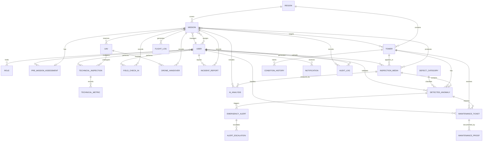

# Entity Relationship Diagram (ERD) - UAV PMS
**Power Grid Inspection & UAV Fleet Management System (MF01 - MF04)**

> [!NOTE]
> For **Report 3 (Software Requirements Specification)**, the conceptual level of abstraction is applied (**Conceptual ERD**).
> It highlights core business entities and their semantic domain relationships across the end-to-end inspection lifecycle without prematurely exposing physical implementation artifacts (such as technical junction tables, surrogate IDs, or low-level storage tables).

---

## 1. How to Use with Draw.io

To import this diagram into **Draw.io**:
1. Open Draw.io (`draw.io` or desktop app).
2. Click **`Arrange` > `Insert` > `Advanced` > `Mermaid...`**.
3. Copy and paste the Mermaid code block from **Section 2** below.
4. Click **Insert** to automatically generate the diagram.

---

## 2. Conceptual ER Diagram (Mermaid)



---

## 3. Table 8: Conceptual Entity Descriptions

| # | Entity | Description |
| :--- | :--- | :--- |
| 1 | **REGION** | Geographic operational jurisdiction containing towers and defining the spatial boundaries for inspection missions. |
| 2 | **TOWER** | Power grid transmission or distribution structure identified by code, line code, voltage level, and geographical location. |
| 3 | **USER** | System user account (Administrator, Mission Manager, Inspector/Pilot, Analyst, Technician) with authentication and profile data. |
| 4 | **ROLE** | System privilege role (SystemAdmin, Manager, Inspector, Analyst, Technician) defining role-based access control permissions. |
| 5 | **MISSION** | Inspection campaign defining objectives, scheduled time window, target towers, assigned crew members, and allocated UAV. |
| 6 | **PRE_MISSION_ASSESSMENT** | Pre-flight feasibility assessment evaluating airspace clearance, weather suitability, crew readiness, and drone availability. |
| 7 | **UAV** | Unmanned Aerial Vehicle hardware unit tracking model, serial number, technical health, battery level, and flight readiness. |
| 8 | **TECHNICAL_INSPECTION** | Periodic or pre-mission technical airworthiness inspection of a UAV performed by a certified technician. |
| 9 | **TECHNICAL_METRIC** | Quantitative telemetry and sensor metrics (vibration, battery health, IMU drift) recorded during technical inspection. |
| 10 | **FIELD_CHECK_IN** | On-site check-in record confirming the physical presence and location coordinates of field personnel before flight. |
| 11 | **DRONE_HANDOVER** | Custody transfer protocol logging pre-flight handoff and post-flight return checklists between technician and pilot. |
| 12 | **FLIGHT_LOG** | Telemetry flight log recording GPS flight track, flight duration, altitude profile, minimum battery, and link quality. |
| 13 | **INCIDENT_REPORT** | Field incident documentation submitted by crew regarding unexpected hazards, equipment anomalies, or weather changes. |
| 14 | **INSPECTION_MEDIA** | High-resolution aerial photographs or video streams captured during inspection, tagged with EXIF metadata and GPS coordinates. |
| 15 | **AI_ANALYSIS** | AI inference job processing uploaded inspection media to identify, localize, and classify infrastructure defects. |
| 16 | **DETECTED_ANOMALY** | Defect anomaly localized on a tower or component, containing bounding box, confidence score, visual crop, and review status. |
| 17 | **DEFECT_CATEGORY** | Standardized taxonomy of power-grid defects (e.g., broken insulator, flashover, bird nest, foreign object, broken strand) with default severity. |
| 18 | **EMERGENCY_ALERT** | High-priority alert triggered by critical in-flight anomalies or severe defects requiring immediate review and response. |
| 19 | **ALERT_ESCALATION** | Formal escalation record transferring an unhandled or critical alert to higher supervisory personnel with documented justification. |
| 20 | **MAINTENANCE_TICKET** | Work order generated from confirmed defects, detailing required repair actions, assigned technician, and due date. |
| 21 | **MAINTENANCE_PROOF** | Photographic and documentary proof (before, during, and after repair) submitted by technicians upon completing maintenance. |
| 22 | **CONDITION_HISTORY** | Historical tracking log recording changes in a tower's risk status and active defect count over successive inspection cycles. |
| 23 | **NOTIFICATION** | System operational notification and push message dispatched to users regarding assignments, alerts, and workflow updates. |
| 24 | **AUDIT_LOG** | Comprehensive immutable audit trail capturing user actions, entity modifications, timestamps, and network origins for accountability. |

---

## 4. Appendix: Physical Data Model (Reference for Implementation / Detailed Design)

<details>
<summary>Click to expand Physical SQL DDL Schema</summary>

```sql
CREATE TABLE regions (
    id UUID PRIMARY KEY,
    code VARCHAR(50) UNIQUE,
    name VARCHAR(255),
    geom GEOMETRY
);

CREATE TABLE towers (
    id UUID PRIMARY KEY,
    region_id UUID REFERENCES regions(id),
    tower_code VARCHAR(100) UNIQUE,
    line_code VARCHAR(100),
    voltage VARCHAR(50),
    pole_type VARCHAR(100),
    address VARCHAR(255),
    geom GEOMETRY,
    risk_level VARCHAR(20),
    active_defects_count INT,
    last_inspected_at TIMESTAMPTZ
);

CREATE TABLE users (
    id UUID PRIMARY KEY,
    username VARCHAR(100) UNIQUE,
    email VARCHAR(255) UNIQUE,
    full_name VARCHAR(255),
    phone VARCHAR(50),
    is_active BOOLEAN
);

CREATE TABLE roles (
    id INT PRIMARY KEY,
    role_name VARCHAR(100) UNIQUE,
    description TEXT
);

CREATE TABLE user_roles (
    user_id UUID REFERENCES users(id),
    role_id INT REFERENCES roles(id),
    assigned_at TIMESTAMPTZ,
    PRIMARY KEY (user_id, role_id)
);

CREATE TABLE uavs (
    id UUID PRIMARY KEY,
    uav_code VARCHAR(50) UNIQUE,
    name VARCHAR(255),
    model VARCHAR(100),
    serial_number VARCHAR(100) UNIQUE,
    status VARCHAR(50),
    operational_status VARCHAR(50),
    technical_health VARCHAR(50),
    battery_level FLOAT,
    total_flight_hours FLOAT,
    current_location GEOMETRY,
    version INT
);

CREATE TABLE missions (
    id UUID PRIMARY KEY,
    mission_code VARCHAR(100) UNIQUE,
    title VARCHAR(255),
    status VARCHAR(50),
    priority INT,
    objective VARCHAR(100),
    planned_start TIMESTAMPTZ,
    planned_end TIMESTAMPTZ,
    actual_start TIMESTAMPTZ,
    actual_end TIMESTAMPTZ,
    manager_id UUID REFERENCES users(id),
    inspector_id UUID REFERENCES users(id),
    uav_id UUID REFERENCES uavs(id),
    region_id UUID REFERENCES regions(id),
    boundary GEOMETRY,
    manager_instructions TEXT,
    confirmation_deadline TIMESTAMPTZ,
    version INT
);

CREATE TABLE pre_mission_assessments (
    id UUID PRIMARY KEY,
    mission_id UUID UNIQUE REFERENCES missions(id),
    manager_id UUID REFERENCES users(id),
    status VARCHAR(50),
    site_feasibility VARCHAR(50),
    weather_suitability VARCHAR(50),
    airspace_clearance VARCHAR(50),
    resource_readiness VARCHAR(50),
    findings JSONB,
    proposed_boundary GEOMETRY,
    evaluated_at TIMESTAMPTZ
);

CREATE TABLE mission_targets (
    id UUID PRIMARY KEY,
    mission_id UUID REFERENCES missions(id),
    tower_id UUID REFERENCES towers(id),
    sequence_order INT,
    inspection_status VARCHAR(50),
    inspected_at TIMESTAMPTZ
);

CREATE TABLE mission_assignments (
    id UUID PRIMARY KEY,
    mission_id UUID REFERENCES missions(id),
    user_id UUID REFERENCES users(id),
    assignment_role VARCHAR(50),
    is_required BOOLEAN,
    status VARCHAR(50),
    response_status VARCHAR(50),
    assigned_at TIMESTAMPTZ,
    responded_at TIMESTAMPTZ,
    response_reason TEXT,
    version INT
);

CREATE TABLE resource_bookings (
    id UUID PRIMARY KEY,
    mission_id UUID REFERENCES missions(id),
    user_id UUID REFERENCES users(id),
    drone_id UUID REFERENCES uavs(id),
    start_at TIMESTAMPTZ,
    end_at TIMESTAMPTZ,
    status VARCHAR(50)
);

CREATE TABLE drone_technical_inspections (
    id UUID PRIMARY KEY,
    drone_id UUID REFERENCES uavs(id),
    technician_user_id UUID REFERENCES users(id),
    status VARCHAR(50),
    health VARCHAR(50),
    started_at TIMESTAMPTZ,
    completed_at TIMESTAMPTZ,
    valid_until TIMESTAMPTZ,
    raw_snapshot JSONB,
    notes TEXT
);

CREATE TABLE drone_technical_metrics (
    id UUID PRIMARY KEY,
    inspection_id UUID REFERENCES drone_technical_inspections(id),
    metric_code VARCHAR(100),
    subsystem VARCHAR(100),
    numeric_value NUMERIC,
    passed BOOLEAN,
    is_critical BOOLEAN,
    unit VARCHAR(20)
);

CREATE TABLE mission_check_ins (
    id UUID PRIMARY KEY,
    mission_id UUID REFERENCES missions(id),
    user_id UUID REFERENCES users(id),
    check_in_location GEOMETRY,
    checked_in_at TIMESTAMPTZ,
    status VARCHAR(50)
);

CREATE TABLE drone_handovers (
    id UUID PRIMARY KEY,
    mission_id UUID REFERENCES missions(id),
    drone_id UUID REFERENCES uavs(id),
    handed_over_by UUID REFERENCES users(id),
    received_by UUID REFERENCES users(id),
    received_at TIMESTAMPTZ,
    initial_checklist JSONB,
    status VARCHAR(50),
    returned_at TIMESTAMPTZ,
    return_checklist JSONB
);

CREATE TABLE mission_flight_logs (
    id UUID PRIMARY KEY,
    mission_id UUID REFERENCES missions(id),
    gps_track JSONB,
    min_battery_recorded FLOAT,
    max_altitude_m FLOAT,
    flight_duration_seconds INT,
    connection_status VARCHAR(50),
    recorded_at TIMESTAMPTZ,
    created_by UUID REFERENCES users(id)
);

CREATE TABLE incident_reports (
    id UUID PRIMARY KEY,
    mission_id UUID REFERENCES missions(id),
    reported_by UUID REFERENCES users(id),
    tower_id UUID REFERENCES towers(id),
    incident_type VARCHAR(100),
    severity VARCHAR(50),
    description TEXT,
    file_url VARCHAR(500),
    status VARCHAR(50),
    reported_at TIMESTAMPTZ
);

CREATE TABLE inspection_media (
    id UUID PRIMARY KEY,
    mission_id UUID REFERENCES missions(id),
    tower_id UUID REFERENCES towers(id),
    uploaded_by UUID REFERENCES users(id),
    capture_location GEOMETRY,
    media_type VARCHAR(50),
    file_url VARCHAR(500),
    ai_source VARCHAR(50),
    validation_status VARCHAR(50),
    captured_at TIMESTAMPTZ
);

CREATE TABLE ai_analysis_requests (
    id UUID PRIMARY KEY,
    media_id UUID REFERENCES inspection_media(id),
    mission_id UUID REFERENCES missions(id),
    tower_id UUID REFERENCES towers(id),
    uploaded_by UUID REFERENCES users(id),
    source_event_id UUID,
    media_type VARCHAR(50),
    status VARCHAR(50),
    result JSONB,
    completed_at TIMESTAMPTZ,
    created_at TIMESTAMPTZ
);

CREATE TABLE defect_categories (
    id INT PRIMARY KEY,
    category_code VARCHAR(100) UNIQUE,
    name VARCHAR(255),
    default_severity VARCHAR(50),
    description TEXT,
    is_active BOOLEAN
);

CREATE TABLE detected_anomalies (
    id UUID PRIMARY KEY,
    media_id UUID REFERENCES inspection_media(id),
    tower_id UUID REFERENCES towers(id),
    category_id INT REFERENCES defect_categories(id),
    analyst_id UUID REFERENCES users(id),
    bounding_box JSONB,
    confidence_score FLOAT,
    validation_status VARCHAR(50),
    analyst_feedback JSONB,
    validated_at TIMESTAMPTZ,
    crop_url VARCHAR(500),
    image_url VARCHAR(500),
    gps JSONB,
    ai_source VARCHAR(50)
);

CREATE TABLE emergency_alerts (
    id UUID PRIMARY KEY,
    anomaly_id UUID REFERENCES detected_anomalies(id),
    tower_id UUID REFERENCES towers(id),
    mission_id UUID REFERENCES missions(id),
    status VARCHAR(50),
    priority VARCHAR(50),
    triggered_at TIMESTAMPTZ,
    resolved_at TIMESTAMPTZ,
    reviewed_by_user_id UUID REFERENCES users(id),
    notes TEXT
);

CREATE TABLE alert_escalations (
    id UUID PRIMARY KEY,
    alert_id UUID REFERENCES emergency_alerts(id),
    escalated_by UUID REFERENCES users(id),
    escalated_to UUID REFERENCES users(id),
    escalation_level INT,
    reason TEXT,
    escalated_at TIMESTAMPTZ
);

CREATE TABLE maintenance_tickets (
    id UUID PRIMARY KEY,
    ticket_code VARCHAR(100) UNIQUE,
    anomaly_id UUID REFERENCES detected_anomalies(id),
    tower_id UUID REFERENCES towers(id),
    manager_id UUID REFERENCES users(id),
    technician_id UUID REFERENCES users(id),
    status VARCHAR(50),
    priority VARCHAR(50),
    description TEXT,
    due_date TIMESTAMPTZ,
    assigned_at TIMESTAMPTZ,
    started_at TIMESTAMPTZ,
    resolved_at TIMESTAMPTZ
);

CREATE TABLE maintenance_proofs (
    id UUID PRIMARY KEY,
    ticket_id UUID REFERENCES maintenance_tickets(id),
    proof_type VARCHAR(50),
    file_url VARCHAR(500),
    uploaded_by UUID REFERENCES users(id),
    uploaded_at TIMESTAMPTZ
);

CREATE TABLE tower_condition_histories (
    id UUID PRIMARY KEY,
    tower_id UUID REFERENCES towers(id),
    risk_level VARCHAR(50),
    active_defects_count INT,
    assessed_at TIMESTAMPTZ
);

CREATE TABLE notifications (
    id UUID PRIMARY KEY,
    user_id UUID REFERENCES users(id),
    type VARCHAR(100),
    reference_type VARCHAR(100),
    reference_id UUID,
    title VARCHAR(255),
    body TEXT,
    is_read BOOLEAN,
    sent_at TIMESTAMPTZ
);

CREATE TABLE audit_logs (
    id UUID PRIMARY KEY,
    user_id UUID REFERENCES users(id),
    table_name VARCHAR(100),
    record_id UUID,
    action_type VARCHAR(50),
    old_values JSONB,
    new_values JSONB,
    created_at TIMESTAMPTZ
);
```
</details>
